# 2-1. 인증 대상 및 방식

> 변환 안내(원문 외): 아래 본문은 PDF 텍스트를 추출한 전사입니다. 코드 줄번호·특수 공백·원문 오류를 유지했습니다. 실행용 코드가 아닙니다. 표·그림·들여쓰기는 연결된 페이지 이미지와 대조하세요. 페이지 경계의 줄바꿈을 보존하며, 동일 페이지가 여러 항목에 나뉘면 각 항목의 본문은 해당 구간만 포함합니다.

### PDF 552페이지 / 인쇄 552페이지

<!-- source-page:SW-Diagnosis-2021:552; source-lines:0,2,3,4,5,6,7,8,9,10,11,12,13,14,15,16,17,18,19,20,21,22,23,24,25,26,27,28,29,30,31,32,33,34,35,36,37,38,39,40,41,42,43,44,45,46,47,48,49,50,51,52,53,54,55,56,57,58,59,60,61,62,63,64,65,66,67,68,69,70,71,72,73,74,75,76,77,78,79,80,81,82,83,84,85,86,87,88,89,90,91,92,93,94,95,96,97,98,99,100,101,102,103,104,105,106,107,108 -->

552

2-1. 인증 대상 및 방식

다음은 “인증 대상 및 방식” 보안요구사항에 대한 안전한 설계 산출물의 예시이며, 제시된 설계 산출물의 
종류와 내용은 개발되는 소프트웨어의 특성, 환경, 방법론 등에 따라 다를 수 있다.

사용자 요구사항 정의서에는 “인증 대상 및 방식” 보안요구사항의 세부 보안요구사항을 비기능 보안 
요구항목으로 등록하고 해결방안과 검수기준을 제시하고 있다.

안전한 보안설계의 예 : 사용자 요구사항 정의서

```text
요구
사항 ID
요구사항명 
구분 
요구사항설명 
요구사항 
출처
제약 
사항
중요 
도
해결방안
검수기준
비고
SR-
020101
인증 후 중요
기능/리소스
허용
비 
기능
중요기능이나 리소스 에 
대해서는 인증 후 사용 
정책이 적용되어야 한다.
RFP 
보안요구 
사항 2.1
없음 
상
인증 여부를 체크하
는 서블릿 필터 컴
포넌트를 추가하여 
중요기능을 처리하
기 전에 인증 여부
를 확인한다.
로그인하지 않고 중
요 기능을 요청 할 
경우, 인증 오류 메
시지가 출력된다.
SR-
020102
안전한 
인증방식 사용
비 
기능
안전한 인증방식을 사용
하여 인증우회나 권한상
승이 발생하지 않도록 해
야 한다.
RFP 
보안요구 
사항 2.1
없음 
상
외부 
입력값을 
Query Map에 바
인딩할 경우 에는 #
을 이용하도록 개발 
가이드에 명시하고, 
개발보안 교육으로 
개발자에게 전파하
여 지켜질 수 있도
록 한다.
유효한 아이디와 비
밀번호를 입력한 경
우, 인증정보 확인
하여 세션을 생성한
다.
SR-
020103
중요기능에 
대해 2단계 
인증 적용
비 
기능
중요기능에 대해 2단계 
(2 factor)인증을 고려 
해야 한다.
RFP 
보안요구 
사항 2.1
없음 
상
아키텍처 정의에 따 
라 
모든 
쿼리는
MyBatis 프레임워
크의 쿼리 맵으로 
정의, 실행 한다. 이
때, 변수 바인 딩은 
SR-010102 에 따
라 # 기호를 이용 
한다.
중요기능요청시 인
증서 선택창이 뜨
고, 인증서 비밀번
호가 일치하는 경우
에만 요청이 서버 
로 전달, 처리된다.
```

<details><summary>원본 페이지 이미지 (변환 외 보존 자료)</summary>

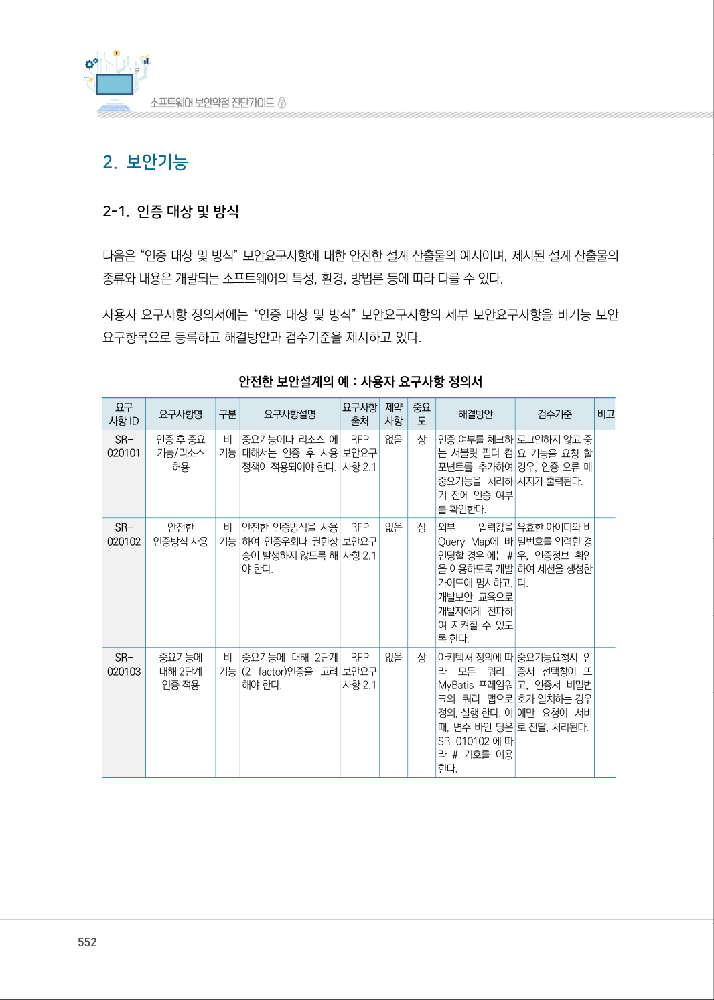

</details>

### PDF 553페이지 / 인쇄 553페이지

<!-- source-page:SW-Diagnosis-2021:553; source-lines:0,1,2,3,4,5,6,7,8,9,10,11,12,13,14,15,16,17,18,19,20,21,22,23,24,25,26,27,28,29,30,31,32,33,34,35,36,37,38,39,40,41,42 -->

553

제5장부록

요구사항 추적표에는 사용자 요구사항 정의서에 등록된 “인증 대상 및 방식” 보안요구사항의 세부 
보안요구사항이 분석, 설계, 구현, 시험 단계에서 어떻게 구체화되는지 추적할 수 있도록 관련 산출물의 
참조 정보를 제시하고 있다.

안전한 보안설계의 예 : 요구사항 추적표

```text
분석 단계
설계 단계
구현 
단계
시험 단계
사용자 요구사항 명세서
...
아키텍처정의서
개발 
가이드
...
...
단위시험
케이즈
요구사항ID
요구사항 명
SR-020101 인증 후 중요 기능/리소스 허용
아키텍처 요구사항 및 구현방안 
SR-020101
2.1.1 
UTC_020101
UTC_020102
SR-020102 안전한 인증방식 사용
아키텍처 요구사항 및 구현방안 
SR-020102
2.1.1 
UTC_020103
SR-020103 중요기능에 대해 2단계 인증 적용
아키텍처 요구사항 및 구현방안 
SR-020103
2.1.2 
UTC_020104
```

아키텍처 설계서의 아키텍처 요구사항 및 구현방안에서 중요 기능/리소스의 노출을 방어하기 위해 
인증 후 중요 기능/리소스를 허용하는 것과 안전한 인증 방법, 중요기능에 대해 2단계 인증 적용 등을 
명시하고 있다.

안전한 보안설계의 예 : 아키텍처 설계서

#### 1. 소프트웨어 아키텍처

<details><summary>원본 페이지 이미지 (변환 외 보존 자료)</summary>

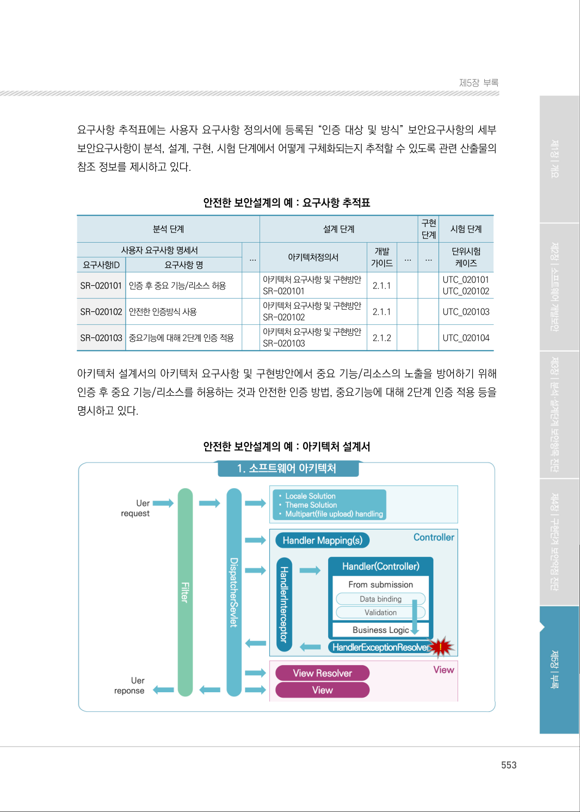

</details>

### PDF 554페이지 / 인쇄 554페이지

<!-- source-page:SW-Diagnosis-2021:554; source-lines:0,1,2,3,4,5,6,7,8,9,10,11,12,13,14,15,16,17,18,19,20,21,22,23,24,25,26,27,28,29,30,31,32,33,34,35,36,37,38,39,40,41,42,43,44,45 -->

554

#### 2. 아키텍처 요구사항 및 구형방안

요구사항ID

SR-020101

요구사항 내용
중요기능이나 리소스에 대해서는 인증 후 사용 정책이 적용되어야 한다.

구현방안

①기능목록 또는 기능명세서를 이용하여 인증이 필요한 중요기능과 리소스를 식별한다.
②Filter 또는 Interceptor 컴포넌트를 이용하여 인증 여부를 확인 후 중요 기능 및 리소스에 접근할 수 

있도록 한다.
③오류처리 공통모듈에 인증오류(unauthentication)를 추가하고, 인증되지 않은 사용자가 중요 기능 및 리

소스에 접근할 경우 인증오류가 발생하도록 한다.
④인증오류가 발생하면 증적유지 및 감사추적을 할 수 있도록 접근정보를 로그파일로 남긴다.

요구사항ID

SR-020102

요구사항 내용
안전한 인증방식을 사용하여 인증우회나 권한상승이 발생하지 않도록 해야 한다.

구현방안

①세션을 생성, 관리하는 폼 기반 인증(form-based authentication) 방식을 이용하여 인증 요청을 처리한다.
②아이디와 비밀번호는 다음의 규칙을 만족해야 하며, 서버측에서 입력값 검증을 수행한다.

- 아이디는 영문자, 숫자 사용이 가능하며, 길이는 8~10자리로 제한한다.
- 비밀번호는 영문자, 숫자, 특수문자 사용이 가능하며, 길이는 8~12자리로 제한한다.
③사용자 정보 테이블에 일치하는 아이디와 비밀번호가 존재하는지 확인하는 방식으로 인증을 처리한다. 

이때, SQL 삽입 취약점이 발생하지 않도록 시큐어코딩 가이드에 따라 SQL문을 만들고 실행한다.
④인증에 성공하면 세션ID를 재생성하고, 세션에 처리에 필요한 정보를 담은 후 일반 사용자와 관리자를 

구분하여 제공될 페이지로 리다이렉트 한다.

요구사항ID

SR-020103

요구사항 내용
중요기능에 대해 2단계(2 factor)인증을 고려해야 한다.

구현방안

①2단계 인증을 적용할 중요기능을 도출한다.

|  |  |  |
| --- | --- | --- |
| 기능 | 내용 | 적용할 추가 인증기법 |
| 비밀번호 변경 | 로그인한 사용자의 비밀번호를 변경 | 사용자의 현재 사용 중인 비밀번호 |
| 사용자 권한 변경 | 관리자 기능으로 일반 사용자의 권한을 변경 | 관리자 비밀번호 |
| 서버 재기동 | 운영 중인 서버를 재기동 | 서버 인증서 |

②①번 과정에서 도출한 기능에 대해 2단계 인증이 적용될 수 있도록 상세 설계에 반영한다.
④2단계 인증을 적용한 각 기능에 대해서는 추가 인증 없이 처리가 완료되는지 여부를 확인한다.

<details><summary>원본 페이지 이미지 (변환 외 보존 자료)</summary>

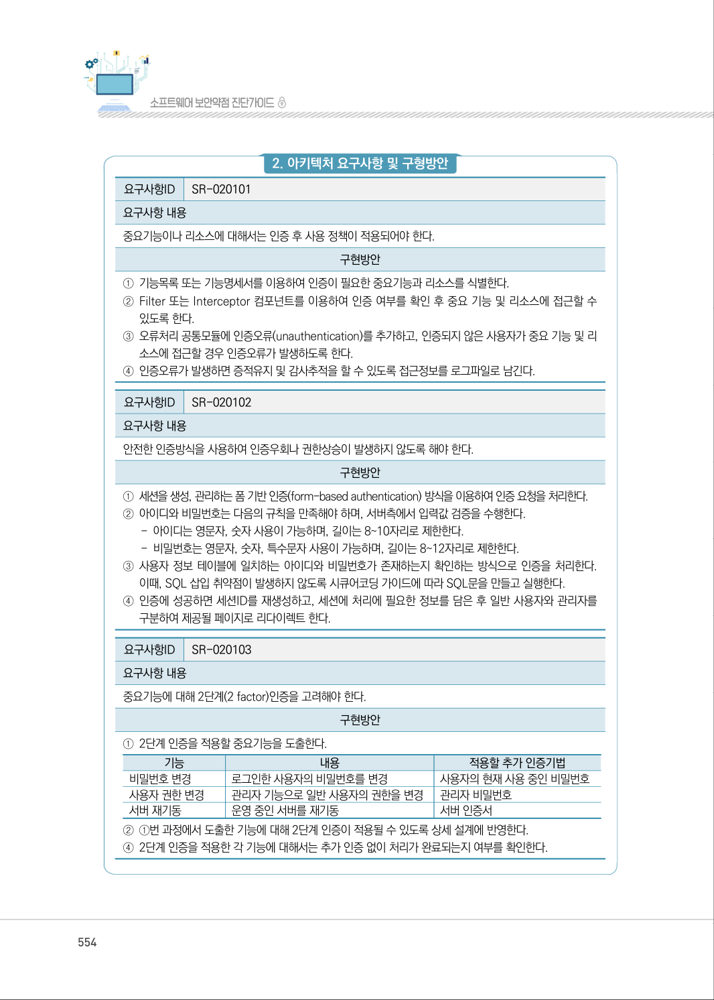

</details>

### PDF 555페이지 / 인쇄 555페이지

<!-- source-page:SW-Diagnosis-2021:555; source-lines:0,1,2,3,4,5,6,7,8,9,10,11,12,13,14,15,16,17,18,19,20,21,22,23,24,25,26,27,28,29,30,31,32,33,34 -->

555

제5장부록

개발가이드에는 중요 기능/리소스의 노출을 막기 위한 인증 여부 확인 방법, 폼 기반의 인증 방법, 
2단계 인증 기법을 제시하고 있다.

안전한 보안설계의 예 : 개발가이드

2.1.1 인증 여부 확인
인증 여부를 확인하는 공통 모듈로 개발한다.
public boolean isAuthenticated(HttpSession s) 
{ 
 boolean authenticated = false; 

 try { 
    authenticated 
    = getBooleanSessionAttribute(s, getUserId() +
“.isAuthenticated”); 
 } catch (ParameterNotFoundException e) { 
  // error 
 } 
 return authenticated; 
} 

protected boolean getBooleanSessionAttribute(HttpSession s,
String
 name) throws ParameterNotFoundException 
{ 
 boolean value = false; 

 Object attribute = s.getRequest().getSession().getAttribute(name);
if (attribute ==
 null) { 
   throw new ParameterNotFoundException(); 
 } else { 
   value = ((Boolean) attribute).booleanValue(); 
 } 
 return value; 
}
인증 여부 확인 모듈을 Filter 또는 Interceptor와 같은 컴포넌트에 등록하여 유입되는 모든 요청에 대해 자동으로 
인증 여부를 확인할 수 있도록 한다.

<details><summary>원본 페이지 이미지 (변환 외 보존 자료)</summary>

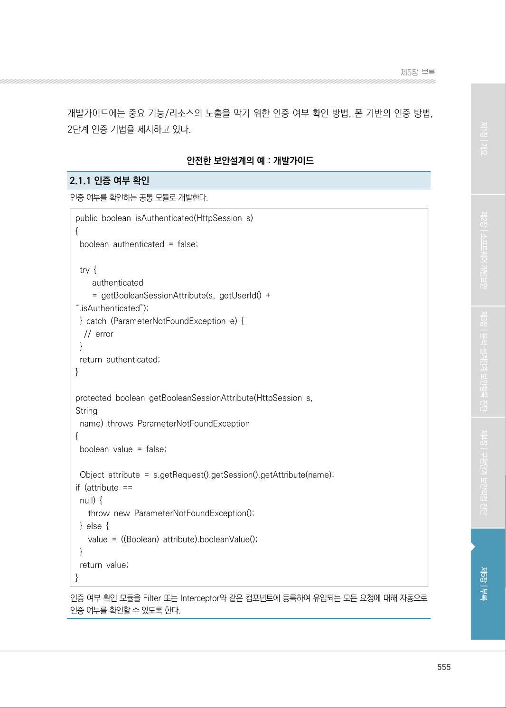

</details>

### PDF 556페이지 / 인쇄 556페이지

<!-- source-page:SW-Diagnosis-2021:556; source-lines:0,1,2,3,4,5,6,7,8,9,10,11,12,13,14,15,16,17,18,19,20,21,22,23,24,25,26,27,28,29,30,31,32,33,34,35,36 -->

556

2.1.1 인증 여부 확인

&lt;mvc:interceptors&gt;
         &lt;bean class=”kr.co.openeg.lab.common.interceptor.SessionInterceptor” /&gt; 
&lt;/mvc:interceptors&gt; 
public class SessionInterceptor extends HandlerInterceptorAdapter 
  { @Override 
  public boolean preHandle(HttpServletRequest 

request, HttpServletResponse 
response, 
Object handler) throws

    Exception { if

(isAuthenticated(request.getSession())) { 
      return true; 
    } else { 
       return false; 
    }
  }

  @Override 
  public void postHandle(HttpServletRequest request,

HttpServletResponse response, Object handler,
ModelAndView modelAndView) throws Exception { 

  }
}
인증 여부 확인 모듈을 Filter 또는 Interceptor와 같은 컴포넌트에 등록하여 유입되는 모든 요청에 대해 자동으로 
인증 여부를 확인할 수 있도록 한다.
2.1.1 인증 여부 확인
사용자가 입력한 아이디와 비밀번호를 POST 방식으로 서버로 전달한다. 요청 파라미터로 전달된 아이디와 비밀
번호와 일치하는 사용자 정보가 존재하는 경우 “사용자ID.isAuthenticated” 형식의 세션ID를 생성하고, 처리에 
필요한 정보를 세션에 저장한다.
인증 처리과정에서 유의할 사항은 다음과 같다.
- 아이디와 비밀번호는 POST 방식으로 전달한다. 
- 아이디와 비밀번호는 서버에서 입력값 검증 후 사용한다. 
- 비밀번호는 서버에서 일방향 해시함수로 변환한다. 
- 사용자 정보를 조회할 때 SQL 삽입과 같은 취약점이 발생하지 않도록 시큐어코딩 기법에 따른다.
- 세션에 저장할 내용과 식별자는 분석/설계 단계에 정의하여 관리한다.
String id = request.getParameter(“id”); 

<details><summary>원본 페이지 이미지 (변환 외 보존 자료)</summary>

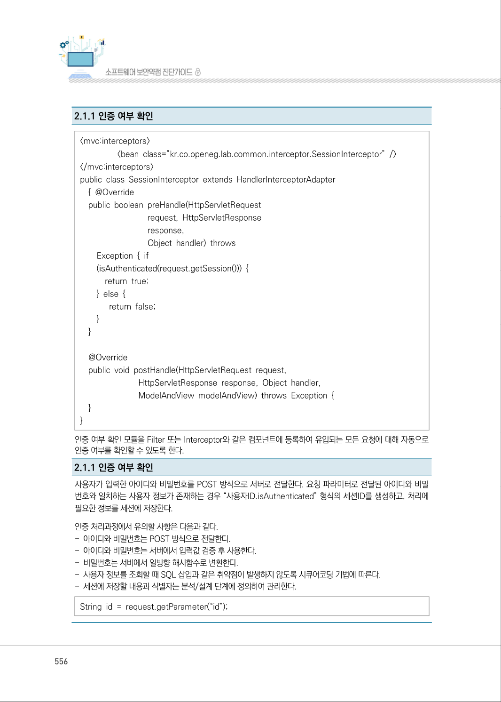

</details>

### PDF 557페이지 / 인쇄 557페이지

<!-- source-page:SW-Diagnosis-2021:557; source-lines:0,1,2,3,4,5,6,7,8,9,10,11,12,13,14,15,16,17,18,19,20,21,22,23,24,25,26,27,28,29,30,31,32 -->

557

제5장부록

2.1.1 인증 여부 확인

String pw = request.getParameter(“pw”); 

if (!CommonUtils.isValid(“ID”, id) || !CommonUtils.isValid(“PW”, pw)) { 
   // 입력값 검증에 
   실패 return false; 
}
pw = CommonUtils.getHash(pw); 

if (!CommonUtils.isValidUser(id, pw)) { 
// 인증 
실패 
return
false; 
} 

// 세션 생성 
String sessionId = id + “.isAuthenticated”;
session.setAttribute(sessionId, “true”); 

2.1.3 2단계 인증
단계 인증이 필요한 중요 기능을 도출하여 각 기능에 적용할 추가 인증 기법을 정의한다.
2단계 인증 기법은 기능의 중요성과 적용 가능성 등을 고려하여 아래의 방법들 중 하나를 선택한다.

| 구분 | 인증기법 | 예 |
| --- | --- | --- |
| TYPE1 | 지식기반인증 | 비밀번호, PIN |
| TYPE2 | 소유기반인증 | 토큰, 스마트카드 |
| TYPE3 | 생체기반인증 | 지문, 홍채 |

<details><summary>원본 페이지 이미지 (변환 외 보존 자료)</summary>

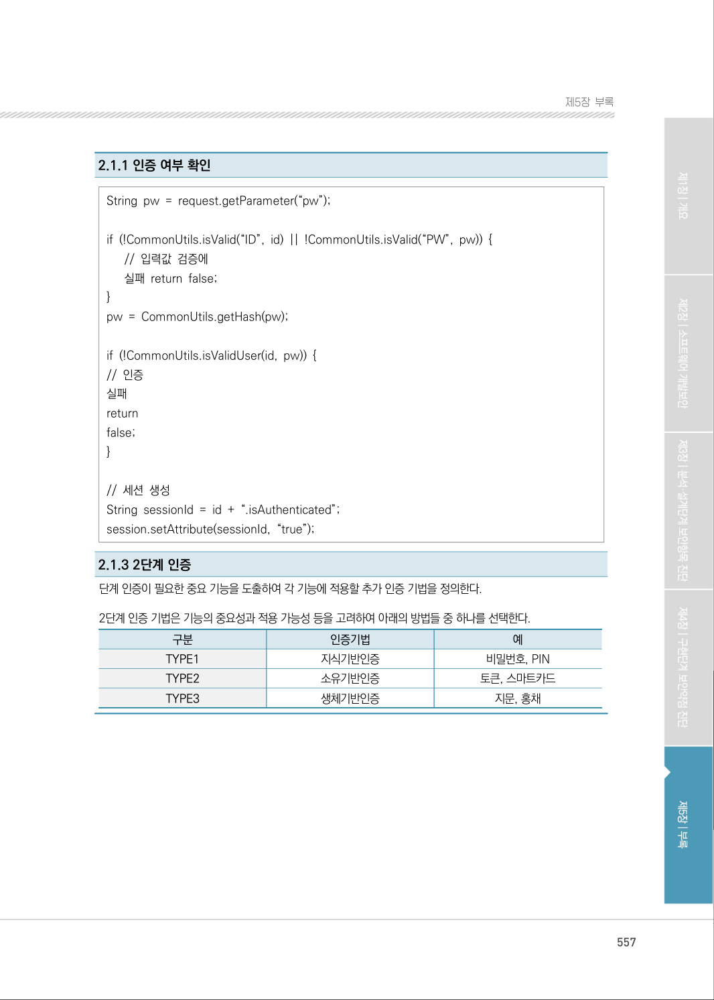

</details>

### PDF 558페이지 / 인쇄 558페이지

<!-- source-page:SW-Diagnosis-2021:558; source-lines:0,1,2,3,4,5,6,7,8,9,10,11,12,13,14,15,16,17,18,19,20,21,22,23,24,25,26,27,28,29,30,31,32,33,34,35,36,37,38,39,40,41,42,43,44,45,46,47,48,49,50,51,52,53,54,55,56,57,58,59,60,61,62,63,64,65,66,67,68,69,70,71,72,73,74,75,76,77,78,79,80,81,82,83,84,85,86,87,88,89,90,91,92,93,94,95,96,97,98,99,100,101,102,103,104,105,106,107,108,109,110,111,112,113,114,115,116,117,118,119,120,121,122,123,124 -->

558

단위 테스트 케이스에는 관리자 기능, 회원정보 수정과 같은 중요 기능을 인증 후 접근할 수 있도록 
제한하고 있는지 여부와 인증 우회가 가능한지 여부를 테스트하는 방법과 절차가 제시되어 있다.

안전한 보안설계의 예 : 단위 테스트 케이스

```text
요구사항 ID
UTC_0201
설명
중요기능 및 리소스에 대해서는 인증한 사용자만 접근할 수 있도록 제한하고, 인증하지 않은 사용자의 접근에 
대해서는 미리 정의한 오류 메시지가 표출되는지 확인한다.
관련 컴포넌트 
ID
CMT_0201
관련 프로그램 
ID
PRG_0201
케이스 ID
케이스 
명
작업 
권한 
시험 데이터
시험항목 및 처리절차 
예상결과 및 검증방법 
시험
결과
UTC_020101
관리자 
기능 접근 
관리자 
관리자 기능 
접근 URL
①브라우저 주소창에 관리
자 페이지 주소를 입력 
하고 엔터
②관리자 기능 표출 여부 
및 오류 메시지 출력여부
를 확인
③접근 로그 생성 여부 확인
①관리자로 로그인한 경우, 해당 
페이지 표출 
②관리자로 로그인하지 않았거나, 
로그인 하지 않은 경우, “잘못된 
접근 입니다.” 메시지 출력 후 
index 페이지로 이동 
③요청시간, 요청IP, 접속URL, 처
리 결과, 메시지 등의 정보를 포
함한 접근 로그를 생성
UTC_020102
회원정보 
수정 
페이지 
접근
전체 
관리자 기능 
접근 URL
①브라우저 주소창에 회원 
정보 수정 페이지 주소를 
입력하고 엔터
②수정 페이지 표출 여부 
및 오류 메시지 출력 여
부를 확인
③접근 로그 생성 여부 확인
①로그인한 경우, 회원정보 수정 
페이지 표출
②로그인하지 않은 경우, “로그인 
후 사용 할 수 있습니다.” 메시지 
출력 후 로그인 페이지로 이동
③요청시간, 요청IP, 접속URL, 처
리 결과, 메시지 등의 정보를 포
함한 접근 로그를 생성
UTC_020103
인증우회 
전체
생성 규칙을 
위배하는 
아이디/비밀번호
SQL 삽입을 
유발하는 
아이디/비밀번호
①로그인 페이지에서 시험 
데이터(비정상적인 아이
디/패스 워드)를 입력 후 
엔터
②로그인 성공 여부 및 오류 
메시지 출력 여부 확인 
③접근 로그 생성 여부 확인
①“일치하는 계정이 존재하지 않습
니다.” 메시지 출력 후 로그인 페
이지로 이동
②생성 규칙에 위배되는 아이디/비
밀번호를 입력하거나 SQL 삽입
을 유발하는 아이디/비밀번호를 
입력 하는 경우, 요청시간, 요청
IP, 접속 URL, 처리결과, 메시
지 등의 정보를 포함한 접근 로
그를 생성
UTC_020104
비밀번호 
변경 
전체 
관리자 기능 
접근 URL
①로그인후 비밀번호 변경 
페이지 호출 
②현재 비밀번호를 입력 하
지 않은 상태에서 비밀번
호 변경 버튼 클릭 
③또는 현재 비밀번호를 파
라미터에서 제외 하고 비
밀번호변경처리URL 을 
직접 호출
①현재 비밀번호를 입력하지 않은 
상태에서 비밀번호 변경 버튼을 
클릭 한 경우, “현재 비밀번호를 
입력하세요”라는 JavaScript 검
증 결과 메시지 출력
②현재 비밀번호를 파라미터에서 제
외하고 비밀번호 변경 처리 URL
을 직접 호출한 경우, “현재 비밀
번호를 입력 하세요” 메시지 출력 
후 비밀번호 변경 페이지로 이동
③②번과 같은 접근이 있을 경우, 
요청 시간, 요청IP, 접속URL, 
처리결과, 메시지 등의 정보를 
포함한 접근 로그를 생성
```

<details><summary>원본 페이지 이미지 (변환 외 보존 자료)</summary>

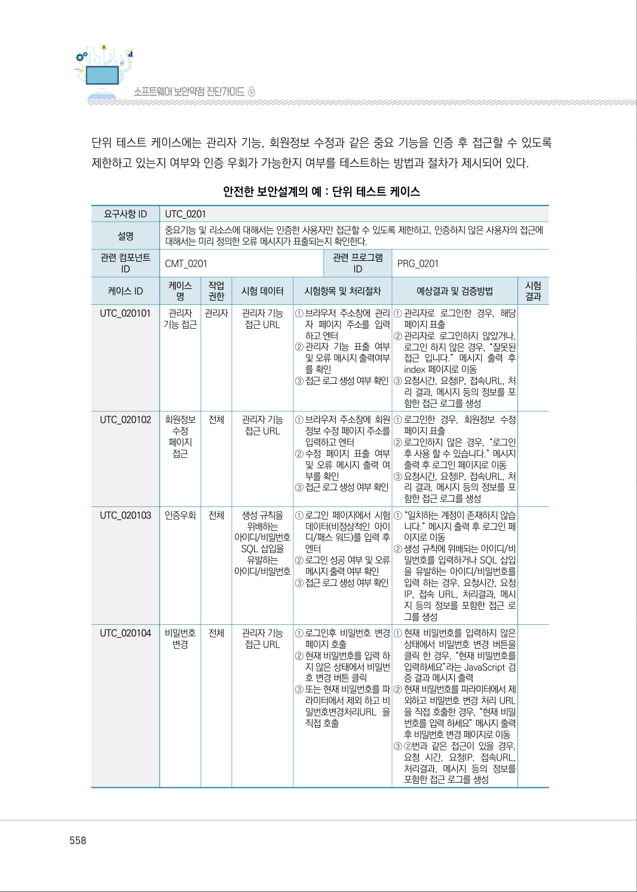

</details>

### PDF 559페이지 / 인쇄 559페이지

<!-- source-page:SW-Diagnosis-2021:559; source-lines:0,1,2,3,4,5,6,7,8,9,10,11,12,13,14,15,16,17,18,19,20,21,22,23,24,25,26,27,28,29,30,31,32,33,34,35,36 -->

559

제5장부록

유즈케이스 명세서에는 로그인한 사용자(회원 또는 관리자)와 로그인하지 않은 사용자(비회원)가 
접근할 수 있는 기능을 구분하고 작업흐름을 명시하고 있다.

안전한 보안설계의 예 : 유즈케이스 명세서

#### 2. 유즈케이스 다이어그램(UCD)

|  |  |  |  |
| --- | --- | --- | --- |
| UCD ID | UCD-020101 | UCD 명 | 게시판 |
| 관련 서브<br>시스템 ID | UCD-0201 | 관련 서브<br>시스템 명 | 고객지원 |

#### 5. 유즈케이스 기술서

```text
요구사항 ID
게시판 회원 기능
액터명
사용자(회원)
유즈케이스
개요 및 설명
회원이 게시판 내용을 등록, 수정, 댓글달기, 내용검색, 내용상세조회를 요청
사전조건
사용자의 회원, 비회원 여부를 확인할 수 있도록 사용자 인증을 수행
사후조건
```

작업흐름

|  |  |
| --- | --- |
| 정상흐름 | 1. 회원이 로그인<br>2. 회원이 게시글을 등록<br>3. 회원이 게시글을 조회 및 상세 조회<br>4. 회원이 게시글을 수정 또는 댓글 달기 |
| 대안흐름 | 1. 관리자는 게시글 삭제 |
| 예외흐름 | 비회원은 회원가입 |

<details><summary>원본 페이지 이미지 (변환 외 보존 자료)</summary>

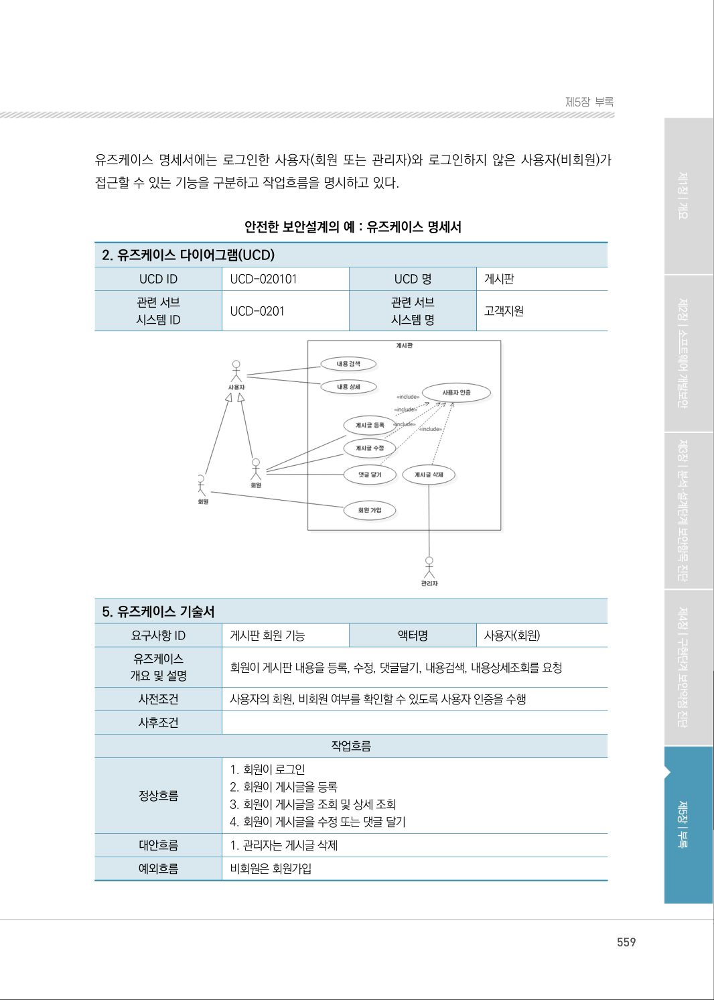

</details>

### PDF 560페이지 / 인쇄 560페이지

<!-- source-page:SW-Diagnosis-2021:560; source-lines:0,1,2,3,4,5 -->

560

클래스 설계서의 시퀀스도에는 인증에 성공한 사용자만 게시판 기능을 사용할 수 있도록 명시하고 
있으며, 설계 클래스도에는 게시판 사용자별 권한을 관리할 수 있도록 명시하고 있다.

안전한 보안설계의 예 : 클래스 설계서

#### 2. 시퀀스도

#### 3. 설계 클래스도

<details><summary>원본 페이지 이미지 (변환 외 보존 자료)</summary>

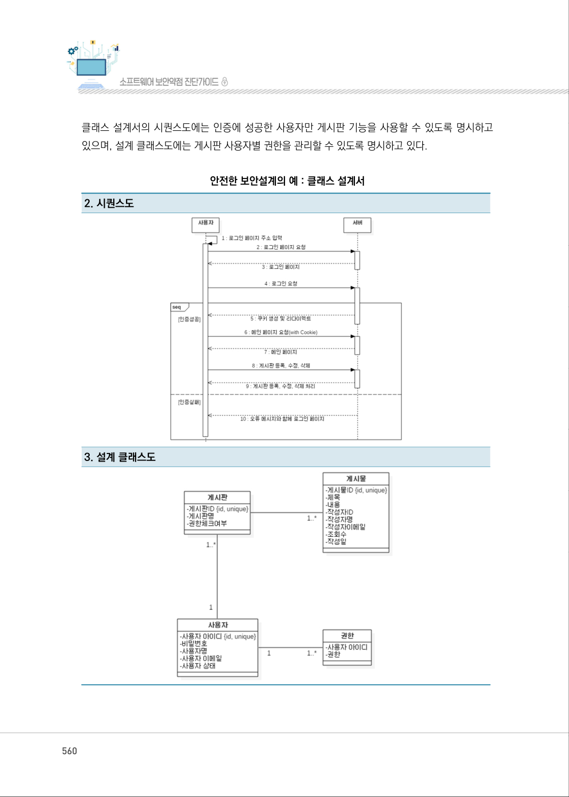

</details>

### PDF 561페이지 / 인쇄 561페이지

<!-- source-page:SW-Diagnosis-2021:561; source-lines:0,1,2,3,4,5,6,7,8,9,10,11,12,13,14,15,16,17,18,19,20,21,22,23,24,25,26,27,28,29,30,31,32,33,34,35,36,37,38,39,40,41,42,43,44,45,46,47,48,49,50,51,52,53,54,55,56,57,58,59,60,61,62,63,64,65,66,67,68,69,70,71,72,73,74 -->

561

제5장부록

ERD와 테이블 정의서에는 게시판별 사용자 권한을 관리할 수 있도록 권한 테이블을 정의하고 있다.

안전한 보안설계의 예 : ERD

안전한 보안설계의 예 : 테이블 정의서

USER_INFO

```text
컬럼명
(영문)
컬럼명 
(한글)
연관 
엔티티명
NN 
여부 
데이터 타입 
길이
PK 
정보
FK
정보
제약
조건
컬럼설명
id
사용자 아이디 
사용자 정보 
Y 
VARCHAR2 
10 
Y 
N 
사용자 아이디
password
사용자 비밀번호 
사용자 정보 
Y 
VARCHAR2 
100 
N 
N 
사용자 비밀번호
Name
이름 
사용자 정보 
Y 
VARCHAR2 
100 
N 
N 
이름
Email
이메일 
사용자 정보 
Y 
VARCHAR2 
20 
N 
N 
이메일
Status
가입상태 
사용자 정보 
Y 
CHAR 
N 
N
사용자 아이디 사용자 
비밀번호 이름 이메일
reg_de
가입일자 
사용자 정보 
Y 
DATE 
N 
N
```

<details><summary>원본 페이지 이미지 (변환 외 보존 자료)</summary>

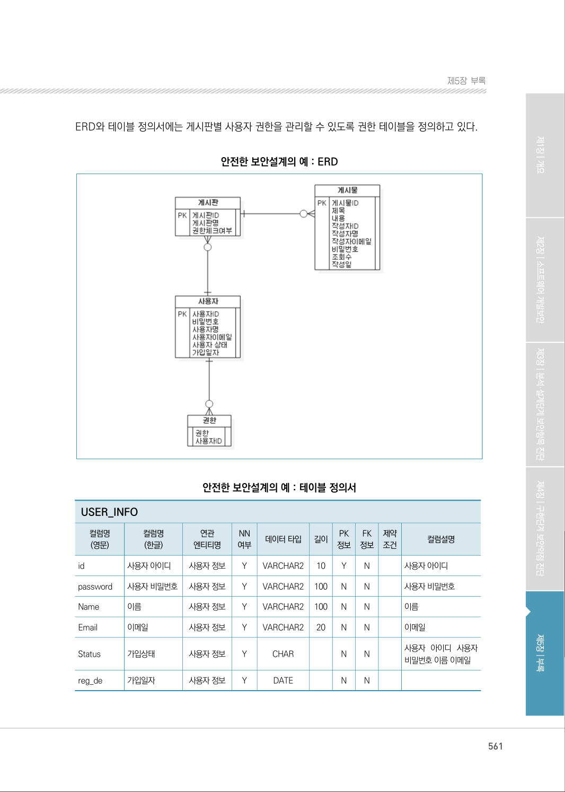

</details>

### PDF 562페이지 / 인쇄 562페이지

<!-- source-page:SW-Diagnosis-2021:562; source-lines:1,2,3,4,5,6,7,8,9,10,11,12,13,14,15,16,17,18,19,20,21,22,23,24,25,26,27,28,29,30,31,32,33,34,35,36 -->

USER_INFO

```text
컬럼명
(영문)
컬럼명 
(한글)
연관 
엔티티명
NN 
여부 
데이터 타입 
길이
PK 
정보
FK
정보
제약
조건
컬럼설명
permission
권한
권한정보 
Y 
VARCHAR2 
10 
Y 
N 
권한
user_id
사용자 아이디
권한정보 
Y 
VARCHAR2 
10 
N 
N 
사용자 아이디
```

<details><summary>원본 페이지 이미지 (변환 외 보존 자료)</summary>

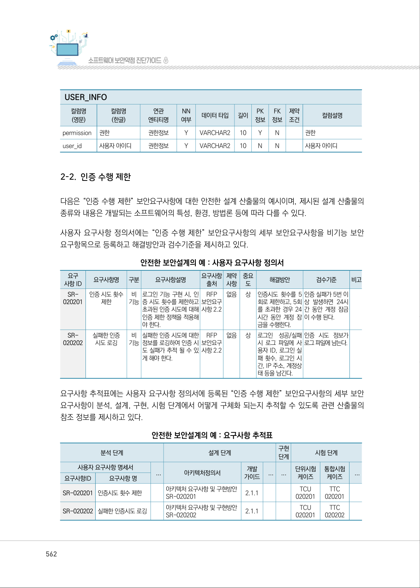

</details>

---

## 탐색 링크 (원문 외)

[통합 인덱스](../../../INDEX.md)

