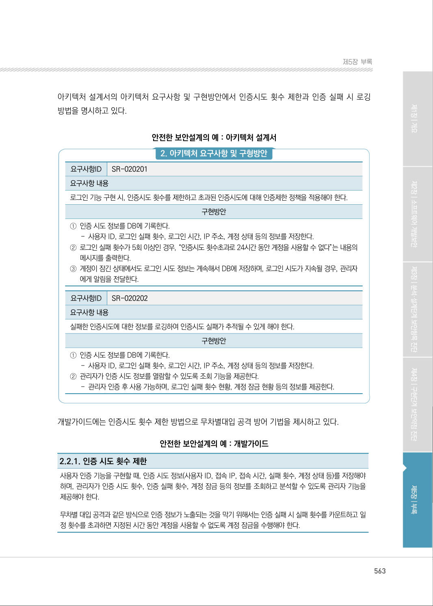
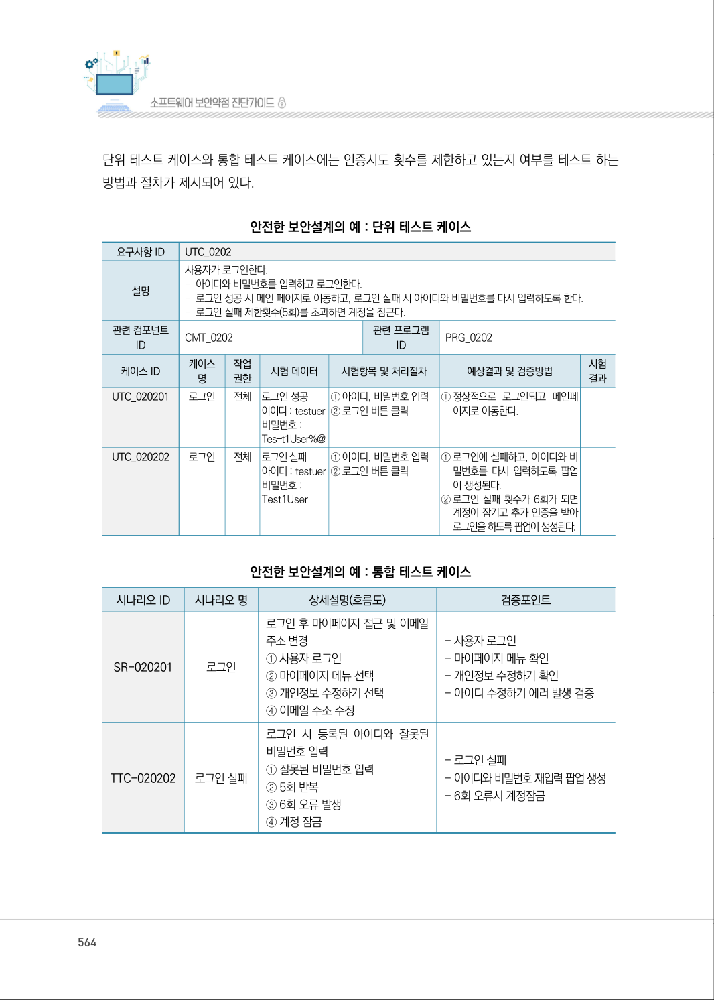
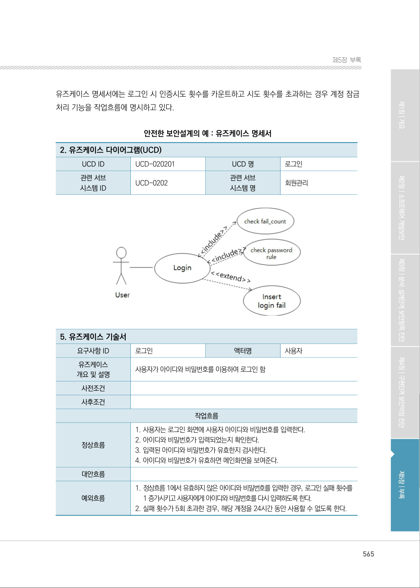
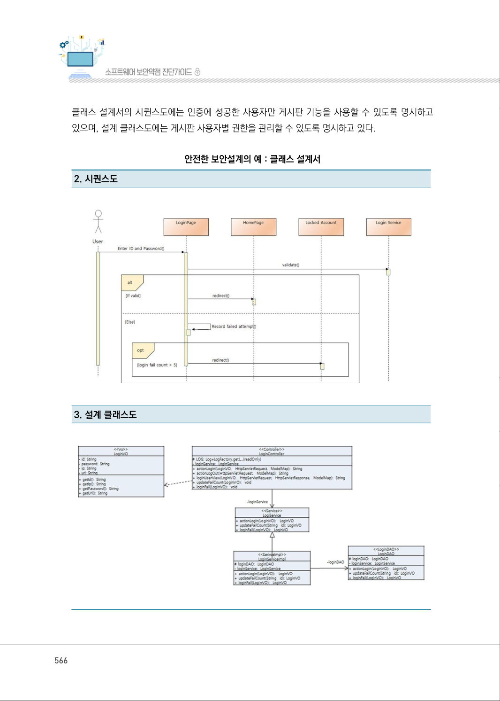
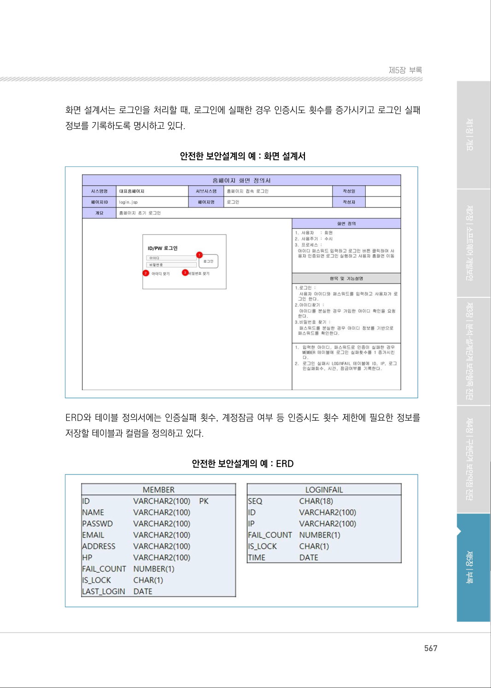
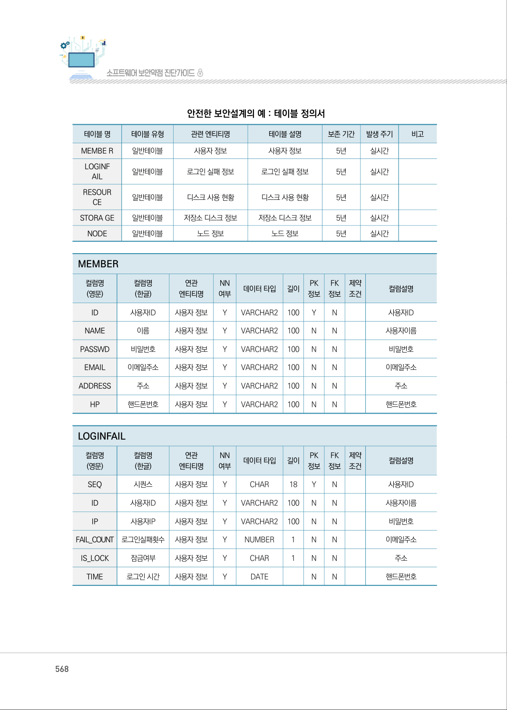
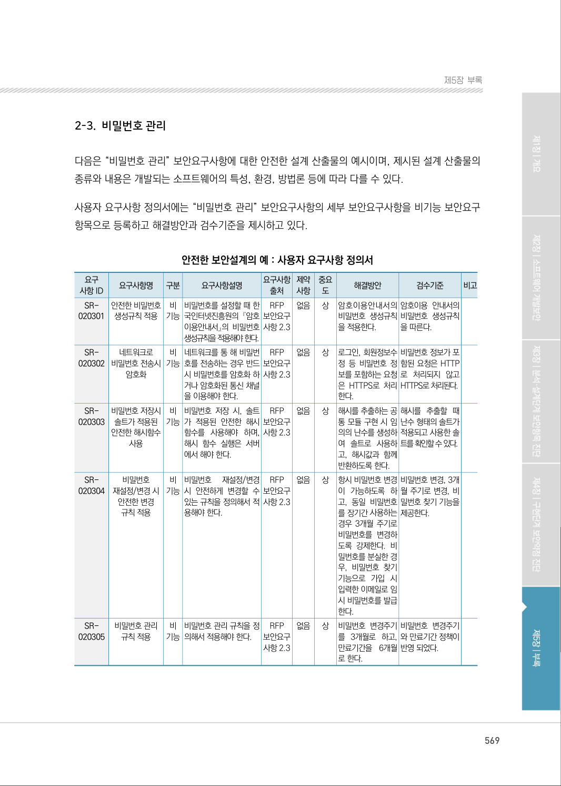

# 2-2. 인증 수행 제한

> 변환 안내(원문 외): 아래 본문은 PDF 텍스트를 추출한 전사입니다. 코드 줄번호·특수 공백·원문 오류를 유지했습니다. 실행용 코드가 아닙니다. 표·그림·들여쓰기는 연결된 페이지 이미지와 대조하세요. 페이지 경계의 줄바꿈을 보존하며, 동일 페이지가 여러 항목에 나뉘면 각 항목의 본문은 해당 구간만 포함합니다.

### PDF 562페이지 / 인쇄 562페이지

<!-- source-page:SW-Diagnosis-2021:562; source-lines:0,37,38,39,40,41,42,43,44,45,46,47,48,49,50,51,52,53,54,55,56,57,58,59,60,61,62,63,64,65,66,67,68,69,70,71,72,73,74,75,76,77,78,79,80,81,82,83,84,85,86,87,88,89,90,91,92,93,94,95,96,97,98,99,100,101,102,103,104,105,106,107,108,109,110,111,112,113,114,115,116,117,118,119,120,121,122,123,124,125,126,127,128,129,130,131,132,133,134,135,136,137,138,139,140,141,142,143 -->

562

2-2. 인증 수행 제한

다음은 “인증 수행 제한” 보안요구사항에 대한 안전한 설계 산출물의 예시이며, 제시된 설계 산출물의 
종류와 내용은 개발되는 소프트웨어의 특성, 환경, 방법론 등에 따라 다를 수 있다.

사용자 요구사항 정의서에는 “인증 수행 제한” 보안요구사항의 세부 보안요구사항을 비기능 보안
요구항목으로 등록하고 해결방안과 검수기준을 제시하고 있다.

안전한 보안설계의 예 : 사용자 요구사항 정의서

```text
요구
사항 ID
요구사항명 
구분 
요구사항설명 
요구사항 
출처
제약 
사항
중요 
도
해결방안
검수기준
비고
SR-
020201
인증 시도 횟수 
제한
비 
기능
로그인 기능 구현 시, 인
증 시도 횟수를 제한하고 
초과된 인증 시도에 대해 
인증 제한 정책을 적용해
야 한다.
RFP 
보안요구 
사항 2.2
없음 
상
인증시도 횟수를 5
회로 제한하고, 5회
를 초과한 경우 24
시간 동안 계정 잠
금을 수행한다.
인증 실패가 5번 이
상 발생하면 24시
간 동안 계정 잠금
이 수행 된다.
SR-
020202
실패한 인증 
시도 로깅
비 
기능
실패한 인증 시도에 대한 
정보를 로깅하여 인증 시
도 실패가 추적 될 수 있
게 해야 한다.
RFP 
보안요구 
사항 2.2
없음 
상
로그인 성공/실패 
시 로그 파일에 사
용자 ID, 로그인 실
패 횟수, 로그인 시
간, IP 주소, 계정상
태 등을 남긴다.
인증 시도 정보가 
로그 파일에 남는다.
```

요구사항 추적표에는 사용자 요구사항 정의서에 등록된 “인증 수행 제한” 보안요구사항의 세부 보안 
요구사항이 분석, 설계, 구현, 시험 단계에서 어떻게 구체화 되는지 추적할 수 있도록 관련 산출물의 
참조 정보를 제시하고 있다.

안전한 보안설계의 예 : 요구사항 추적표

```text
분석 단계
설계 단계
구현 
단계
시험 단계
사용자 요구사항 명세서
...
아키텍처정의서
개발 
가이드
...
...
단위시험
케이즈
통합시험
케이즈
...
요구사항ID
요구사항 명
SR-020201 인증시도 횟수 제한 
아키텍처 요구사항 및 구현방안 
SR-020201
2.1.1 
TCU 
020201
TTC 
020201
SR-020202 실패한 인증시도 로깅 
아키텍처 요구사항 및 구현방안 
SR-020202
2.1.1 
TCU 
020201
TTC 
020202
```

<details><summary>원본 페이지 이미지 (변환 외 보존 자료)</summary>


</details>

### PDF 563페이지 / 인쇄 563페이지

<!-- source-page:SW-Diagnosis-2021:563; source-lines:0,1,2,3,4,5,6,7,8,9,10,11,12,13,14,15,16,17,18,19,20,21,22,23,24,25,26,27,28,29,30,31,32,33 -->

563

제5장부록

아키텍처 설계서의 아키텍처 요구사항 및 구현방안에서 인증시도 횟수 제한과 인증 실패 시 로깅 
방법을 명시하고 있다.

안전한 보안설계의 예 : 아키텍처 설계서

#### 2. 아키텍처 요구사항 및 구형방안

요구사항ID

SR-020201

요구사항 내용
로그인 기능 구현 시, 인증시도 횟수를 제한하고 초과된 인증시도에 대해 인증제한 정책을 적용해야 한다.

구현방안

①인증 시도 정보를 DB에 기록한다.

- 사용자 ID, 로그인 실패 횟수, 로그인 시간, IP 주소, 계정 상태 등의 정보를 저장한다.
②로그인 실패 횟수가 5회 이상인 경우, “인증시도 횟수초과로 24시간 동안 계정을 사용할 수 없다”는 내용의 

메시지를 출력한다.
③계정이 잠긴 상태에서도 로그인 시도 정보는 계속해서 DB에 저장하며, 로그인 시도가 지속될 경우, 관리자

에게 알림을 전달한다.

요구사항ID

SR-020202

요구사항 내용
실패한 인증시도에 대한 정보를 로깅하여 인증시도 실패가 추적될 수 있게 해야 한다.

구현방안

①인증 시도 정보를 DB에 기록한다.

- 사용자 ID, 로그인 실패 횟수, 로그인 시간, IP 주소, 계정 상태 등의 정보를 저장한다.
②관리자가 인증 시도 정보를 열람할 수 있도록 조회 기능을 제공한다.

- 관리자 인증 후 사용 가능하며, 로그인 실패 횟수 현황, 계정 잠금 현황 등의 정보를 제공한다.

개발가이드에는 인증시도 횟수 제한 방법으로 무차별대입 공격 방어 기법을 제시하고 있다.

안전한 보안설계의 예 : 개발가이드

2.2.1. 인증 시도 횟수 제한
사용자 인증 기능을 구현할 때, 인증 시도 정보(사용자 ID, 접속 IP, 접속 시간, 실패 횟수, 계정 상태 등)를 저장해야 
하며, 관리자가 인증 시도 횟수, 인증 실패 횟수, 계정 잠금 등의 정보를 조회하고 분석할 수 있도록 관리자 기능을 
제공해야 한다.
무차별 대입 공격과 같은 방식으로 인증 정보가 노출되는 것을 막기 위해서는 인증 실패 시 실패 횟수를 카운트하고 일
정 횟수를 초과하면 지정된 시간 동안 계정을 사용할 수 없도록 계정 잠금을 수행해야 한다.

<details><summary>원본 페이지 이미지 (변환 외 보존 자료)</summary>



</details>

### PDF 564페이지 / 인쇄 564페이지

<!-- source-page:SW-Diagnosis-2021:564; source-lines:0,1,2,3,4,5,6,7,8,9,10,11,12,13,14,15,16,17,18,19,20,21,22,23,24,25,26,27,28,29,30,31,32,33,34,35,36,37,38,39,40,41,42,43,44,45,46,47,48,49,50,51,52,53,54,55,56,57,58,59,60,61,62,63,64,65,66,67,68,69,70,71,72,73,74,75,76,77,78,79,80 -->

564

단위 테스트 케이스와 통합 테스트 케이스에는 인증시도 횟수를 제한하고 있는지 여부를 테스트 하는 
방법과 절차가 제시되어 있다.

안전한 보안설계의 예 : 단위 테스트 케이스

```text
요구사항 ID
UTC_0202
설명
사용자가 로그인한다.
- 아이디와 비밀번호를 입력하고 로그인한다. 
- 로그인 성공 시 메인 페이지로 이동하고, 로그인 실패 시 아이디와 비밀번호를 다시 입력하도록 한다.
- 로그인 실패 제한횟수(5회)를 초과하면 계정을 잠근다.
관련 컴포넌트 
ID
CMT_0202
관련 프로그램 
ID
PRG_0202
케이스 ID
케이스 
명
작업 
권한 
시험 데이터
시험항목 및 처리절차 
예상결과 및 검증방법 
시험
결과
UTC_020201
로그인 
전체
로그인 성공 
아이디 : testuer
비밀번호 : 
Tes-t1User%@
①아이디, 비밀번호 입력
②로그인 버튼 클릭
①정상적으로 로그인되고 메인페
이지로 이동한다.
UTC_020202
로그인 
전체
로그인 실패 
아이디 : testuer 
비밀번호 : 
Test1User
①아이디, 비밀번호 입력
②로그인 버튼 클릭
①로그인에 실패하고, 아이디와 비
밀번호를 다시 입력하도록 팝업
이 생성된다.
②로그인 실패 횟수가 6회가 되면 
계정이 잠기고 추가 인증을 받아 
로그인을 하도록 팝업이 생성된다.
```

안전한 보안설계의 예 : 통합 테스트 케이스

|  |  |  |  |
| --- | --- | --- | --- |
| 시나리오 ID | 시나리오 명 | 상세설명(흐름도) | 검증포인트 |
| SR-020201 | 로그인 | 로그인 후 마이페이지 접근 및 이메일<br>주소 변경<br>① 사용자 로그인<br>② 마이페이지 메뉴 선택<br>③ 개인정보 수정하기 선택<br>④ 이메일 주소 수정 | - 사용자 로그인<br>- 마이페이지 메뉴 확인<br>- 개인정보 수정하기 확인<br>- 아이디 수정하기 에러 발생 검증 |
| TTC-020202 | 로그인 실패 | 로그인 시 등록된 아이디와 잘못된<br>비밀번호 입력<br>① 잘못된 비밀번호 입력<br>② 5회 반복<br>③ 6회 오류 발생<br>④ 계정 잠금 | - 로그인 실패<br>- 아이디와 비밀번호 재입력 팝업 생성<br>- 6회 오류시 계정잠금 |

<details><summary>원본 페이지 이미지 (변환 외 보존 자료)</summary>



</details>

### PDF 565페이지 / 인쇄 565페이지

<!-- source-page:SW-Diagnosis-2021:565; source-lines:0,1,2,3,4,5,6,7,8,9,10,11,12,13,14,15,16,17,18,19,20,21,22,23,24,25,26,27,28,29,30,31,32,33,34,35,36 -->

565

제5장부록

유즈케이스 명세서에는 로그인 시 인증시도 횟수를 카운트하고 시도 횟수를 초과하는 경우 계정 잠금 
처리 기능을 작업흐름에 명시하고 있다.

안전한 보안설계의 예 : 유즈케이스 명세서

#### 2. 유즈케이스 다이어그램(UCD)

|  |  |  |  |
| --- | --- | --- | --- |
| UCD ID | UCD-020201 | UCD 명 | 로그인 |
| 관련 서브<br>시스템 ID | UCD-0202 | 관련 서브<br>시스템 명 | 회원관리 |

#### 5. 유즈케이스 기술서

```text
요구사항 ID
로그인 
액터명
사용자
유즈케이스
개요 및 설명
사용자가 아이디와 비밀번호를 이용하여 로그인 함
사전조건
사후조건
```

작업흐름

|  |  |
| --- | --- |
| 정상흐름 | 1. 사용자는 로그인 화면에 사용자 아이디와 비밀번호를 입력한다.<br>2. 아이디와 비밀번호가 입력되었는지 확인한다.<br>3. 입력된 아이디와 비밀번호가 유효한지 검사한다.<br>4. 아이디와 비밀번호가 유효하면 메인화면을 보여준다. |
| 대안흐름 |  |
| 예외흐름 | 1. 정상흐름 1에서 유효하지 않은 아이디와 비밀번호를 입력한 경우, 로그인 실패 횟수를<br>1 증가시키고 사용자에게 아이디와 비밀번호를 다시 입력하도록 한다.<br>2. 실패 횟수가 5회 초과한 경우, 해당 계정을 24시간 동안 사용할 수 없도록 한다. |

<details><summary>원본 페이지 이미지 (변환 외 보존 자료)</summary>



</details>

### PDF 566페이지 / 인쇄 566페이지

<!-- source-page:SW-Diagnosis-2021:566; source-lines:0,1,2,3,4,5 -->

566

클래스 설계서의 시퀀스도에는 인증에 성공한 사용자만 게시판 기능을 사용할 수 있도록 명시하고 
있으며, 설계 클래스도에는 게시판 사용자별 권한을 관리할 수 있도록 명시하고 있다. 

안전한 보안설계의 예 : 클래스 설계서

#### 2. 시퀀스도

#### 3. 설계 클래스도

<details><summary>원본 페이지 이미지 (변환 외 보존 자료)</summary>



</details>

### PDF 567페이지 / 인쇄 567페이지

<!-- source-page:SW-Diagnosis-2021:567; source-lines:0,1,2,3,4,5,6,7 -->

567

제5장부록

화면 설계서는 로그인을 처리할 때, 로그인에 실패한 경우 인증시도 횟수를 증가시키고 로그인 실패 
정보를 기록하도록 명시하고 있다.

안전한 보안설계의 예 : 화면 설계서

ERD와 테이블 정의서에는 인증실패 횟수, 계정잠금 여부 등 인증시도 횟수 제한에 필요한 정보를 
저장할 테이블과 컬럼을 정의하고 있다.

안전한 보안설계의 예 : ERD

<details><summary>원본 페이지 이미지 (변환 외 보존 자료)</summary>



</details>

### PDF 568페이지 / 인쇄 568페이지

<!-- source-page:SW-Diagnosis-2021:568; source-lines:0,1,2,3,4,5,6,7,8,9,10,11,12,13,14,15,16,17,18,19,20,21,22,23,24,25,26,27,28,29,30,31,32,33,34,35,36,37,38,39,40,41,42,43,44,45,46,47,48,49,50,51,52,53,54,55,56,57,58,59,60,61,62,63,64,65,66,67,68,69,70,71,72,73,74,75,76,77,78,79,80,81,82,83,84,85,86,87,88,89,90,91,92,93,94,95,96,97,98,99,100,101,102,103,104,105,106,107,108,109,110,111,112,113,114,115,116,117,118,119,120,121,122,123,124,125,126,127,128,129,130,131,132,133,134,135,136,137,138,139,140,141,142,143,144,145,146,147,148,149,150,151,152,153,154,155,156,157,158,159,160,161,162,163,164,165,166,167,168,169,170,171,172,173,174,175,176,177,178,179,180,181,182,183 -->

568

안전한 보안설계의 예 : 테이블 정의서

```text
테이블 명
테이블 유형 
관련 엔티티명 
테이블 설명
보존 기간 
발생 주기 
비고
MEMBE R
일반테이블 
사용자 정보 
사용자 정보
5년 
실시간
LOGINF
AIL
일반테이블 
로그인 실패 정보 
로그인 실패 정보
5년 
실시간
RESOUR
CE
일반테이블 
디스크 사용 현황 
디스크 사용 현황
5년 
실시간
STORA GE
일반테이블 
저장소 디스크 정보 
저장소 디스크 정보
5년 
실시간
NODE
일반테이블 
노드 정보 
노드 정보 
5년 
실시간
```

MEMBER

```text
컬럼명
(영문)
컬럼명 
(한글)
연관 
엔티티명
NN 
여부 
데이터 타입 
길이
PK 
정보
FK
정보
제약
조건
컬럼설명
ID
사용자ID 
사용자 정보 
Y 
VARCHAR2 
100 
Y 
N 
사용자ID
NAME
이름 
사용자 정보 
Y 
VARCHAR2 
100 
N 
N 
사용자이름
PASSWD
비밀번호 
사용자 정보 
Y 
VARCHAR2 
100 
N 
N 
비밀번호
EMAIL
이메일주소 
사용자 정보 
Y 
VARCHAR2 
100 
N 
N 
이메일주소 
ADDRESS
주소 
사용자 정보 
Y 
VARCHAR2 
100 
N 
N 
주소 
HP
핸드폰번호 
사용자 정보 
Y 
VARCHAR2 
100 
N 
N 
핸드폰번호 
```

LOGINFAIL

```text
컬럼명
(영문)
컬럼명 
(한글)
연관 
엔티티명
NN 
여부 
데이터 타입 
길이
PK 
정보
FK
정보
제약
조건
컬럼설명
SEQ
시퀀스 
사용자 정보 
Y 
CHAR 
18 
Y 
N 
사용자ID
ID
사용자ID 
사용자 정보 
Y 
VARCHAR2 
100 
N 
N 
사용자이름
IP
사용자IP 
사용자 정보 
Y 
VARCHAR2 
100 
N 
N 
비밀번호
FAIL_COUNT
로그인실패횟수 
사용자 정보 
Y 
NUMBER 
1 
N 
N 
이메일주소 
IS_LOCK
잠금여부 
사용자 정보 
Y 
CHAR 
1 
N 
N 
주소 
TIME
로그인 시간 
사용자 정보 
Y 
DATE 
N 
N 
핸드폰번호 
```

<details><summary>원본 페이지 이미지 (변환 외 보존 자료)</summary>



</details>

### PDF 569페이지 / 인쇄 569페이지

<!-- source-page:SW-Diagnosis-2021:569; source-lines:1 -->

제5장부록

<details><summary>원본 페이지 이미지 (변환 외 보존 자료)</summary>



</details>

---

## 탐색 링크 (원문 외)

[통합 인덱스](../../../INDEX.md)

