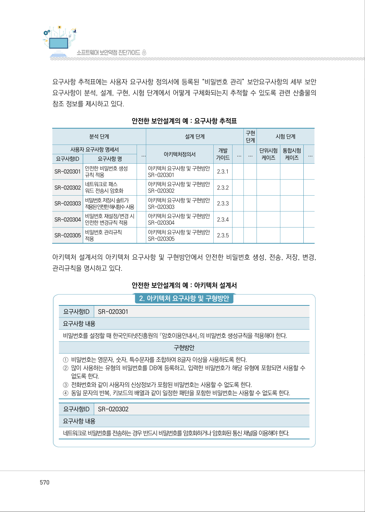
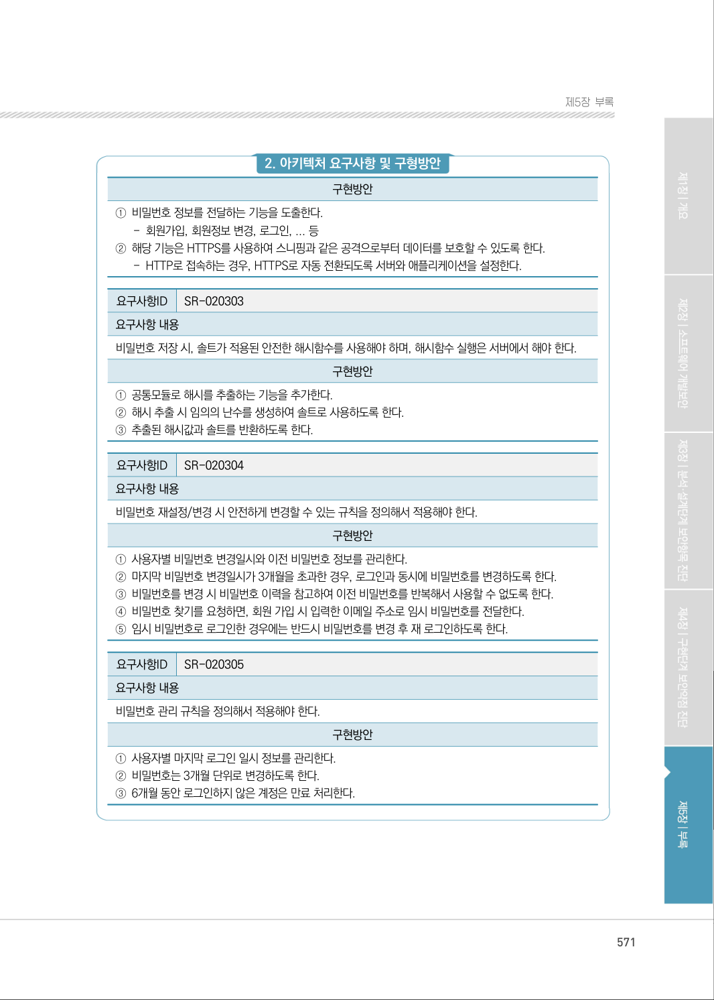
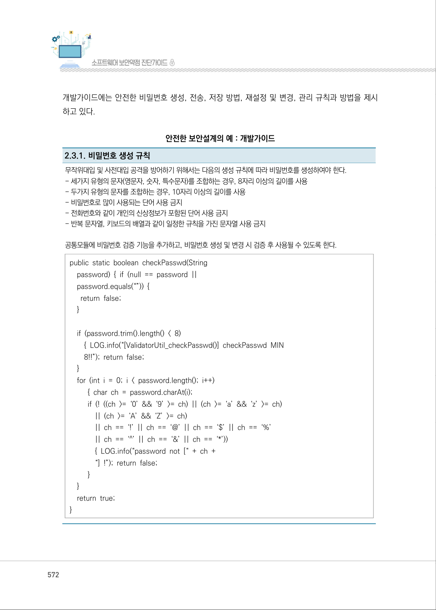
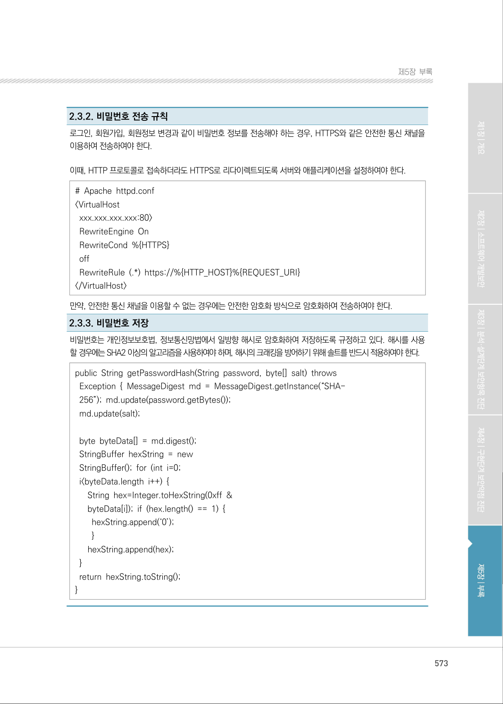
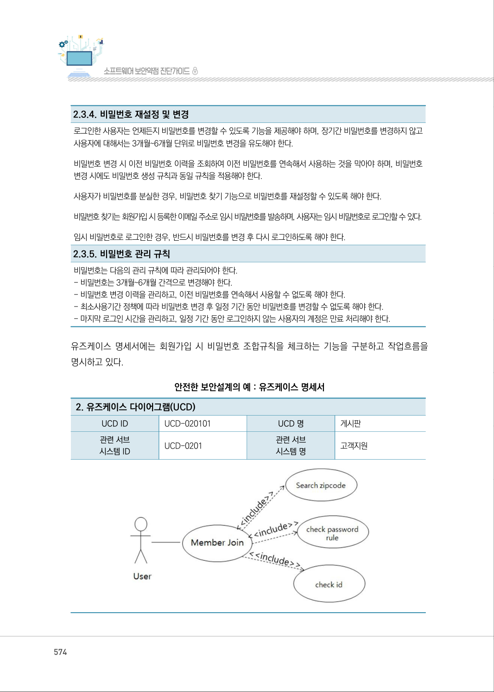
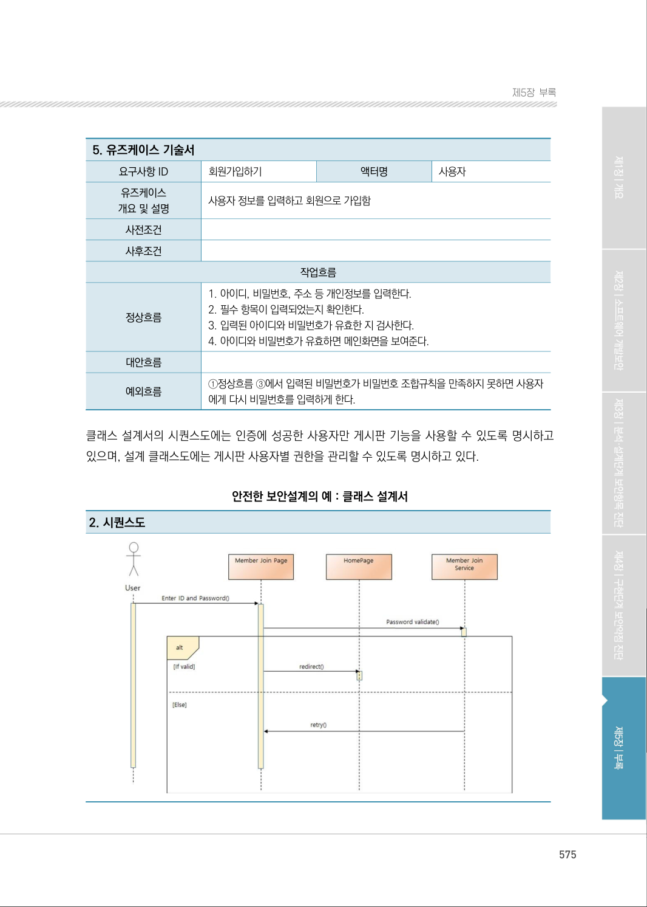
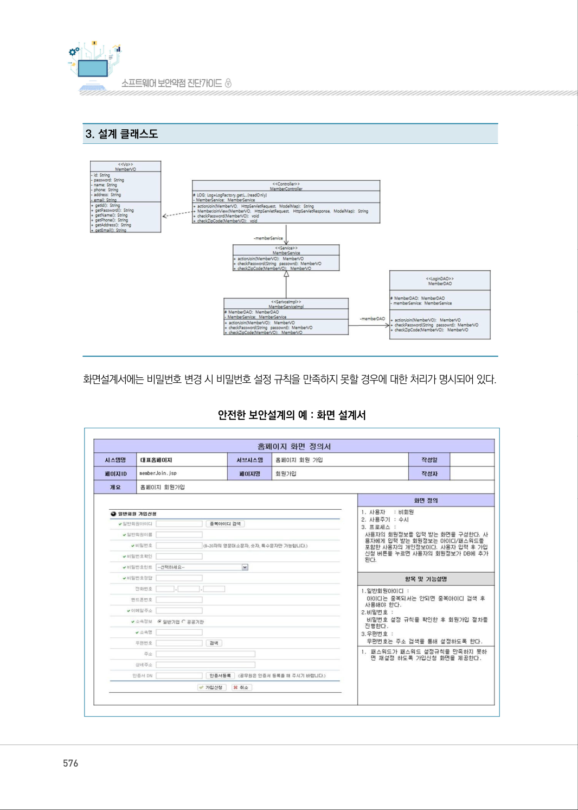

# 2-3. 비밀번호 관리

> 변환 안내(원문 외): 아래 본문은 PDF 텍스트를 추출한 전사입니다. 코드 줄번호·특수 공백·원문 오류를 유지했습니다. 실행용 코드가 아닙니다. 표·그림·들여쓰기는 연결된 페이지 이미지와 대조하세요. 페이지 경계의 줄바꿈을 보존하며, 동일 페이지가 여러 항목에 나뉘면 각 항목의 본문은 해당 구간만 포함합니다.

### PDF 569페이지 / 인쇄 569페이지

<!-- source-page:SW-Diagnosis-2021:569; source-lines:0,2,3,4,5,6,7,8,9,10,11,12,13,14,15,16,17,18,19,20,21,22,23,24,25,26,27,28,29,30,31,32,33,34,35,36,37,38,39,40,41,42,43,44,45,46,47,48,49,50,51,52,53,54,55,56,57,58,59,60,61,62,63,64,65,66,67,68,69,70,71,72,73,74,75,76,77,78,79,80,81,82,83,84,85,86,87,88,89,90,91,92,93,94,95,96,97,98,99,100,101,102,103,104,105,106,107,108,109,110,111,112,113,114,115,116,117,118,119,120,121,122,123,124,125,126,127,128,129,130,131,132,133,134,135,136,137,138,139,140,141,142,143,144,145,146,147,148,149,150,151 -->

569

2-3. 비밀번호 관리

다음은 “비밀번호 관리” 보안요구사항에 대한 안전한 설계 산출물의 예시이며, 제시된 설계 산출물의 
종류와 내용은 개발되는 소프트웨어의 특성, 환경, 방법론 등에 따라 다를 수 있다.

사용자 요구사항 정의서에는 “비밀번호 관리” 보안요구사항의 세부 보안요구사항을 비기능 보안요구
항목으로 등록하고 해결방안과 검수기준을 제시하고 있다.

안전한 보안설계의 예 : 사용자 요구사항 정의서

```text
요구
사항 ID
요구사항명 
구분 
요구사항설명 
요구사항 
출처
제약 
사항
중요 
도
해결방안
검수기준
비고
SR-
020301
안전한 비밀번호 
생성규칙 적용
비 
기능
비밀번호를 설정할 때 한
국인터넷진흥원의 『암호
이용안내서』의 비밀번호 
생성규칙을 적용해야 한다.
RFP 
보안요구 
사항 2.3
없음 
상
암호이용안내서의 
비밀번호 생성규칙
을 적용한다.
암호이용 안내서의 
비밀번호 생성규칙
을 따른다.
SR-
020302
네트워크로 
비밀번호 전송시 
암호화
비 
기능
네트워크를 통 해 비밀번
호를 전송하는 경우 반드
시 비밀번호를 암호화 하
거나 암호화된 통신 채널
을 이용해야 한다.
RFP 
보안요구 
사항 2.3
없음 
상
로그인, 회원정보수
정 등 비밀번호 정
보를 포함하는 요청
은 HTTPS로 처리
한다.
비밀번호 정보가 포
함된 요청은 HTTP
로 처리되지 않고 
HTTPS로 처리된다.
SR-
020303
비밀번호 저장시 
솔트가 적용된 
안전한 해시함수 
사용
비 
기능
비밀번호 저장 시, 솔트 
가 적용된 안전한 해시 
함수를 사용해야 하며, 
해시 함수 실행은 서버 
에서 해야 한다.
RFP 
보안요구 
사항 2.3
없음 
상
해시를 추출하는 공
통 모듈 구현 시 임
의의 난수를 생성하
여 솔트로 사용하
고, 해시값과 함께
반환하도록 한다.
해시를 추출할 때 
난수 형태의 솔트가
적용되고 사용한 솔
트를 확인할 수 있다.
SR-
020304
비밀번호 
재설정/변경 시 
안전한 변경 
규칙 적용
비 
기능
비밀번호 
재설정/변경 
시 안전하게 변경할 수 
있는 규칙을 정의해서 적
용해야 한다.
RFP 
보안요구 
사항 2.3
없음 
상
항시 비밀번호 변경
이 가능하도록 하
고, 동일 비밀번호
를 장기간 사용하는 
경우 3개월 주기로 
비밀번호를 변경하
도록 강제한다. 비
밀번호를 분실한 경
우, 비밀번호 찾기 
기능으로 가입 시 
입력한 이메일로 임
시 비밀번호를 발급 
한다.
비밀번호 변경, 3개
월 주기로 변경, 비
밀번호 찾기 기능을
제공한다.
SR-
020305
비밀번호 관리 
규칙 적용
비 
기능
비밀번호 관리 규칙을 정
의해서 적용해야 한다.
RFP 
보안요구 
사항 2.3
없음 
상
비밀번호 변경주기
를 3개월로 하고, 
만료기간을 6개월
로 한다.
비밀번호 변경주기
와 만료기간 정책이 
반영 되었다.
```

<details><summary>원본 페이지 이미지 (변환 외 보존 자료)</summary>


</details>

### PDF 570페이지 / 인쇄 570페이지

<!-- source-page:SW-Diagnosis-2021:570; source-lines:0,1,2,3,4,5,6,7,8,9,10,11,12,13,14,15,16,17,18,19,20,21,22,23,24,25,26,27,28,29,30,31,32,33,34,35,36,37,38,39,40,41,42,43,44,45,46,47,48,49,50,51,52,53,54,55,56,57,58,59,60,61,62,63,64,65,66 -->

570

요구사항 추적표에는 사용자 요구사항 정의서에 등록된 “비밀번호 관리” 보안요구사항의 세부 보안 
요구사항이 분석, 설계, 구현, 시험 단계에서 어떻게 구체화되는지 추적할 수 있도록 관련 산출물의 
참조 정보를 제시하고 있다.

안전한 보안설계의 예 : 요구사항 추적표

```text
분석 단계
설계 단계
구현 
단계
시험 단계
사용자 요구사항 명세서
...
아키텍처정의서
개발 
가이드
...
...
단위시험
케이즈
통합시험
케이즈
...
요구사항ID
요구사항 명
SR-020301 안전한 비밀번호 생성 
규칙 적용
아키텍처 요구사항 및 구현방안 
SR-020301
2.3.1
SR-020302 네트워크로 패스
워드 전송시 암호화
아키텍처 요구사항 및 구현방안 
SR-020302
2.3.2
SR-020303 비밀번호 저장시 솔트가 
적용된 안전한 해시함수 사용
아키텍처 요구사항 및 구현방안 
SR-020303
2.3.3
SR-020304 비밀번호 재설정/변경 시 
안전한 변경규칙 적용
아키텍처 요구사항 및 구현방안 
SR-020304
2.3.4
SR-020305 비밀번호 관리규칙 
적용
아키텍처 요구사항 및 구현방안 
SR-020305 
2.3.5
```

아키텍처 설계서의 아키텍처 요구사항 및 구현방안에서 안전한 비밀번호 생성, 전송, 저장, 변경, 
관리규칙을 명시하고 있다.

안전한 보안설계의 예 : 아키텍처 설계서

#### 2. 아키텍처 요구사항 및 구형방안

요구사항ID

SR-020301

요구사항 내용
비밀번호를 설정할 때 한국인터넷진흥원의 『암호이용안내서』의 비밀번호 생성규칙을 적용해야 한다.

구현방안

①비밀번호는 영문자, 숫자, 특수문자를 조합하여 8글자 이상을 사용하도록 한다.
②많이 사용하는 유형의 비밀번호를 DB에 등록하고, 입력한 비밀번호가 해당 유형에 포함되면 사용할 수 

없도록 한다.
③전화번호와 같이 사용자의 신상정보가 포함된 비밀번호는 사용할 수 없도록 한다.
④동일 문자의 반복, 키보드의 배열과 같이 일정한 패턴을 포함한 비밀번호는 사용할 수 없도록 한다.

요구사항ID

SR-020302

요구사항 내용
네트워크로 비밀번호를 전송하는 경우 반드시 비밀번호를 암호화하거나 암호화된 통신 채널을 이용해야 한다.

<details><summary>원본 페이지 이미지 (변환 외 보존 자료)</summary>



</details>

### PDF 571페이지 / 인쇄 571페이지

<!-- source-page:SW-Diagnosis-2021:571; source-lines:0,1,2,3,4,5,6,7,8,9,10,11,12,13,14,15,16,17,18,19,20,21,22,23,24,25,26,27,28,29,30,31,32,33 -->

571

제5장부록

#### 2. 아키텍처 요구사항 및 구형방안

구현방안

①비밀번호 정보를 전달하는 기능을 도출한다.

- 회원가입, 회원정보 변경, 로그인, ... 등
②해당 기능은 HTTPS를 사용하여 스니핑과 같은 공격으로부터 데이터를 보호할 수 있도록 한다.

- HTTP로 접속하는 경우, HTTPS로 자동 전환되도록 서버와 애플리케이션을 설정한다.

요구사항ID

SR-020303

요구사항 내용
비밀번호 저장 시, 솔트가 적용된 안전한 해시함수를 사용해야 하며, 해시함수 실행은 서버에서 해야 한다.

구현방안

①공통모듈로 해시를 추출하는 기능을 추가한다. 
②해시 추출 시 임의의 난수를 생성하여 솔트로 사용하도록 한다. 
③추출된 해시값과 솔트를 반환하도록 한다.

요구사항ID

SR-020304

요구사항 내용
비밀번호 재설정/변경 시 안전하게 변경할 수 있는 규칙을 정의해서 적용해야 한다.

구현방안

①사용자별 비밀번호 변경일시와 이전 비밀번호 정보를 관리한다. 
②마지막 비밀번호 변경일시가 3개월을 초과한 경우, 로그인과 동시에 비밀번호를 변경하도록 한다.
③비밀번호를 변경 시 비밀번호 이력을 참고하여 이전 비밀번호를 반복해서 사용할 수 없도록 한다.
④비밀번호 찾기를 요청하면, 회원 가입 시 입력한 이메일 주소로 임시 비밀번호를 전달한다.
⑤임시 비밀번호로 로그인한 경우에는 반드시 비밀번호를 변경 후 재 로그인하도록 한다.

요구사항ID

SR-020305

요구사항 내용
비밀번호 관리 규칙을 정의해서 적용해야 한다.

구현방안

①사용자별 마지막 로그인 일시 정보를 관리한다. 
②비밀번호는 3개월 단위로 변경하도록 한다. 
③6개월 동안 로그인하지 않은 계정은 만료 처리한다.

<details><summary>원본 페이지 이미지 (변환 외 보존 자료)</summary>



</details>

### PDF 572페이지 / 인쇄 572페이지

<!-- source-page:SW-Diagnosis-2021:572; source-lines:0,1,2,3,4,5,6,7,8,9,10,11,12,13,14,15,16,17,18,19,20,21,22,23,24,25,26,27,28,29,30,31,32 -->

572

개발가이드에는 안전한 비밀번호 생성, 전송, 저장 방법, 재설정 및 변경, 관리 규칙과 방법을 제시
하고 있다.

안전한 보안설계의 예 : 개발가이드

2.3.1. 비밀번호 생성 규칙
무작위대입 및 사전대입 공격을 방어하기 위해서는 다음의 생성 규칙에 따라 비밀번호를 생성하여야 한다.
- 세가지 유형의 문자(영문자, 숫자, 특수문자)를 조합하는 경우, 8자리 이상의 길이를 사용
- 두가지 유형의 문자를 조합하는 경우, 10자리 이상의 길이를 사용 
- 비밀번호로 많이 사용되는 단어 사용 금지 
- 전화번호와 같이 개인의 신상정보가 포함된 단어 사용 금지 
- 반복 문자열, 키보드의 배열과 같이 일정한 규칙을 가진 문자열 사용 금지 

공통모듈에 비밀번호 검증 기능을 추가하고, 비밀번호 생성 및 변경 시 검증 후 사용될 수 있도록 한다.
public static boolean checkPasswd(String
  password) { if (null == password || 
  password.equals(“”)) { 
   return false; 
  }

  if (password.trim().length() &lt; 8)
    { LOG.info(“[ValidatorUtil_checkPasswd()] checkPasswd MIN
    8!!”); return false; 
  }
  for (int i = 0; i &lt; password.length(); i++) 
     { char ch = password.charAt(i); 
     if (! ((ch &gt;= ‘0’ &amp;&amp; ‘9’ &gt;= ch) || (ch &gt;= ‘a’ &amp;&amp; ‘z’ &gt;= ch) 
       || (ch &gt;= ‘A’ &amp;&amp; ‘Z’ &gt;= ch) 
       || ch == ‘!’ || ch == ‘@’ || ch == ‘$’ || ch == ‘%’ 
       || ch == ‘^’ || ch == ‘&amp;’ || ch == ‘*’))
       { LOG.info(“password not [“ + ch + 
       “] !”); return false; 
     } 
  }
  return true; 
}

<details><summary>원본 페이지 이미지 (변환 외 보존 자료)</summary>



</details>

### PDF 573페이지 / 인쇄 573페이지

<!-- source-page:SW-Diagnosis-2021:573; source-lines:0,1,2,3,4,5,6,7,8,9,10,11,12,13,14,15,16,17,18,19,20,21,22,23,24,25,26,27,28,29,30,31,32,33 -->

573

제5장부록

2.3.2. 비밀번호 전송 규칙
로그인, 회원가입, 회원정보 변경과 같이 비밀번호 정보를 전송해야 하는 경우, HTTPS와 같은 안전한 통신 채널을 
이용하여 전송하여야 한다.

이때, HTTP 프로토콜로 접속하더라도 HTTPS로 리다이렉트되도록 서버와 애플리케이션을 설정하여야 한다.
# Apache httpd.conf
&lt;VirtualHost 
 xxx.xxx.xxx.xxx:80&gt; 
 RewriteEngine On
 RewriteCond %{HTTPS}
 off 
 RewriteRule (.*) https://%{HTTP_HOST}%{REQUEST_URI} 
&lt;/VirtualHost&gt; 
만약, 안전한 통신 채널을 이용할 수 없는 경우에는 안전한 암호화 방식으로 암호화하여 전송하여야 한다.
2.3.3. 비밀번호 저장
비밀번호는 개인정보보호법, 정보통신망법에서 일방향 해시로 암호화하여 저장하도록 규정하고 있다. 해시를 사용
할 경우에는 SHA2 이상의 알고리즘을 사용하여야 하며, 해시의 크래킹을 방어하기 위해 솔트를 반드시 적용하여야 한다.
public String getPasswordHash(String password, byte[] salt) throws
 Exception { MessageDigest md = MessageDigest.getInstance(“SHA- 
 256”); md.update(password.getBytes()); 
 md.update(salt); 

 byte byteData[] = md.digest(); 
 StringBuffer hexString = new
 StringBuffer(); for (int i=0; 
 i&lt;byteData.length i++) { 
   String hex=Integer.toHexString(0xff &amp;
   byteData[i]); if (hex.length() == 1) { 
    hexString.append(‘0’); 
    } 
   hexString.append(hex); 
 } 
 return hexString.toString(); 
}

<details><summary>원본 페이지 이미지 (변환 외 보존 자료)</summary>



</details>

### PDF 574페이지 / 인쇄 574페이지

<!-- source-page:SW-Diagnosis-2021:574; source-lines:0,1,2,3,4,5,6,7,8,9,10,11,12,13,14,15,16,17,18,19,20,21,22,23,24,25,26,27,28 -->

574

2.3.4. 비밀번호 재설정 및 변경
로그인한 사용자는 언제든지 비밀번호를 변경할 수 있도록 기능을 제공해야 하며, 장기간 비밀번호를 변경하지 않고 
사용자에 대해서는 3개월~6개월 단위로 비밀번호 변경을 유도해야 한다.
비밀번호 변경 시 이전 비밀번호 이력을 조회하여 이전 비밀번호를 연속해서 사용하는 것을 막아야 하며, 비밀번호 
변경 시에도 비밀번호 생성 규칙과 동일 규칙을 적용해야 한다.
사용자가 비밀번호를 분실한 경우, 비밀번호 찾기 기능으로 비밀번호를 재설정할 수 있도록 해야 한다.
비밀번호 찾기는 회원가입 시 등록한 이메일 주소로 임시 비밀번호를 발송하며, 사용자는 임시 비밀번호로 로그인할 수 있다.
임시 비밀번호로 로그인한 경우, 반드시 비밀번호를 변경 후 다시 로그인하도록 해야 한다.
2.3.5. 비밀번호 관리 규칙
비밀번호는 다음의 관리 규칙에 따라 관리되어야 한다.
- 비밀번호는 3개월~6개월 간격으로 변경해야 한다.
- 비밀번호 변경 이력을 관리하고, 이전 비밀번호를 연속해서 사용할 수 없도록 해야 한다.
- 최소사용기간 정책에 따라 비밀번호 변경 후 일정 기간 동안 비밀번호를 변경할 수 없도록 해야 한다.
- 마지막 로그인 시간을 관리하고, 일정 기간 동안 로그인하지 않는 사용자의 계정은 만료 처리해야 한다.

유즈케이스 명세서에는 회원가입 시 비밀번호 조합규칙을 체크하는 기능을 구분하고 작업흐름을 
명시하고 있다.

안전한 보안설계의 예 : 유즈케이스 명세서

#### 2. 유즈케이스 다이어그램(UCD)

|  |  |  |  |
| --- | --- | --- | --- |
| UCD ID | UCD-020101 | UCD 명 | 게시판 |
| 관련 서브<br>시스템 ID | UCD-0201 | 관련 서브<br>시스템 명 | 고객지원 |

<details><summary>원본 페이지 이미지 (변환 외 보존 자료)</summary>



</details>

### PDF 575페이지 / 인쇄 575페이지

<!-- source-page:SW-Diagnosis-2021:575; source-lines:0,1,2,3,4,5,6,7,8,9,10,11,12,13,14,15,16,17,18,19,20,21,22,23,24,25 -->

575

제5장부록

#### 5. 유즈케이스 기술서

요구사항 ID

회원가입하기

액터명

사용자

유즈케이스
개요 및 설명

사용자 정보를 입력하고 회원으로 가입함

사전조건
사후조건

작업흐름

|  |  |
| --- | --- |
| 정상흐름 | 1. 아이디, 비밀번호, 주소 등 개인정보를 입력한다.<br>2. 필수 항목이 입력되었는지 확인한다.<br>3. 입력된 아이디와 비밀번호가 유효한 지 검사한다.<br>4. 아이디와 비밀번호가 유효하면 메인화면을 보여준다. |
| 대안흐름 |  |
| 예외흐름 | ①정상흐름 ③에서 입력된 비밀번호가 비밀번호 조합규칙을 만족하지 못하면 사용자<br>에게 다시 비밀번호를 입력하게 한다. |

클래스 설계서의 시퀀스도에는 인증에 성공한 사용자만 게시판 기능을 사용할 수 있도록 명시하고 
있으며, 설계 클래스도에는 게시판 사용자별 권한을 관리할 수 있도록 명시하고 있다.

안전한 보안설계의 예 : 클래스 설계서

#### 2. 시퀀스도

<details><summary>원본 페이지 이미지 (변환 외 보존 자료)</summary>



</details>

### PDF 576페이지 / 인쇄 576페이지

<!-- source-page:SW-Diagnosis-2021:576; source-lines:0,1,2,3 -->

576

#### 3. 설계 클래스도

화면설계서에는 비밀번호 변경 시 비밀번호 설정 규칙을 만족하지 못할 경우에 대한 처리가 명시되어 있다.

안전한 보안설계의 예 : 화면 설계서

<details><summary>원본 페이지 이미지 (변환 외 보존 자료)</summary>



</details>

### PDF 577페이지 / 인쇄 577페이지

<!-- source-page:SW-Diagnosis-2021:577; source-lines:1 -->

제5장부록

<details><summary>원본 페이지 이미지 (변환 외 보존 자료)</summary>


</details>

---

## 탐색 링크 (원문 외)

[통합 인덱스](../../../INDEX.md)

