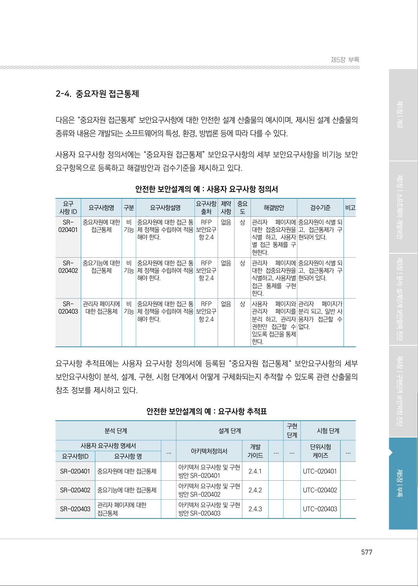
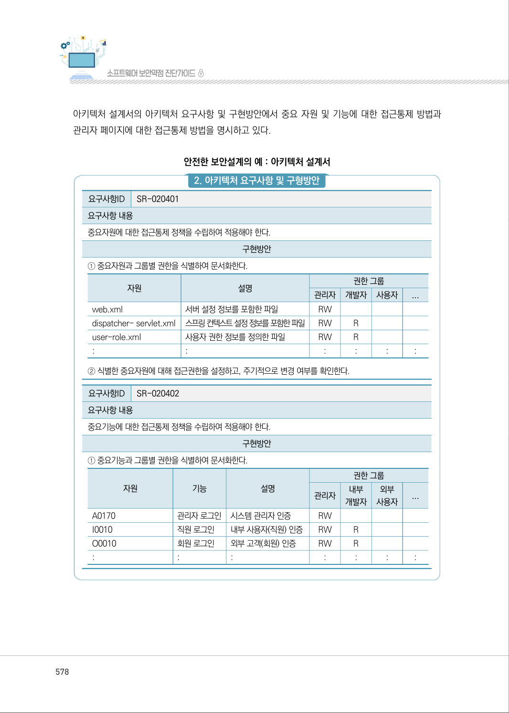
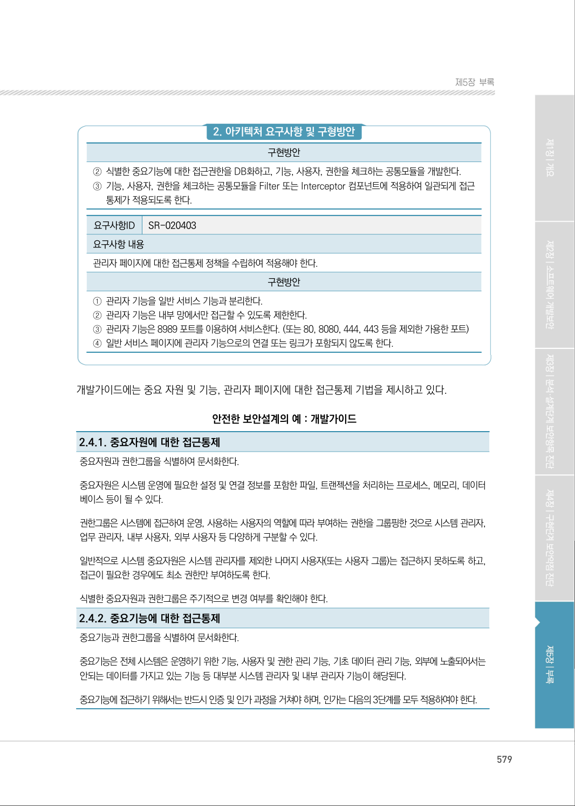
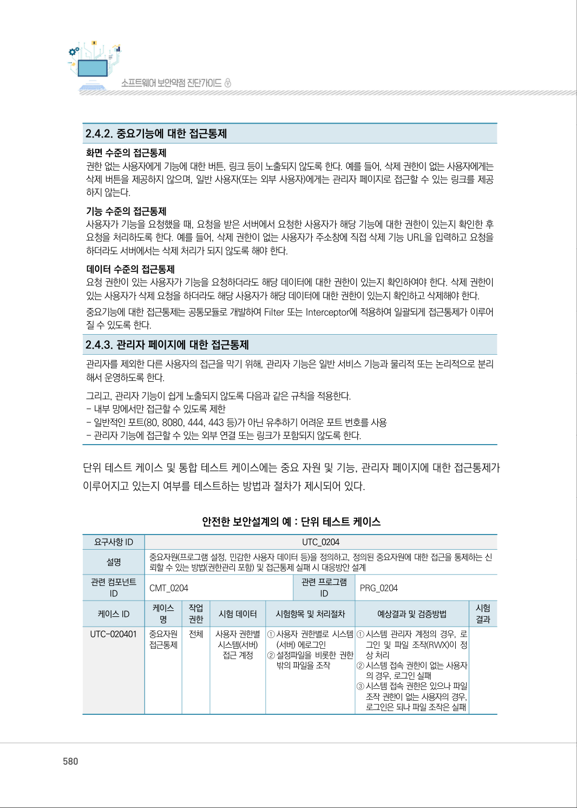
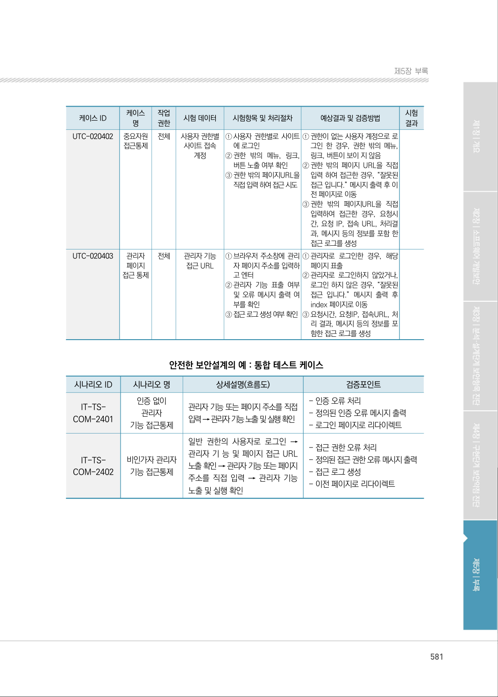
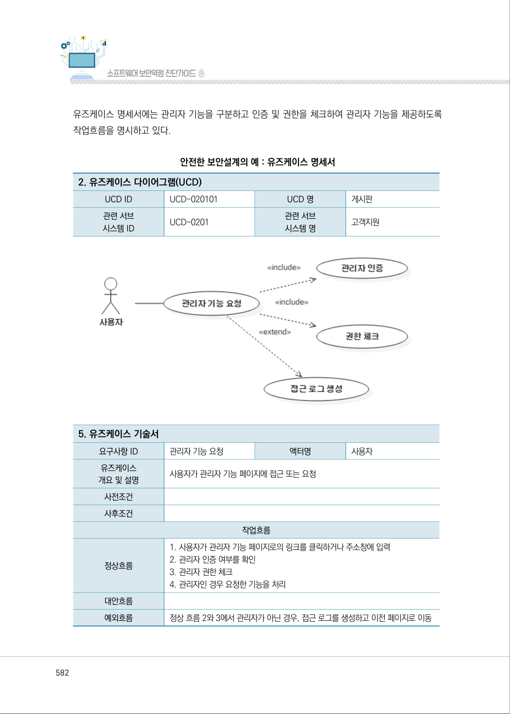
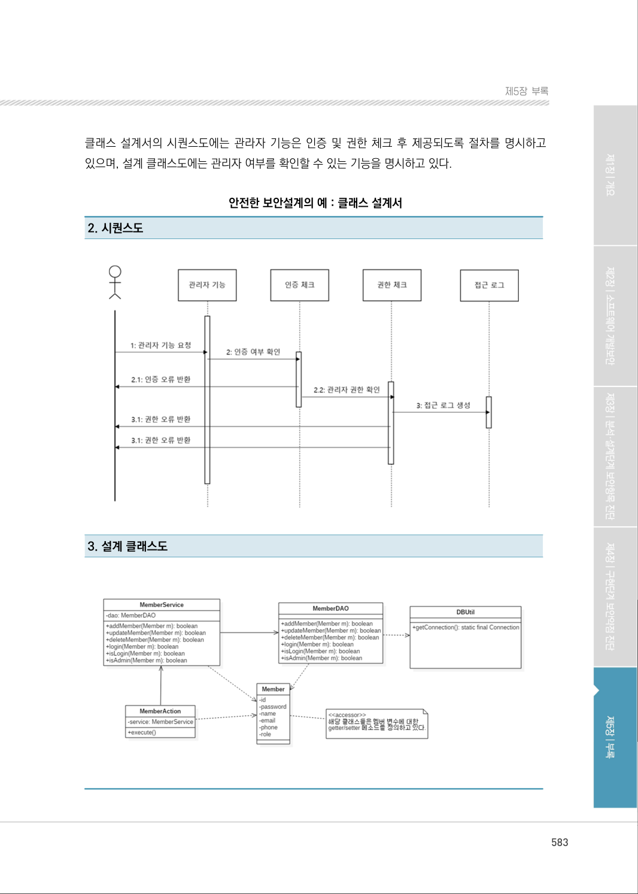
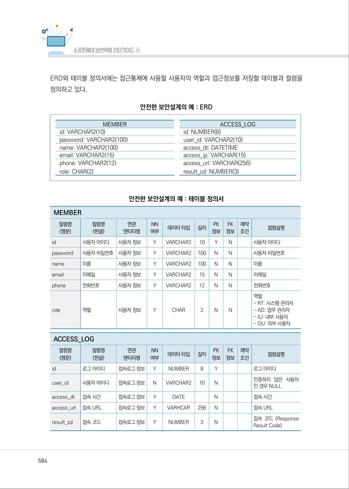
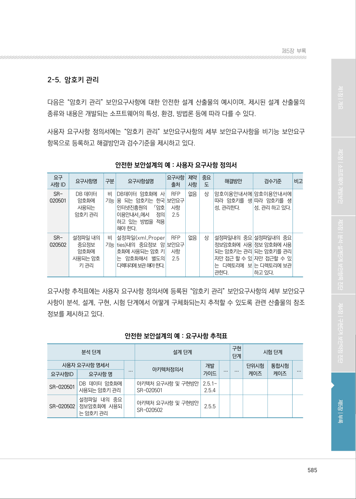

# 2-4. 중요자원 접근통제

> 변환 안내(원문 외): 아래 본문은 PDF 텍스트를 추출한 전사입니다. 코드 줄번호·특수 공백·원문 오류를 유지했습니다. 실행용 코드가 아닙니다. 표·그림·들여쓰기는 연결된 페이지 이미지와 대조하세요. 페이지 경계의 줄바꿈을 보존하며, 동일 페이지가 여러 항목에 나뉘면 각 항목의 본문은 해당 구간만 포함합니다.

### PDF 577페이지 / 인쇄 577페이지

<!-- source-page:SW-Diagnosis-2021:577; source-lines:0,2,3,4,5,6,7,8,9,10,11,12,13,14,15,16,17,18,19,20,21,22,23,24,25,26,27,28,29,30,31,32,33,34,35,36,37,38,39,40,41,42,43,44,45,46,47,48,49,50,51,52,53,54,55,56,57,58,59,60,61,62,63,64,65,66,67,68,69,70,71,72,73,74,75,76,77,78,79,80,81,82,83,84,85,86,87,88,89,90,91,92,93,94,95,96,97,98,99,100,101,102,103,104,105,106,107,108,109,110,111,112,113,114,115,116,117,118,119,120,121,122,123,124,125,126,127,128,129,130,131,132,133,134 -->

577

2-4. 중요자원 접근통제

다음은 “중요자원 접근통제” 보안요구사항에 대한 안전한 설계 산출물의 예시이며, 제시된 설계 산출물의 
종류와 내용은 개발되는 소프트웨어의 특성, 환경, 방법론 등에 따라 다를 수 있다.

사용자 요구사항 정의서에는 “중요자원 접근통제” 보안요구사항의 세부 보안요구사항을 비기능 보안
요구항목으로 등록하고 해결방안과 검수기준을 제시하고 있다.

안전한 보안설계의 예 : 사용자 요구사항 정의서

```text
요구
사항 ID
요구사항명 
구분 
요구사항설명 
요구사항 
출처
제약 
사항
중요 
도
해결방안
검수기준
비고
SR-
020401
중요자원에 대한 
접근통제
비 
기능
중요자원에 대한 접근 통
제 정책을 수립하여 적용 
해야 한다.
RFP 
보안요구 
항 2.4
없음 
상
관리자 
페이지에 
대한 접중요자원을 
식별 하고, 사용자
별 접근 통제를 구
현한다.
중요자원이 식별 되
고, 접근통제가 구
현되어 있다.
SR-
020402
중요기능에 대한 
접근통제
비 
기능
중요자원에 대한 접근 통
제 정책을 수립하여 적용 
해야 한다.
RFP 
보안요구 
항 2.4
없음 
상
관리자 
페이지에 
대한 접중요자원을 
식별하고, 사용자별 
접근 통제를 구현
한다.
중요자원이 식별 되
고, 접근통제가 구
현되어 있다.
SR-
020403
관리자 페이지에 
대한 접근통제
비 
기능
중요자원에 대한 접근 통
제 정책을 수립하여 적용 
해야 한다.
RFP 
보안요구 
항 2.4
없음 
상
사용자 
페이지와 
관리자 
페이지를 
분리 하고, 관리자 
권한만 접근할 수 
있도록 접근을 통제
한다.
관리자 
페이지가 
분리 되고, 일반 사
용자가 접근할 수 
없다.
```

요구사항 추적표에는 사용자 요구사항 정의서에 등록된 “중요자원 접근통제“ 보안요구사항의 세부 
보안요구사항이 분석, 설계, 구현, 시험 단계에서 어떻게 구체화되는지 추적할 수 있도록 관련 산출물의 
참조 정보를 제시하고 있다.

안전한 보안설계의 예 : 요구사항 추적표

```text
분석 단계
설계 단계
구현 
단계
시험 단계
사용자 요구사항 명세서
...
아키텍처정의서
개발 
가이드
...
...
단위시험
케이즈
...
요구사항ID
요구사항 명
SR-020401
중요자원에 대한 접근통제 
아키텍처 요구사항 및 구현
방안 SR-020401
2.4.1
UTC-020401
SR-020402
중요기능에 대한 접근통제 
아키텍처 요구사항 및 구현
방안 SR-020402 
2.4.2
UTC-020402
SR-020403
관리자 페이지에 대한 
접근통제
아키텍처 요구사항 및 구현
방안 SR-020403 
2.4.3
UTC-020403
```

<details><summary>원본 페이지 이미지 (변환 외 보존 자료)</summary>



</details>

### PDF 578페이지 / 인쇄 578페이지

<!-- source-page:SW-Diagnosis-2021:578; source-lines:0,1,2,3,4,5,6,7,8,9,10,11,12,13,14,15,16,17,18,19,20,21,22,23,24,25,26,27,28,29,30,31,32,33,34,35,36,37,38,39,40,41,42,43,44,45,46,47,48,49,50,51,52,53,54,55,56,57,58,59,60,61,62,63,64,65,66,67,68,69,70,71 -->

578

아키텍처 설계서의 아키텍처 요구사항 및 구현방안에서 중요 자원 및 기능에 대한 접근통제 방법과 
관리자 페이지에 대한 접근통제 방법을 명시하고 있다.

안전한 보안설계의 예 : 아키텍처 설계서

#### 2. 아키텍처 요구사항 및 구형방안

요구사항ID

SR-020401

요구사항 내용
중요자원에 대한 접근통제 정책을 수립하여 적용해야 한다.

구현방안

① 중요자원과 그룹별 권한을 식별하여 문서화한다.

```text
자원
설명 
권한 그룹
관리자
개발자
사용자
...
web.xml
서버 설정 정보를 포함한 파일 
RW
dispatcher- servlet.xml
스프링 컨텍스트 설정 정보를 포함한 파일
RW 
R
user-role.xml
사용자 권한 정보를 정의한 파일 
RW 
R
:
: 
: 
: 
: 
: 
```

② 식별한 중요자원에 대해 접근권한을 설정하고, 주기적으로 변경 여부를 확인한다.

요구사항ID

SR-020402

요구사항 내용
중요기능에 대한 접근통제 정책을 수립하여 적용해야 한다.

구현방안

① 중요기능과 그룹별 권한을 식별하여 문서화한다.

```text
자원
기능
설명
권한 그룹
관리자 
내부
개발자 
외부
사용자 
...
A0170
관리자 로그인 시스템 관리자 인증 
RW
I0010
직원 로그인 
내부 사용자(직원) 인증 
RW 
R
O0010
회원 로그인 
외부 고객(회원) 인증 
RW 
R
:
: 
: 
: 
: 
: 
: 
```

<details><summary>원본 페이지 이미지 (변환 외 보존 자료)</summary>



</details>

### PDF 579페이지 / 인쇄 579페이지

<!-- source-page:SW-Diagnosis-2021:579; source-lines:0,1,2,3,4,5,6,7,8,9,10,11,12,13,14,15,16,17,18,19,20,21,22,23,24,25,26,27,28,29,30,31 -->

579

제5장부록

#### 2. 아키텍처 요구사항 및 구형방안

구현방안

②식별한 중요기능에 대한 접근권한을 DB화하고, 기능, 사용자, 권한을 체크하는 공통모듈을 개발한다.
③기능, 사용자, 권한을 체크하는 공통모듈을 Filter 또는 Interceptor 컴포넌트에 적용하여 일관되게 접근

통제가 적용되도록 한다.

요구사항ID

SR-020403

요구사항 내용
관리자 페이지에 대한 접근통제 정책을 수립하여 적용해야 한다.

구현방안

①관리자 기능을 일반 서비스 기능과 분리한다. 
②관리자 기능은 내부 망에서만 접근할 수 있도록 제한한다. 
③관리자 기능은 8989 포트를 이용하여 서비스한다. (또는 80, 8080, 444, 443 등을 제외한 가용한 포트)
④일반 서비스 페이지에 관리자 기능으로의 연결 또는 링크가 포함되지 않도록 한다.

개발가이드에는 중요 자원 및 기능, 관리자 페이지에 대한 접근통제 기법을 제시하고 있다. 

안전한 보안설계의 예 : 개발가이드

2.4.1. 중요자원에 대한 접근통제
중요자원과 권한그룹을 식별하여 문서화한다.
중요자원은 시스템 운영에 필요한 설정 및 연결 정보를 포함한 파일, 트랜젝션을 처리하는 프로세스, 메모리, 데이터
베이스 등이 될 수 있다.
권한그룹은 시스템에 접근하여 운영, 사용하는 사용자의 역할에 따라 부여하는 권한을 그룹핑한 것으로 시스템 관리자, 
업무 관리자, 내부 사용자, 외부 사용자 등 다양하게 구분할 수 있다.
일반적으로 시스템 중요자원은 시스템 관리자를 제외한 나머지 사용자(또는 사용자 그룹)는 접근하지 못하도록 하고, 
접근이 필요한 경우에도 최소 권한만 부여하도록 한다.
식별한 중요자원과 권한그룹은 주기적으로 변경 여부를 확인해야 한다.
2.4.2. 중요기능에 대한 접근통제
중요기능과 권한그룹을 식별하여 문서화한다.
중요기능은 전체 시스템은 운영하기 위한 기능, 사용자 및 권한 관리 기능, 기초 데이터 관리 기능, 외부에 노출되어서는 
안되는 데이터를 가지고 있는 기능 등 대부분 시스템 관리자 및 내부 관리자 기능이 해당된다.
중요기능에 접근하기 위해서는 반드시 인증 및 인가 과정을 거쳐야 하며, 인가는 다음의 3단계를 모두 적용하여야 한다.

<details><summary>원본 페이지 이미지 (변환 외 보존 자료)</summary>



</details>

### PDF 580페이지 / 인쇄 580페이지

<!-- source-page:SW-Diagnosis-2021:580; source-lines:0,1,2,3,4,5,6,7,8,9,10,11,12,13,14,15,16,17,18,19,20,21,22,23,24,25,26,27,28,29,30,31,32,33,34,35,36,37,38,39,40,41,42,43,44,45,46,47,48,49,50,51,52,53,54,55,56,57,58,59,60,61,62,63,64 -->

580

2.4.2. 중요기능에 대한 접근통제
화면 수준의 접근통제
권한 없는 사용자에게 기능에 대한 버튼, 링크 등이 노출되지 않도록 한다. 예를 들어, 삭제 권한이 없는 사용자에게는 
삭제 버튼을 제공하지 않으며, 일반 사용자(또는 외부 사용자)에게는 관리자 페이지로 접근할 수 있는 링크를 제공 
하지 않는다.
기능 수준의 접근통제
사용자가 기능을 요청했을 때, 요청을 받은 서버에서 요청한 사용자가 해당 기능에 대한 권한이 있는지 확인한 후 
요청을 처리하도록 한다. 예를 들어, 삭제 권한이 없는 사용자가 주소창에 직접 삭제 기능 URL을 입력하고 요청을 
하더라도 서버에서는 삭제 처리가 되지 않도록 해야 한다.
데이터 수준의 접근통제
요청 권한이 있는 사용자가 기능을 요청하더라도 해당 데이터에 대한 권한이 있는지 확인하여야 한다. 삭제 권한이 
있는 사용자가 삭제 요청을 하더라도 해당 사용자가 해당 데이터에 대한 권한이 있는지 확인하고 삭제해야 한다.
중요기능에 대한 접근통제는 공통모듈로 개발하여 Filter 또는 Interceptor에 적용하여 일괄되게 접근통제가 이루어 
질 수 있도록 한다.
2.4.3. 관리자 페이지에 대한 접근통제
관리자를 제외한 다른 사용자의 접근을 막기 위해, 관리자 기능은 일반 서비스 기능과 물리적 또는 논리적으로 분리
해서 운영하도록 한다.
그리고, 관리자 기능이 쉽게 노출되지 않도록 다음과 같은 규칙을 적용한다.
- 내부 망에서만 접근할 수 있도록 제한 
- 일반적인 포트(80, 8080, 444, 443 등)가 아닌 유추하기 어려운 포트 번호를 사용 
- 관리자 기능에 접근할 수 있는 외부 연결 또는 링크가 포함되지 않도록 한다.

단위 테스트 케이스 및 통합 테스트 케이스에는 중요 자원 및 기능, 관리자 페이지에 대한 접근통제가 
이루어지고 있는지 여부를 테스트하는 방법과 절차가 제시되어 있다.

안전한 보안설계의 예 : 단위 테스트 케이스

```text
요구사항 ID
UTC_0204
설명
중요자원(프로그램 설정, 민감한 사용자 데이터 등)을 정의하고, 정의된 중요자원에 대한 접근을 통제하는 신
뢰할 수 있는 방법(권한관리 포함) 및 접근통제 실패 시 대응방안 설계
관련 컴포넌트 
ID
CMT_0204
관련 프로그램 
ID
PRG_0204
케이스 ID
케이스 
명
작업 
권한 
시험 데이터
시험항목 및 처리절차 
예상결과 및 검증방법 
시험
결과
UTC-020401
중요자원 
접근통제 
전체
사용자 권한별 
시스템(서버) 
접근 계정
①사용자 권한별로 시스템 
(서버) 에로그인 
②설정파일을 비롯한 권한 
밖의 파일을 조작
①시스템 관리자 계정의 경우, 로
그인 및 파일 조작(RWX)이 정
상 처리
②시스템 접속 권한이 없는 사용자
의 경우, 로그인 실패 
③시스템 접속 권한은 있으나 파일 
조작 권한이 없는 사용자의 경우, 
로그인은 되나 파일 조작은 실패
```

<details><summary>원본 페이지 이미지 (변환 외 보존 자료)</summary>



</details>

### PDF 581페이지 / 인쇄 581페이지

<!-- source-page:SW-Diagnosis-2021:581; source-lines:0,1,2,3,4,5,6,7,8,9,10,11,12,13,14,15,16,17,18,19,20,21,22,23,24,25,26,27,28,29,30,31,32,33,34,35,36,37,38,39,40,41,42,43,44,45,46,47,48,49,50,51,52,53,54,55,56,57,58,59,60,61,62,63,64,65,66,67,68,69,70,71,72,73,74,75,76,77,78,79,80,81,82,83,84,85,86,87 -->

581

제5장부록

```text
케이스 ID
케이스 
명
작업 
권한 
시험 데이터
시험항목 및 처리절차 
예상결과 및 검증방법 
시험
결과
UTC-020402
중요자원 
접근통제 
전체
사용자 권한별 
사이트 접속 
계정
①사용자 권한별로 사이트
에 로그인
②권한 밖의 메뉴, 링크, 
버튼 노출 여부 확인 
③권한 밖의 페이지URL을 
직접 입력 하여 접근 시도
①권한이 없는 사용자 계정으로 로
그인 한 경우, 권한 밖의 메뉴, 
링크, 버튼이 보이 지 않음 
②권한 밖의 페이지 URL을 직접 
입력 하여 접근한 경우, “잘못된 
접근 입니다.” 메시지 출력 후 이
전 페이지로 이동
③권한 밖의 페이지URL을 직접 
입력하여 접근한 경우, 요청시
간, 요청 IP, 접속 URL, 처리결
과, 메시지 등의 정보를 포함 한 
접근 로그를 생성
UTC-020403
관리자 
페이지 
접근 통제
전체 
관리자 기능 
접근 URL
①브라우저 주소창에 관리
자 페이지 주소를 입력하
고 엔터
②관리자 기능 표출 여부 
및 오류 메시지 출력 여
부를 확인
③접근 로그 생성 여부 확인
①관리자로 로그인한 경우, 해당 
페이지 표출 
②관리자로 로그인하지 않았거나, 
로그인 하지 않은 경우, “잘못된 
접근 입니다.” 메시지 출력 후 
index 페이지로 이동 
③요청시간, 요청IP, 접속URL, 처
리 결과, 메시지 등의 정보를 포
함한 접근 로그를 생성
```

안전한 보안설계의 예 : 통합 테스트 케이스

|  |  |  |  |
| --- | --- | --- | --- |
| 시나리오 ID | 시나리오 명 | 상세설명(흐름도) | 검증포인트 |
| IT-TS-<br>COM-2401 | 인증 없이<br>관리자<br>기능 접근통제 | 관리자 기능 또는 페이지 주소를 직접<br>입력 → 관리자 기능 노출 및 실행 확인 | - 인증 오류 처리<br>- 정의된 인증 오류 메시지 출력<br>- 로그인 페이지로 리다이렉트 |
| IT-TS-<br>COM-2402 | 비인가자 관리자<br>기능 접근통제 | 일반 권한의 사용자로 로그인 →<br>관리자 기 능 및 페이지 접근 URL<br>노출 확인 → 관리자 기능 또는 페이지<br>주소를 직접 입력 → 관리자 기능<br>노출 및 실행 확인 | - 접근 권한 오류 처리<br>- 정의된 접근 권한 오류 메시지 출력<br>- 접근 로그 생성<br>- 이전 페이지로 리다이렉트 |

<details><summary>원본 페이지 이미지 (변환 외 보존 자료)</summary>



</details>

### PDF 582페이지 / 인쇄 582페이지

<!-- source-page:SW-Diagnosis-2021:582; source-lines:0,1,2,3,4,5,6,7,8,9,10,11,12,13,14,15,16,17,18,19,20,21,22,23,24,25,26,27,28,29,30,31,32,33 -->

582

유즈케이스 명세서에는 관리자 기능을 구분하고 인증 및 권한을 체크하여 관리자 기능을 제공하도록 
작업흐름을 명시하고 있다.

안전한 보안설계의 예 : 유즈케이스 명세서

#### 2. 유즈케이스 다이어그램(UCD)

|  |  |  |  |
| --- | --- | --- | --- |
| UCD ID | UCD-020101 | UCD 명 | 게시판 |
| 관련 서브<br>시스템 ID | UCD-0201 | 관련 서브<br>시스템 명 | 고객지원 |

#### 5. 유즈케이스 기술서

```text
요구사항 ID
관리자 기능 요청
액터명
사용자
유즈케이스
개요 및 설명
사용자가 관리자 기능 페이지에 접근 또는 요청
사전조건
사후조건
```

작업흐름

|  |  |
| --- | --- |
| 정상흐름 | 1. 사용자가 관리자 기능 페이지로의 링크를 클릭하거나 주소창에 입력<br>2. 관리자 인증 여부를 확인<br>3. 관리자 권한 체크<br>4. 관리자인 경우 요청한 기능을 처리 |
| 대안흐름 |  |
| 예외흐름 | 정상 흐름 2와 3에서 관리자가 아닌 경우, 접근 로그를 생성하고 이전 페이지로 이동 |

<details><summary>원본 페이지 이미지 (변환 외 보존 자료)</summary>



</details>

### PDF 583페이지 / 인쇄 583페이지

<!-- source-page:SW-Diagnosis-2021:583; source-lines:0,1,2,3,4,5,6 -->

583

제5장부록

클래스 설계서의 시퀀스도에는 관라자 기능은 인증 및 권한 체크 후 제공되도록 절차를 명시하고 
있으며, 설계 클래스도에는 관리자 여부를 확인할 수 있는 기능을 명시하고 있다.

안전한 보안설계의 예 : 클래스 설계서

#### 2. 시퀀스도

#### 3. 설계 클래스도

<details><summary>원본 페이지 이미지 (변환 외 보존 자료)</summary>



</details>

### PDF 584페이지 / 인쇄 584페이지

<!-- source-page:SW-Diagnosis-2021:584; source-lines:0,1,2,3,4,5,6,7,8,9,10,11,12,13,14,15,16,17,18,19,20,21,22,23,24,25,26,27,28,29,30,31,32,33,34,35,36,37,38,39,40,41,42,43,44,45,46,47,48,49,50,51,52,53,54,55,56,57,58,59,60,61,62,63,64,65,66,67,68,69,70,71,72,73,74,75,76,77,78,79,80,81,82,83,84,85,86,87,88,89,90,91,92,93,94,95,96,97,98,99,100,101,102,103,104,105,106,107,108,109,110,111,112,113,114,115,116,117,118,119,120,121,122,123,124,125,126,127,128,129,130,131,132,133,134,135,136,137,138,139,140,141,142,143,144,145,146,147,148,149,150,151,152 -->

584

ERD와 테이블 정의서에는 접근통제에 사용할 사용자의 역할과 접근정보를 저장할 테이블과 컬럼을 
정의하고 있다.

안전한 보안설계의 예 : ERD

MEMBER

ACCESS_LOG

id: VARCHAR2(10)

id: NUMBER(8)

password: VARCHAR2(100)

user_id: VARCHAR2(10)

name: VARCHAR2(100)

access_dt: DATETIME

email: VARCHAR2(15)

access_ip: VARCHAR(15)

phone: VARCHAR2(12)
role: CHAR(2)

access_url: VARCHAR(256)
result_cd: NUMBER(3)

안전한 보안설계의 예 : 테이블 정의서

MEMBER

```text
컬럼명
(영문)
컬럼명 
(한글)
연관 
엔티티명
NN 
여부 
데이터 타입 
길이
PK 
정보
FK
정보
제약
조건
컬럼설명
id
사용자 아이디 
사용자 정보 
Y 
VARCHAR2 
10 
Y 
N 
사용자 아이디
password
사용자 비밀번호 사용자 정보 
Y 
VARCHAR2 
100 
N 
N 
사용자 비밀번호
name
이름 
사용자 정보 
Y 
VARCHAR2 
100 
N 
N 
이름
email
이메일 
사용자 정보 
Y 
VARCHAR2 
15 
N 
N 
이메일
phone
전화번호 
사용자 정보 
Y 
VARCHAR2 
12 
N 
N 
전화번호
role
역할 
사용자 정보 
Y 
CHAR 
2 
N 
N
역할
- RT: 시스템 관리자
- AD: 업무 관리자
- IU: 내부 사용자
- OU: 외부 사용자
```

ACCESS_LOG

```text
컬럼명
(영문)
컬럼명 
(한글)
연관 
엔티티명
NN 
여부 
데이터 타입 
길이
PK 
정보
FK
정보
제약
조건
컬럼설명
id
로그 아이디 
접속로그 정보 
Y 
NUMBER 
8 
Y 
로그 아이디
user_id
사용자 아이디 
접속로그 정보 
N
VARCHAR2 
10 
N
인증하지 않은 사용자 
인 경우 NULL
access_dt
접속 시간 
접속로그 정보 
Y 
DATE 
N 
접속 시간
access_url
접속 URL 
접속로그 정보 
Y 
VARHCAR 
256 
N 
접속 URL
result_cd
접속 코드 
접속로그 정보 
Y 
NUMBER 
3 
N
접속 코드 (Response 
Result Code)
```

<details><summary>원본 페이지 이미지 (변환 외 보존 자료)</summary>



</details>

### PDF 585페이지 / 인쇄 585페이지

<!-- source-page:SW-Diagnosis-2021:585; source-lines:1 -->

제5장부록

<details><summary>원본 페이지 이미지 (변환 외 보존 자료)</summary>



</details>

---

## 탐색 링크 (원문 외)

[통합 인덱스](../../../INDEX.md)

