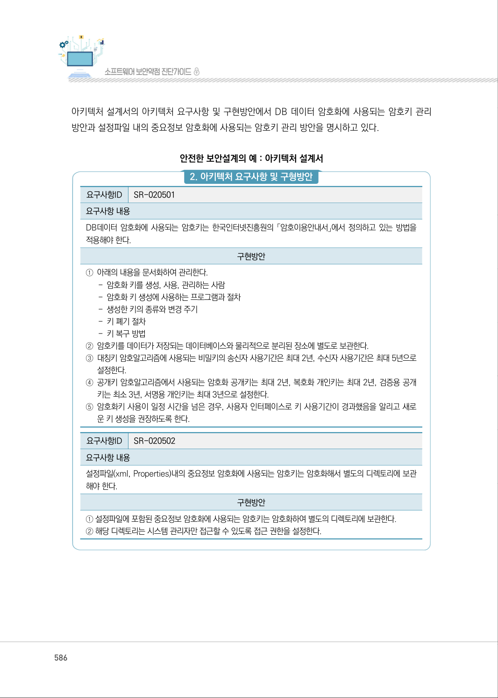
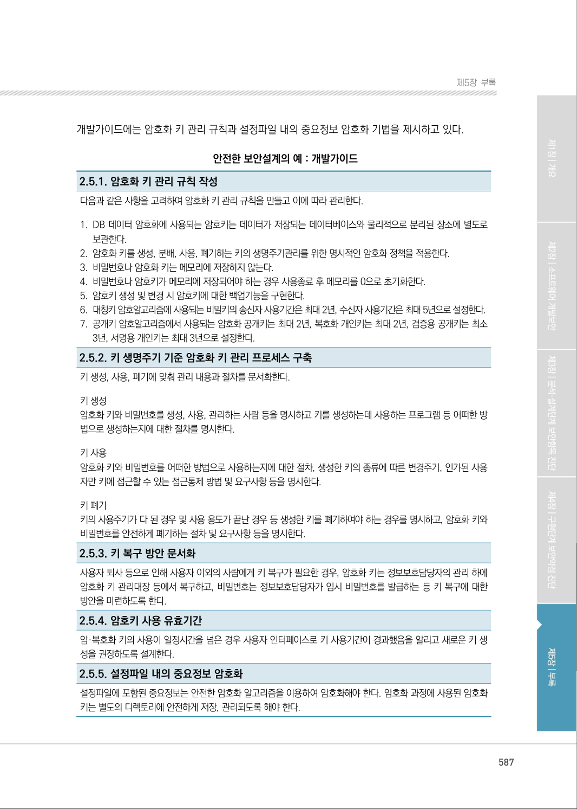

# 2-5. 암호키 관리

> 변환 안내(원문 외): 아래 본문은 PDF 텍스트를 추출한 전사입니다. 코드 줄번호·특수 공백·원문 오류를 유지했습니다. 실행용 코드가 아닙니다. 표·그림·들여쓰기는 연결된 페이지 이미지와 대조하세요. 페이지 경계의 줄바꿈을 보존하며, 동일 페이지가 여러 항목에 나뉘면 각 항목의 본문은 해당 구간만 포함합니다.

### PDF 585페이지 / 인쇄 585페이지

<!-- source-page:SW-Diagnosis-2021:585; source-lines:0,2,3,4,5,6,7,8,9,10,11,12,13,14,15,16,17,18,19,20,21,22,23,24,25,26,27,28,29,30,31,32,33,34,35,36,37,38,39,40,41,42,43,44,45,46,47,48,49,50,51,52,53,54,55,56,57,58,59,60,61,62,63,64,65,66,67,68,69,70,71,72,73,74,75,76,77,78,79,80,81,82,83,84,85,86,87,88,89,90,91,92,93,94,95,96,97,98,99,100,101,102,103,104,105,106,107,108,109,110,111,112,113,114,115,116,117 -->

585

2-5. 암호키 관리

다음은 “암호키 관리” 보안요구사항에 대한 안전한 설계 산출물의 예시이며, 제시된 설계 산출물의 
종류와 내용은 개발되는 소프트웨어의 특성, 환경, 방법론 등에 따라 다를 수 있다.

사용자 요구사항 정의서에는 “암호키 관리” 보안요구사항의 세부 보안요구사항을 비기능 보안요구 
항목으로 등록하고 해결방안과 검수기준을 제시하고 있다.

안전한 보안설계의 예 : 사용자 요구사항 정의서

```text
요구
사항 ID
요구사항명 
구분 
요구사항설명 
요구사항 
출처
제약 
사항
중요 
도
해결방안
검수기준
비고
SR-
020501
DB 데이터 
암호화에 
사용되는 
암호키 관리
비 
기능
DB데이터 암호화에 사 
용 되는 암호키는 한국 
인터넷진흥원의 
「암호 
이용안내서」에서 
정의 
하고 있는 방법을 적용 
해야 한다.
RFP 
보안요구 
사항
2.5
없음 
상
암호이용안내서에 
따라 암호키를 생
성, 관리한다.
암호이용안내서에 
따라 암호키를 생
성, 관리 하고 있다.
SR-
020502
설정파일 내의 
중요정보
암호화에 
사용되는 암호 
키 관리
비 
기능
설정파일(xml,Proper 
ties)내의 중요정보 암 
호화에 사용되는 암호 키
는 암호화해서 별도의 
디렉터리에 보관 해야 한다.
RFP 
보안요구 
사항
2.5
없음 
상
설정파일내의 중요 
정보암호화에 사용 
되는 암호키는 관리 
자만 접근 할 수 있
는 디렉토리에 보 
관한다.
설정파일내의 중요
정보 암호화에 사용
되는 암호키를 관리
자만 접근할 수 있
는 디렉토리에 보관
하고 있다.
```

요구사항 추적표에는 사용자 요구사항 정의서에 등록된 “암호키 관리” 보안요구사항의 세부 보안요구 
사항이 분석, 설계, 구현, 시험 단계에서 어떻게 구체화되는지 추적할 수 있도록 관련 산출물의 참조 
정보를 제시하고 있다.

안전한 보안설계의 예 : 요구사항 추적표

```text
분석 단계
설계 단계
구현 
단계
시험 단계
사용자 요구사항 명세서
...
아키텍처정의서
개발 
가이드
...
...
단위시험
케이즈
통합시험
케이즈
...
요구사항ID
요구사항 명
SR-020501 DB 데이터 암호화에 
사용되는 암호키 관리
아키텍처 요구사항 및 구현방안 
SR-020501
2.5.1~ 
2.5.4
SR-020502
설정파일 내의 중요
정보암호화에 사용되
는 암호키 관리
아키텍처 요구사항 및 구현방안 
SR-020502 
2.5.5
```

<details><summary>원본 페이지 이미지 (변환 외 보존 자료)</summary>


</details>

### PDF 586페이지 / 인쇄 586페이지

<!-- source-page:SW-Diagnosis-2021:586; source-lines:0,1,2,3,4,5,6,7,8,9,10,11,12,13,14,15,16,17,18,19,20,21,22,23,24,25,26,27,28,29,30,31 -->

586

아키텍처 설계서의 아키텍처 요구사항 및 구현방안에서 DB 데이터 암호화에 사용되는 암호키 관리 
방안과 설정파일 내의 중요정보 암호화에 사용되는 암호키 관리 방안을 명시하고 있다.

안전한 보안설계의 예 : 아키텍처 설계서

#### 2. 아키텍처 요구사항 및 구형방안

요구사항ID

SR-020501

요구사항 내용
DB데이터 암호화에 사용되는 암호키는 한국인터넷진흥원의 「암호이용안내서」에서 정의하고 있는 방법을 
적용해야 한다.

구현방안

①아래의 내용을 문서화하여 관리한다.

- 암호화 키를 생성, 사용, 관리하는 사람
- 암호화 키 생성에 사용하는 프로그램과 절차
- 생성한 키의 종류와 변경 주기
- 키 폐기 절차
- 키 복구 방법
②암호키를 데이터가 저장되는 데이터베이스와 물리적으로 분리된 장소에 별도로 보관한다.
③대칭키 암호알고리즘에 사용되는 비밀키의 송신자 사용기간은 최대 2년, 수신자 사용기간은 최대 5년으로 

설정한다.
④공개키 암호알고리즘에서 사용되는 암호화 공개키는 최대 2년, 복호화 개인키는 최대 2년, 검증용 공개

키는 최소 3년, 서명용 개인키는 최대 3년으로 설정한다.
⑤암호화키 사용이 일정 시간을 넘은 경우, 사용자 인터페이스로 키 사용기간이 경과했음을 알리고 새로

운 키 생성을 권장하도록 한다.

요구사항ID

SR-020502

요구사항 내용
설정파일(xml, Properties)내의 중요정보 암호화에 사용되는 암호키는 암호화해서 별도의 디렉토리에 보관
해야 한다.

구현방안

① 설정파일에 포함된 중요정보 암호화에 사용되는 암호키는 암호화하여 별도의 디렉토리에 보관한다.
② 해당 디렉토리는 시스템 관리자만 접근할 수 있도록 접근 권한을 설정한다.

<details><summary>원본 페이지 이미지 (변환 외 보존 자료)</summary>



</details>

### PDF 587페이지 / 인쇄 587페이지

<!-- source-page:SW-Diagnosis-2021:587; source-lines:0,1,2,3,4,5,6,7,8,9,10,11,12,13,14,15,16,17,18,19,20,21,22,23,24,25,26,27,28,29,30,31,32,33,34,35 -->

587

제5장부록

개발가이드에는 암호화 키 관리 규칙과 설정파일 내의 중요정보 암호화 기법을 제시하고 있다.

안전한 보안설계의 예 : 개발가이드

2.5.1. 암호화 키 관리 규칙 작성
다음과 같은 사항을 고려하여 암호화 키 관리 규칙을 만들고 이에 따라 관리한다.

#### 1. DB 데이터 암호화에 사용되는 암호키는 데이터가 저장되는 데이터베이스와 물리적으로 분리된 장소에 별도로 

보관한다.

#### 2. 암호화 키를 생성, 분배, 사용, 폐기하는 키의 생명주기관리를 위한 명시적인 암호화 정책을 적용한다.

#### 3. 비밀번호나 암호화 키는 메모리에 저장하지 않는다.

#### 4. 비밀번호나 암호키가 메모리에 저장되어야 하는 경우 사용종료 후 메모리를 0으로 초기화한다.

#### 5. 암호키 생성 및 변경 시 암호키에 대한 백업기능을 구현한다.

#### 6. 대칭키 암호알고리즘에 사용되는 비밀키의 송신자 사용기간은 최대 2년, 수신자 사용기간은 최대 5년으로 설정한다.

#### 7. 공개키 암호알고리즘에서 사용되는 암호화 공개키는 최대 2년, 복호화 개인키는 최대 2년, 검증용 공개키는 최소 

3년, 서명용 개인키는 최대 3년으로 설정한다.
2.5.2. 키 생명주기 기준 암호화 키 관리 프로세스 구축
키 생성, 사용, 폐기에 맞춰 관리 내용과 절차를 문서화한다.
키 생성
암호화 키와 비밀번호를 생성, 사용, 관리하는 사람 등을 명시하고 키를 생성하는데 사용하는 프로그램 등 어떠한 방
법으로 생성하는지에 대한 절차를 명시한다.
키 사용
암호화 키와 비밀번호를 어떠한 방법으로 사용하는지에 대한 절차, 생성한 키의 종류에 따른 변경주기, 인가된 사용
자만 키에 접근할 수 있는 접근통제 방법 및 요구사항 등을 명시한다.
키 폐기
키의 사용주기가 다 된 경우 및 사용 용도가 끝난 경우 등 생성한 키를 폐기하여야 하는 경우를 명시하고, 암호화 키와 
비밀번호를 안전하게 폐기하는 절차 및 요구사항 등을 명시한다.
2.5.3. 키 복구 방안 문서화
사용자 퇴사 등으로 인해 사용자 이외의 사람에게 키 복구가 필요한 경우, 암호화 키는 정보보호담당자의 관리 하에 
암호화 키 관리대장 등에서 복구하고, 비밀번호는 정보보호담당자가 임시 비밀번호를 발급하는 등 키 복구에 대한 
방안을 마련하도록 한다.
2.5.4. 암호키 사용 유효기간
암·복호화 키의 사용이 일정시간을 넘은 경우 사용자 인터페이스로 키 사용기간이 경과했음을 알리고 새로운 키 생
성을 권장하도록 설계한다.
2.5.5. 설정파일 내의 중요정보 암호화
설정파일에 포함된 중요정보는 안전한 암호화 알고리즘을 이용하여 암호화해야 한다. 암호화 과정에 사용된 암호화 
키는 별도의 디렉토리에 안전하게 저장, 관리되도록 해야 한다.

<details><summary>원본 페이지 이미지 (변환 외 보존 자료)</summary>



</details>

---

## 탐색 링크 (원문 외)

[통합 인덱스](../../../INDEX.md)

