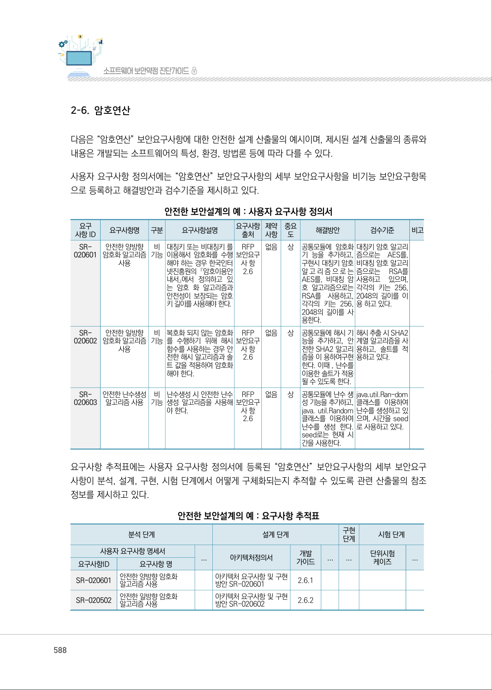
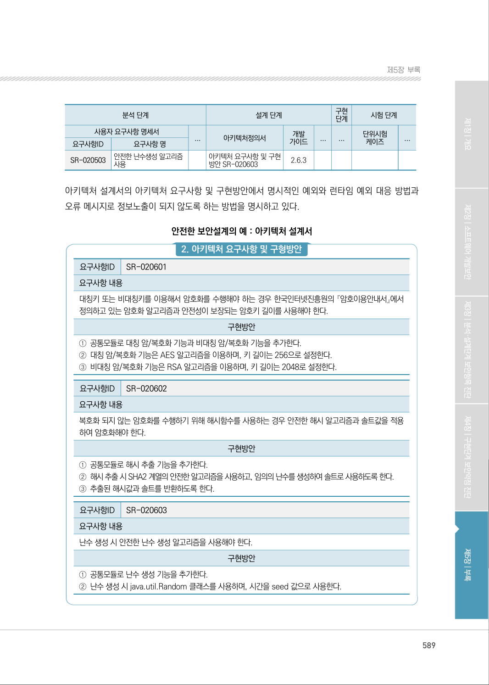
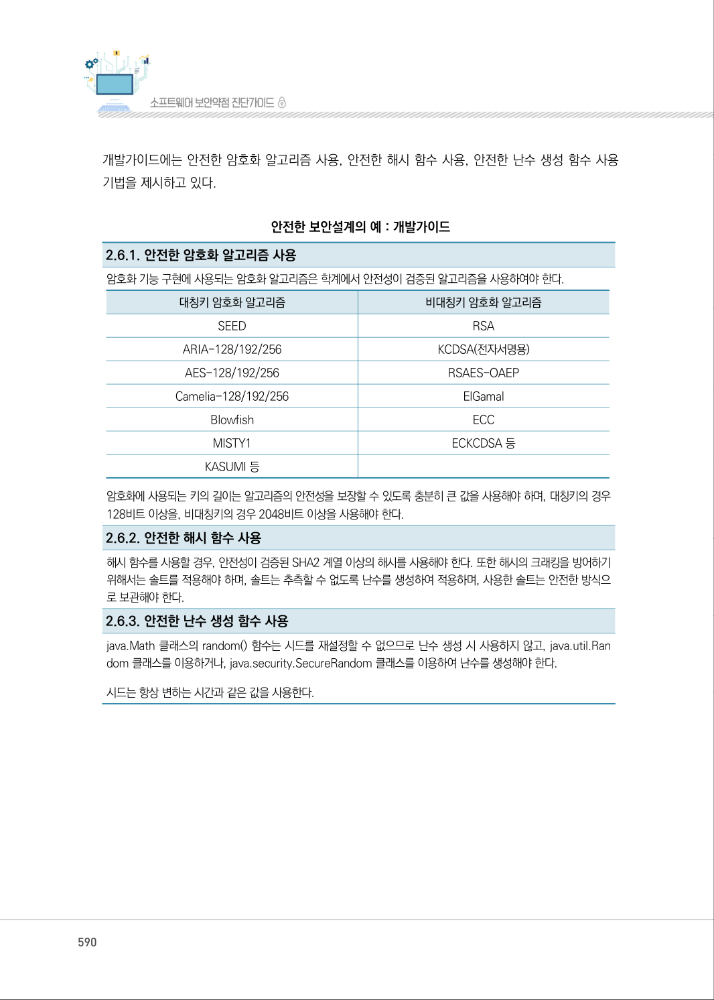
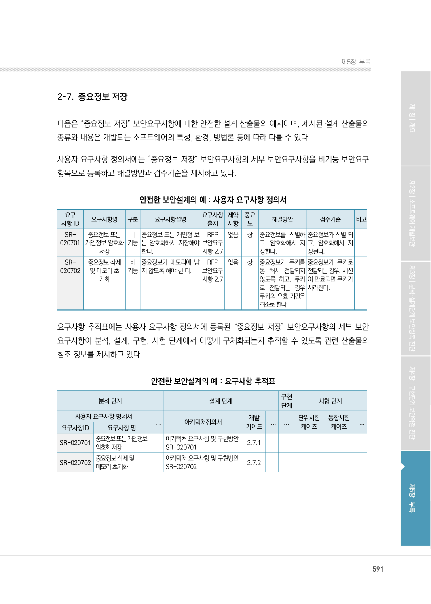

# 2-6. 암호연산

> 변환 안내(원문 외): 아래 본문은 PDF 텍스트를 추출한 전사입니다. 코드 줄번호·특수 공백·원문 오류를 유지했습니다. 실행용 코드가 아닙니다. 표·그림·들여쓰기는 연결된 페이지 이미지와 대조하세요. 페이지 경계의 줄바꿈을 보존하며, 동일 페이지가 여러 항목에 나뉘면 각 항목의 본문은 해당 구간만 포함합니다.

### PDF 588페이지 / 인쇄 588페이지

<!-- source-page:SW-Diagnosis-2021:588; source-lines:0,1,2,3,4,5,6,7,8,9,10,11,12,13,14,15,16,17,18,19,20,21,22,23,24,25,26,27,28,29,30,31,32,33,34,35,36,37,38,39,40,41,42,43,44,45,46,47,48,49,50,51,52,53,54,55,56,57,58,59,60,61,62,63,64,65,66,67,68,69,70,71,72,73,74,75,76,77,78,79,80,81,82,83,84,85,86,87,88,89,90,91,92,93,94,95,96,97,98,99,100,101,102,103,104,105,106,107,108,109,110,111,112,113,114,115,116,117,118,119,120,121,122,123,124,125,126,127,128,129,130,131,132,133,134,135,136,137,138,139,140,141,142,143,144,145,146,147,148,149,150,151 -->

588

2-6. 암호연산

다음은 “암호연산” 보안요구사항에 대한 안전한 설계 산출물의 예시이며, 제시된 설계 산출물의 종류와 
내용은 개발되는 소프트웨어의 특성, 환경, 방법론 등에 따라 다를 수 있다.

사용자 요구사항 정의서에는 “암호연산” 보안요구사항의 세부 보안요구사항을 비기능 보안요구항목 
으로 등록하고 해결방안과 검수기준을 제시하고 있다.

안전한 보안설계의 예 : 사용자 요구사항 정의서

```text
요구
사항 ID
요구사항명 
구분 
요구사항설명 
요구사항 
출처
제약 
사항
중요 
도
해결방안
검수기준
비고
SR-
020601
안전한 양방향 
암호화 알고리즘 
사용
비 
기능
대칭키 또는 비대칭키 를 
이용해서 암호화를 수행 
해야 하는 경우 한국인터
넷진흥원의 『암호이용안
내서』에서 정의하고 있
는 암호 화 알고리즘과 
안전성이 보장되는 암호
키 길이를 사용해야 한다.
RFP 
보안요구 
사 항 
2.6
없음 
상
공통모듈에 암호화 
기 능을 추가하고, 
구현시 대칭키 암호 
알고리즘으로는 
AES를, 비대칭 암 
호 알고리즘으로는 
RSA를 사용하고, 
각각의 키는 256, 
2048의 길이를 사
용한다.
대칭키 암호 알고리
즘으로는 AES를,
비대칭 암호 알고리
즘으로는 
RSA를 
사용하고 
있으며, 
각각의 키는 256, 
2048의 길이를 이
용 하고 있다.
SR-
020602
안전한 일방향 
암호화 알고리즘 
사용
비 
기능
복호화 되지 않는 암호화
를 수행하기 위해 해시 
함수를 사용하는 경우 안
전한 해시 알고리즘과 솔
트 값을 적용하여 암호화
해야 한다.
RFP 
보안요구 
사 항 
2.6 
없음 
상
공통모듈에 해시 기 
능을 추가하고, 안
전한 SHA2 알고리
즘을 이 용하여구현
한다. 이때 , 난수를 
이용한 솔트가 적용
될 수 있도록 한다.
해시 추출 시 SHA2 
계열 알고리즘을 사
용하고, 솔트를 적
용하고 있다.
SR-
020603
안전한 난수생성 
알고리즘 사용
비 
기능
난수생성 시 안전한 난수 
생성 알고리즘을 사용해 
야 한다.
RFP 
보안요구 
사 항 
2.6
없음 
상
공통모듈에 난수 생
성 기능을 추가하고, 
java. util.Random 
클래스를 이용하여 
난수를 생성 한다. 
seed로는 현재 시
간을 사용한다.
java.util.Ran-dom 
클래스를 이용하여 
난수를 생성하고 있
으며, 시간을 seed
로 사용하고 있다.
```

요구사항 추적표에는 사용자 요구사항 정의서에 등록된 “암호연산” 보안요구사항의 세부 보안요구 
사항이 분석, 설계, 구현, 시험 단계에서 어떻게 구체화되는지 추적할 수 있도록 관련 산출물의 참조 
정보를 제시하고 있다.

안전한 보안설계의 예 : 요구사항 추적표

```text
분석 단계
설계 단계
구현 
단계
시험 단계
사용자 요구사항 명세서
...
아키텍처정의서
개발 
가이드
...
...
단위시험
케이즈
...
요구사항ID
요구사항 명
SR-020601
안전한 양방향 암호화 
알고리즘 사용
아키텍처 요구사항 및 구현
방안 SR-020601 
2.6.1
SR-020502
안전한 일방향 암호화 
알고리즘 사용
아키텍처 요구사항 및 구현
방안 SR-020602 
2.6.2
```

<details><summary>원본 페이지 이미지 (변환 외 보존 자료)</summary>



</details>

### PDF 589페이지 / 인쇄 589페이지

<!-- source-page:SW-Diagnosis-2021:589; source-lines:0,1,2,3,4,5,6,7,8,9,10,11,12,13,14,15,16,17,18,19,20,21,22,23,24,25,26,27,28,29,30,31,32,33,34,35,36,37,38,39,40,41,42,43,44,45,46,47,48,49,50,51,52,53 -->

589

제5장부록

```text
분석 단계
설계 단계
구현 
단계
시험 단계
사용자 요구사항 명세서
...
아키텍처정의서
개발 
가이드
...
...
단위시험
케이즈
...
요구사항ID
요구사항 명
SR-020503
안전한 난수생성 알고리즘 
사용
아키텍처 요구사항 및 구현
방안 SR-020603
2.6.3
```

아키텍처 설계서의 아키텍처 요구사항 및 구현방안에서 명시적인 예외와 런타임 예외 대응 방법과 
오류 메시지로 정보노출이 되지 않도록 하는 방법을 명시하고 있다.

안전한 보안설계의 예 : 아키텍처 설계서

#### 2. 아키텍처 요구사항 및 구형방안

요구사항ID

SR-020601

요구사항 내용
대칭키 또는 비대칭키를 이용해서 암호화를 수행해야 하는 경우 한국인터넷진흥원의 『암호이용안내서』에서 
정의하고 있는 암호화 알고리즘과 안전성이 보장되는 암호키 길이를 사용해야 한다.

구현방안

①공통모듈로 대칭 암/복호화 기능과 비대칭 암/복호화 기능을 추가한다.
②대칭 암/복호화 기능은 AES 알고리즘을 이용하며, 키 길이는 256으로 설정한다.
③비대칭 암/복호화 기능은 RSA 알고리즘을 이용하며, 키 길이는 2048로 설정한다.

요구사항ID

SR-020602

요구사항 내용
복호화 되지 않는 암호화를 수행하기 위해 해시함수를 사용하는 경우 안전한 해시 알고리즘과 솔트값을 적용
하여 암호화해야 한다.

구현방안

①공통모듈로 해시 추출 기능을 추가한다. 
②해시 추출 시 SHA2 계열의 안전한 알고리즘을 사용하고, 임의의 난수를 생성하여 솔트로 사용하도록 한다.
③추출된 해시값과 솔트를 반환하도록 한다.

요구사항ID

SR-020603

요구사항 내용
난수 생성 시 안전한 난수 생성 알고리즘을 사용해야 한다.

구현방안

①공통모듈로 난수 생성 기능을 추가한다. 
②난수 생성 시 java.util.Random 클래스를 사용하며, 시간을 seed 값으로 사용한다.

<details><summary>원본 페이지 이미지 (변환 외 보존 자료)</summary>



</details>

### PDF 590페이지 / 인쇄 590페이지

<!-- source-page:SW-Diagnosis-2021:590; source-lines:0,1,2,3,4,5,6,7,8,9,10,11,12,13,14,15,16,17,18,19,20,21,22,23,24,25,26,27,28,29,30 -->

590

개발가이드에는 안전한 암호화 알고리즘 사용, 안전한 해시 함수 사용, 안전한 난수 생성 함수 사용 
기법을 제시하고 있다.

안전한 보안설계의 예 : 개발가이드

2.6.1. 안전한 암호화 알고리즘 사용
암호화 기능 구현에 사용되는 암호화 알고리즘은 학계에서 안전성이 검증된 알고리즘을 사용하여야 한다.

|  |  |
| --- | --- |
| 대칭키 암호화 알고리즘 | 비대칭키 암호화 알고리즘 |
| SEED | RSA |
| ARIA-128/192/256 | KCDSA(전자서명용) |
| AES-128/192/256 | RSAES-OAEP |
| Camelia-128/192/256 | ElGamal |
| Blowfish | ECC |
| MISTY1 | ECKCDSA 등 |
| KASUMI 등 |  |

암호화에 사용되는 키의 길이는 알고리즘의 안전성을 보장할 수 있도록 충분히 큰 값을 사용해야 하며, 대칭키의 경우 
128비트 이상을, 비대칭키의 경우 2048비트 이상을 사용해야 한다.
2.6.2. 안전한 해시 함수 사용
해시 함수를 사용할 경우, 안전성이 검증된 SHA2 계열 이상의 해시를 사용해야 한다. 또한 해시의 크래킹을 방어하기 
위해서는 솔트를 적용해야 하며, 솔트는 추측할 수 없도록 난수를 생성하여 적용하며, 사용한 솔트는 안전한 방식으
로 보관해야 한다.
2.6.3. 안전한 난수 생성 함수 사용
java.Math 클래스의 random() 함수는 시드를 재설정할 수 없으므로 난수 생성 시 사용하지 않고, java.util.Ran 
dom 클래스를 이용하거나, java.security.SecureRandom 클래스를 이용하여 난수를 생성해야 한다.
시드는 항상 변하는 시간과 같은 값을 사용한다.

<details><summary>원본 페이지 이미지 (변환 외 보존 자료)</summary>



</details>

### PDF 591페이지 / 인쇄 591페이지

<!-- source-page:SW-Diagnosis-2021:591; source-lines:1 -->

제5장부록

<details><summary>원본 페이지 이미지 (변환 외 보존 자료)</summary>



</details>

---

## 탐색 링크 (원문 외)

[통합 인덱스](../../../INDEX.md)

