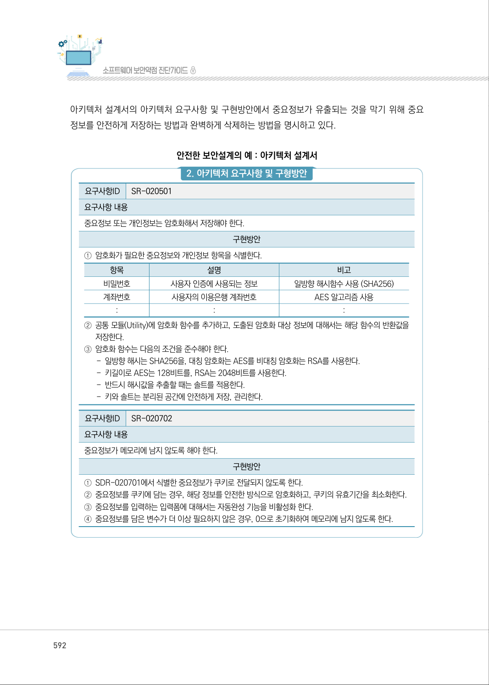
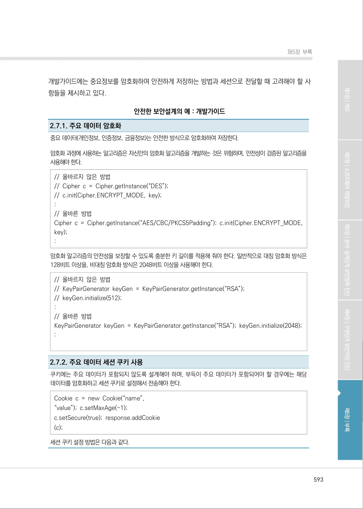

# 2-7. 중요정보 저장

> 변환 안내(원문 외): 아래 본문은 PDF 텍스트를 추출한 전사입니다. 코드 줄번호·특수 공백·원문 오류를 유지했습니다. 실행용 코드가 아닙니다. 표·그림·들여쓰기는 연결된 페이지 이미지와 대조하세요. 페이지 경계의 줄바꿈을 보존하며, 동일 페이지가 여러 항목에 나뉘면 각 항목의 본문은 해당 구간만 포함합니다.

### PDF 591페이지 / 인쇄 591페이지

<!-- source-page:SW-Diagnosis-2021:591; source-lines:0,2,3,4,5,6,7,8,9,10,11,12,13,14,15,16,17,18,19,20,21,22,23,24,25,26,27,28,29,30,31,32,33,34,35,36,37,38,39,40,41,42,43,44,45,46,47,48,49,50,51,52,53,54,55,56,57,58,59,60,61,62,63,64,65,66,67,68,69,70,71,72,73,74,75,76,77,78,79,80,81,82,83,84,85,86,87,88,89,90,91,92,93,94,95,96,97,98,99 -->

591

2-7. 중요정보 저장

다음은 “중요정보 저장” 보안요구사항에 대한 안전한 설계 산출물의 예시이며, 제시된 설계 산출물의 
종류와 내용은 개발되는 소프트웨어의 특성, 환경, 방법론 등에 따라 다를 수 있다. 

사용자 요구사항 정의서에는 “중요정보 저장” 보안요구사항의 세부 보안요구사항을 비기능 보안요구 
항목으로 등록하고 해결방안과 검수기준을 제시하고 있다.

안전한 보안설계의 예 : 사용자 요구사항 정의서

```text
요구
사항 ID
요구사항명 
구분 
요구사항설명 
요구사항 
출처
제약 
사항
중요 
도
해결방안
검수기준
비고
SR-
020701
중요정보 또는 
개인정보 암호화 
저장
비 
기능
중요정보 또는 개인정 보
는 암호화해서 저장해야 
한다.
RFP 
보안요구 
사항 2.7
없음 
상
중요정보를 식별하
고, 암호화해서 저
장한다.
중요정보가 식별 되
고, 암호화해서 저
장된다.
SR-
020702
중요정보 삭제 
및 메모리 초 
기화
비 
기능
중요정보가 메모리에 남
지 않도록 해야 한 다.
RFP 
보안요구 
사항 2.7
없음 
상
중요정보가 쿠키를 
통 해서 전달되지 
않도록 하고, 쿠키
로 전달되는 경우 
쿠키의 유효 기간을 
최소로 한다.
중요정보가 쿠키로 
전달되는 경우, 세션
이 만료되면 쿠키가 
사라진다.
```

요구사항 추적표에는 사용자 요구사항 정의서에 등록된 “중요정보 저장” 보안요구사항의 세부 보안 
요구사항이 분석, 설계, 구현, 시험 단계에서 어떻게 구체화되는지 추적할 수 있도록 관련 산출물의 
참조 정보를 제시하고 있다.

안전한 보안설계의 예 : 요구사항 추적표

```text
분석 단계
설계 단계
구현 
단계
시험 단계
사용자 요구사항 명세서
...
아키텍처정의서
개발 
가이드
...
...
단위시험
케이즈
통합시험
케이즈
...
요구사항ID
요구사항 명
SR-020701 중요정보 또는 개인정보 
암호화 저장
아키텍처 요구사항 및 구현방안 
SR-020701
2.7.1
SR-020702 중요정보 삭제 및 
메모리 초기화
아키텍처 요구사항 및 구현방안 
SR-020702 
2.7.2
```

<details><summary>원본 페이지 이미지 (변환 외 보존 자료)</summary>


</details>

### PDF 592페이지 / 인쇄 592페이지

<!-- source-page:SW-Diagnosis-2021:592; source-lines:0,1,2,3,4,5,6,7,8,9,10,11,12,13,14,15,16,17,18,19,20,21,22,23,24,25,26,27,28,29,30,31,32,33,34,35,36,37,38 -->

592

아키텍처 설계서의 아키텍처 요구사항 및 구현방안에서 중요정보가 유출되는 것을 막기 위해 중요 
정보를 안전하게 저장하는 방법과 완벽하게 삭제하는 방법을 명시하고 있다.

안전한 보안설계의 예 : 아키텍처 설계서

#### 2. 아키텍처 요구사항 및 구형방안

요구사항ID

SR-020501

요구사항 내용
중요정보 또는 개인정보는 암호화해서 저장해야 한다.

구현방안

①암호화가 필요한 중요정보와 개인정보 항목을 식별한다.

| 항목 | 설명 | 비고 |
| --- | --- | --- |
| 비밀번호 | 사용자 인증에 사용되는 정보 | 일방향 해시함수 사용 (SHA256) |
| 계좌번호 | 사용자의 이용은행 계좌번호 | AES 알고리즘 사용 |
| : | : | : |

②공통 모듈(Utility)에 암호화 함수를 추가하고, 도출된 암호화 대상 정보에 대해서는 해당 함수의 반환값을 

저장한다.
③암호화 함수는 다음의 조건을 준수해야 한다.

- 일방향 해시는 SHA256을, 대칭 암호화는 AES를 비대칭 암호화는 RSA를 사용한다.
- 키길이로 AES는 128비트를, RSA는 2048비트를 사용한다.
- 반드시 해시값을 추출할 때는 솔트를 적용한다.
- 키와 솔트는 분리된 공간에 안전하게 저장, 관리한다.

요구사항ID

SR-020702

요구사항 내용
중요정보가 메모리에 남지 않도록 해야 한다.

구현방안

①SDR-020701에서 식별한 중요정보가 쿠키로 전달되지 않도록 한다. 
②중요정보를 쿠키에 담는 경우, 해당 정보를 안전한 방식으로 암호화하고, 쿠키의 유효기간을 최소화한다.
③중요정보를 입력하는 입력폼에 대해서는 자동완성 기능을 비활성화 한다.
④중요정보를 담은 변수가 더 이상 필요하지 않은 경우, 0으로 초기화하여 메모리에 남지 않도록 한다.

<details><summary>원본 페이지 이미지 (변환 외 보존 자료)</summary>



</details>

### PDF 593페이지 / 인쇄 593페이지

<!-- source-page:SW-Diagnosis-2021:593; source-lines:0,1,2,3,4,5,6,7,8,9,10,11,12,13,14,15,16,17,18,19,20,21,22,23,24,25,26,27,28,29,30,31,32,33 -->

593

제5장부록

개발가이드에는 중요정보를 암호화하여 안전하게 저장하는 방법과 세션으로 전달할 때 고려해야 할 사
항들을 제시하고 있다.

안전한 보안설계의 예 : 개발가이드

2.7.1. 주요 데이터 암호화
중요 데이터(개인정보, 인증정보, 금융정보)는 안전한 방식으로 암호화하여 저장한다.
암호화 과정에 사용하는 알고리즘은 자신만의 암호화 알고리즘을 개발하는 것은 위험하며, 안전성이 검증된 알고리즘을 
사용해야 한다.
// 올바르지 않은 방법 
// Cipher c = Cipher.getInstance(“DES”); 
// c.init(Cipher.ENCRYPT_MODE, key); 
: 
// 올바른 방법
Cipher c = Cipher.getInstance(“AES/CBC/PKCS5Padding”); c.init(Cipher.ENCRYPT_MODE, 
key);
: 
암호화 알고리즘의 안전성을 보장할 수 있도록 충분한 키 길이를 적용해 줘야 한다. 일반적으로 대칭 암호화 방식은 
128비트 이상을, 비대칭 암호화 방식은 2048비트 이상을 사용해야 한다.
// 올바르지 않은 방법 
// KeyPairGenerator keyGen = KeyPairGenerator.getInstance(“RSA”); 
// keyGen.initialize(512); 
: 
// 올바른 방법 
KeyPairGenerator keyGen = KeyPairGenerator.getInstance(“RSA”); keyGen.initialize(2048);
: 

2.7.2. 주요 데이터 세션 쿠키 사용
쿠키에는 주요 데이터가 포함되지 않도록 설계해야 하며, 부득이 주요 데이터가 포함되어야 할 경우에는 해당 
데이터를 암호화하고 세션 쿠키로 설정해서 전송해야 한다.
Cookie c = new Cookie(“name”,
“value”); c.setMaxAge(-1); 
c.setSecure(true); response.addCookie 
(c);
세션 쿠키 설정 방법은 다음과 같다.

<details><summary>원본 페이지 이미지 (변환 외 보존 자료)</summary>



</details>

---

## 탐색 링크 (원문 외)

[통합 인덱스](../../../INDEX.md)

