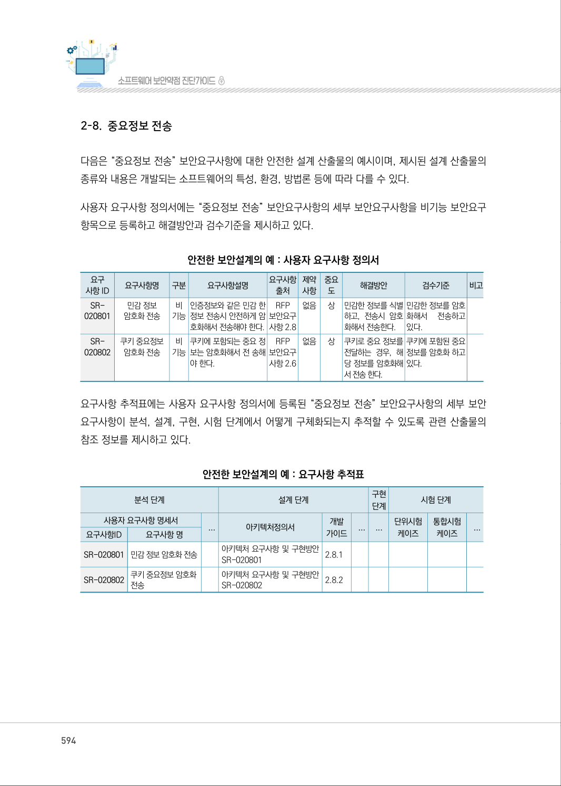
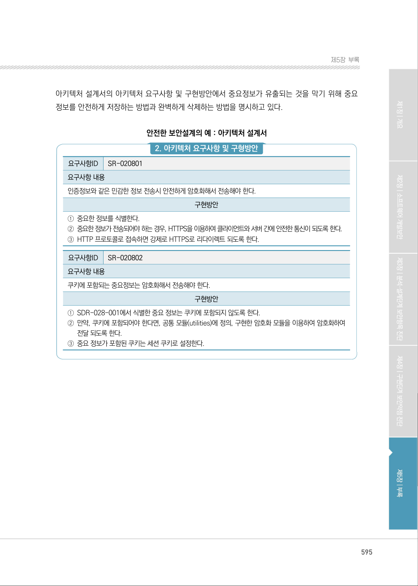
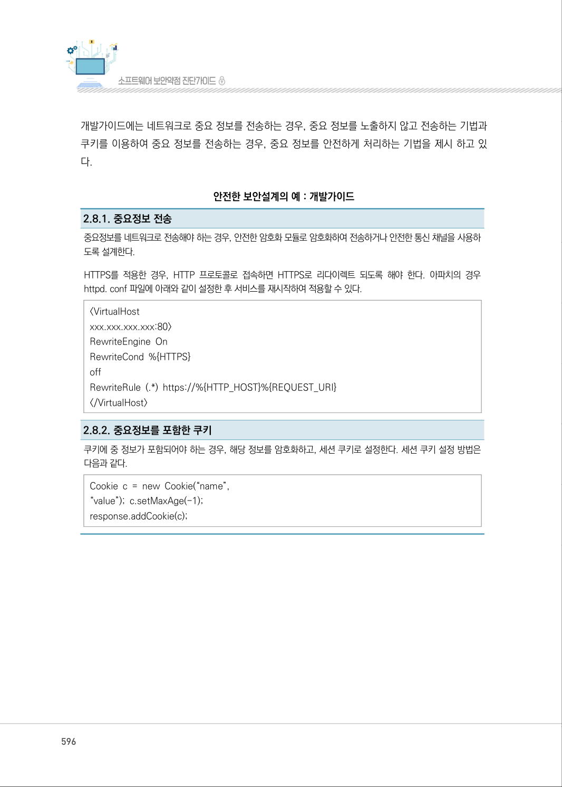

# 2-8. 중요정보 전송

> 변환 안내(원문 외): 아래 본문은 PDF 텍스트를 추출한 전사입니다. 코드 줄번호·특수 공백·원문 오류를 유지했습니다. 실행용 코드가 아닙니다. 표·그림·들여쓰기는 연결된 페이지 이미지와 대조하세요. 페이지 경계의 줄바꿈을 보존하며, 동일 페이지가 여러 항목에 나뉘면 각 항목의 본문은 해당 구간만 포함합니다.

### PDF 594페이지 / 인쇄 594페이지

<!-- source-page:SW-Diagnosis-2021:594; source-lines:0,1,2,3,4,5,6,7,8,9,10,11,12,13,14,15,16,17,18,19,20,21,22,23,24,25,26,27,28,29,30,31,32,33,34,35,36,37,38,39,40,41,42,43,44,45,46,47,48,49,50,51,52,53,54,55,56,57,58,59,60,61,62,63,64,65,66,67,68,69,70,71,72,73,74,75,76,77,78,79,80,81,82,83,84,85,86,87,88,89,90,91,92,93,94 -->

594

2-8. 중요정보 전송

다음은 “중요정보 전송” 보안요구사항에 대한 안전한 설계 산출물의 예시이며, 제시된 설계 산출물의 
종류와 내용은 개발되는 소프트웨어의 특성, 환경, 방법론 등에 따라 다를 수 있다. 

사용자 요구사항 정의서에는 “중요정보 전송” 보안요구사항의 세부 보안요구사항을 비기능 보안요구
항목으로 등록하고 해결방안과 검수기준을 제시하고 있다.

안전한 보안설계의 예 : 사용자 요구사항 정의서

```text
요구
사항 ID
요구사항명 
구분 
요구사항설명 
요구사항 
출처
제약 
사항
중요 
도
해결방안
검수기준
비고
SR-
020801
민감 정보 
암호화 전송
비 
기능
인증정보와 같은 민감 한 
정보 전송시 안전하게 암
호화해서 전송해야 한다.
RFP 
보안요구 
사항 2.8
없음 
상
민감한 정보를 식별 
하고, 전송시 암호
화해서 전송한다.
민감한 정보를 암호
화해서 
전송하고 
있다.
SR-
020802
쿠키 중요정보 
암호화 전송
비 
기능
쿠키에 포함되는 중요 정
보는 암호화해서 전 송해
야 한다.
RFP 
보안요구 
사항 2.6
없음 
상
쿠키로 중요 정보를 
전달하는 경우, 해
당 정보를 암호화해
서 전송 한다.
쿠키에 포함된 중요
정보를 암호화 하고
있다.
```

요구사항 추적표에는 사용자 요구사항 정의서에 등록된 “중요정보 전송” 보안요구사항의 세부 보안 
요구사항이 분석, 설계, 구현, 시험 단계에서 어떻게 구체화되는지 추적할 수 있도록 관련 산출물의 
참조 정보를 제시하고 있다.

안전한 보안설계의 예 : 요구사항 추적표

```text
분석 단계
설계 단계
구현 
단계
시험 단계
사용자 요구사항 명세서
...
아키텍처정의서
개발 
가이드
...
...
단위시험
케이즈
통합시험
케이즈
...
요구사항ID
요구사항 명
SR-020801 민감 정보 암호화 전송
아키텍처 요구사항 및 구현방안 
SR-020801 
2.8.1
SR-020802 쿠키 중요정보 암호화 
전송
아키텍처 요구사항 및 구현방안 
SR-020802 
2.8.2
```

<details><summary>원본 페이지 이미지 (변환 외 보존 자료)</summary>



</details>

### PDF 595페이지 / 인쇄 595페이지

<!-- source-page:SW-Diagnosis-2021:595; source-lines:0,1,2,3,4,5,6,7,8,9,10,11,12,13,14,15,16,17,18,19,20,21,22 -->

595

제5장부록

아키텍처 설계서의 아키텍처 요구사항 및 구현방안에서 중요정보가 유출되는 것을 막기 위해 중요 
정보를 안전하게 저장하는 방법과 완벽하게 삭제하는 방법을 명시하고 있다.

안전한 보안설계의 예 : 아키텍처 설계서

#### 2. 아키텍처 요구사항 및 구형방안

요구사항ID

SR-020801

요구사항 내용
인증정보와 같은 민감한 정보 전송시 안전하게 암호화해서 전송해야 한다.

구현방안

①중요한 정보를 식별한다.
②중요한 정보가 전송되어야 하는 경우, HTTPS을 이용하여 클라이언트와 서버 간에 안전한 통신이 되도록 한다.
③HTTP 프로토콜로 접속하면 강제로 HTTPS로 리다이렉트 되도록 한다.

요구사항ID

SR-020802

요구사항 내용
쿠키에 포함되는 중요정보는 암호화해서 전송해야 한다.

구현방안

①SDR-028-001에서 식별한 중요 정보는 쿠키에 포함되지 않도록 한다.
②만약, 쿠키에 포함되어야 한다면, 공통 모듈(utilities)에 정의, 구현한 암호화 모듈을 이용하여 암호화하여 

전달 되도록 한다.
③중요 정보가 포함된 쿠키는 세션 쿠키로 설정한다.

<details><summary>원본 페이지 이미지 (변환 외 보존 자료)</summary>



</details>

### PDF 596페이지 / 인쇄 596페이지

<!-- source-page:SW-Diagnosis-2021:596; source-lines:0,1,2,3,4,5,6,7,8,9,10,11,12,13,14,15,16,17,18,19,20,21,22 -->

596

개발가이드에는 네트워크로 중요 정보를 전송하는 경우, 중요 정보를 노출하지 않고 전송하는 기법과 
쿠키를 이용하여 중요 정보를 전송하는 경우, 중요 정보를 안전하게 처리하는 기법을 제시 하고 있
다.

안전한 보안설계의 예 : 개발가이드

2.8.1. 중요정보 전송
중요정보를 네트워크로 전송해야 하는 경우, 안전한 암호화 모듈로 암호화하여 전송하거나 안전한 통신 채널을 사용하
도록 설계한다.
HTTPS를 적용한 경우, HTTP 프로토콜로 접속하면 HTTPS로 리다이렉트 되도록 해야 한다. 아파치의 경우 
httpd. conf 파일에 아래와 같이 설정한 후 서비스를 재시작하여 적용할 수 있다.
&lt;VirtualHost 
xxx.xxx.xxx.xxx:80&gt;
RewriteEngine On
RewriteCond %{HTTPS}
off
RewriteRule (.*) https://%{HTTP_HOST}%{REQUEST_URI}
&lt;/VirtualHost&gt;

2.8.2. 중요정보를 포함한 쿠키
쿠키에 중 정보가 포함되어야 하는 경우, 해당 정보를 암호화하고, 세션 쿠키로 설정한다. 세션 쿠키 설정 방법은 
다음과 같다.
Cookie c = new Cookie(“name”,
“value”); c.setMaxAge(-1);
response.addCookie(c);

<details><summary>원본 페이지 이미지 (변환 외 보존 자료)</summary>



</details>

### PDF 597페이지 / 인쇄 597페이지

<!-- source-page:SW-Diagnosis-2021:597; source-lines:1,2 -->

제5장부록

#### 3. 에러처리

<details><summary>원본 페이지 이미지 (변환 외 보존 자료)</summary>


</details>

---

## 탐색 링크 (원문 외)

[통합 인덱스](../../../INDEX.md)

