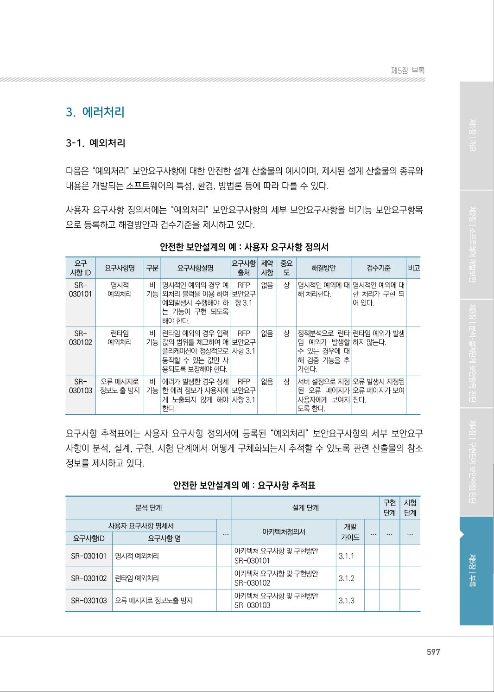
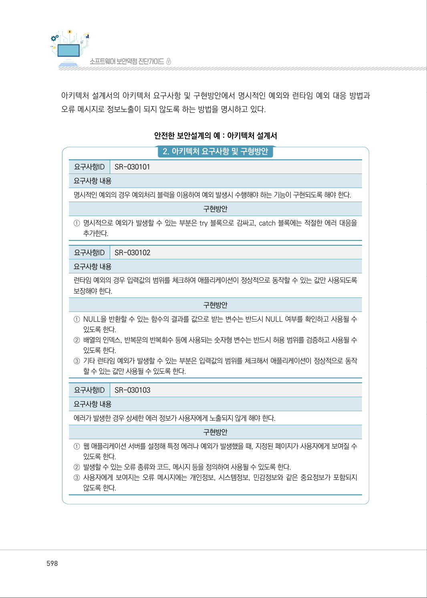
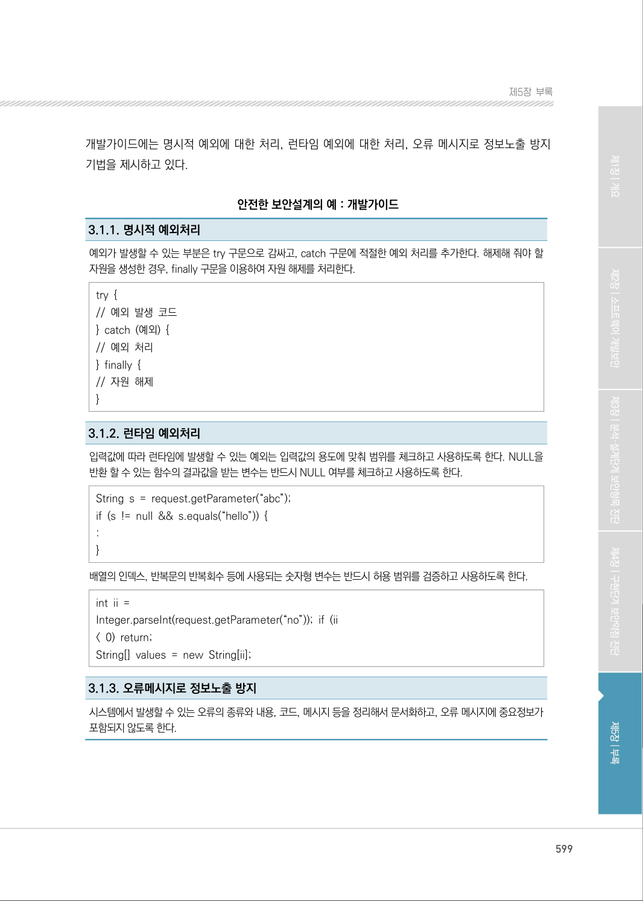
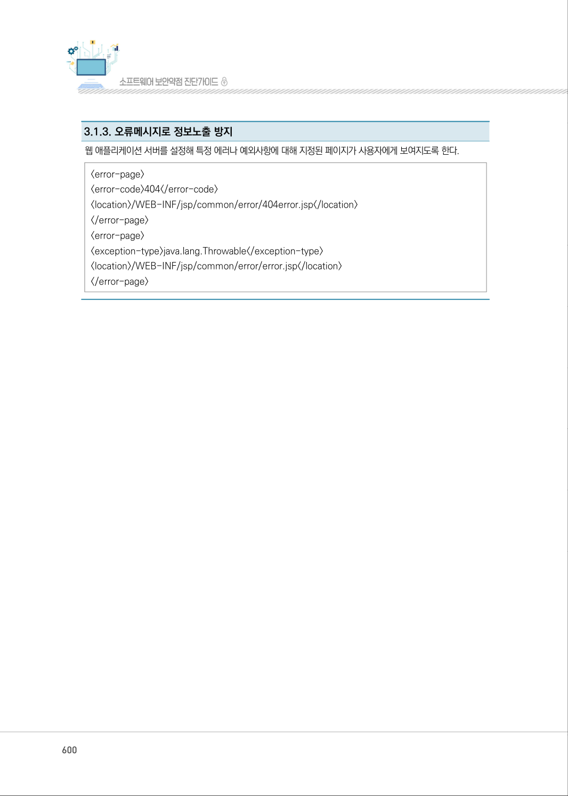

# 3-1. 예외처리

> 변환 안내(원문 외): 아래 본문은 PDF 텍스트를 추출한 전사입니다. 코드 줄번호·특수 공백·원문 오류를 유지했습니다. 실행용 코드가 아닙니다. 표·그림·들여쓰기는 연결된 페이지 이미지와 대조하세요. 페이지 경계의 줄바꿈을 보존하며, 동일 페이지가 여러 항목에 나뉘면 각 항목의 본문은 해당 구간만 포함합니다.

### PDF 597페이지 / 인쇄 597페이지

<!-- source-page:SW-Diagnosis-2021:597; source-lines:0,3,4,5,6,7,8,9,10,11,12,13,14,15,16,17,18,19,20,21,22,23,24,25,26,27,28,29,30,31,32,33,34,35,36,37,38,39,40,41,42,43,44,45,46,47,48,49,50,51,52,53,54,55,56,57,58,59,60,61,62,63,64,65,66,67,68,69,70,71,72,73,74,75,76,77,78,79,80,81,82,83,84,85,86,87,88,89,90,91,92,93,94,95,96,97,98,99,100,101,102,103,104,105,106,107,108,109,110,111,112,113,114,115,116,117,118,119,120,121,122,123 -->

597

3-1. 예외처리

다음은 “예외처리” 보안요구사항에 대한 안전한 설계 산출물의 예시이며, 제시된 설계 산출물의 종류와 
내용은 개발되는 소프트웨어의 특성, 환경, 방법론 등에 따라 다를 수 있다.

사용자 요구사항 정의서에는 “예외처리” 보안요구사항의 세부 보안요구사항을 비기능 보안요구항목 
으로 등록하고 해결방안과 검수기준을 제시하고 있다.

안전한 보안설계의 예 : 사용자 요구사항 정의서

```text
요구
사항 ID
요구사항명 
구분 
요구사항설명 
요구사항 
출처
제약 
사항
중요 
도
해결방안
검수기준
비고
SR-
030101
명시적 
예외처리
비 
기능
명시적인 예외의 경우 예
외처리 블럭을 이용 하여 
예외발생시 수행해야 하
는 기능이 구현 되도록 
해야 한다.
RFP 
보안요구 
항 3.1
없음 
상
명시적인 예외에 대
해 처리한다.
명시적인 예외에 대
한 처리가 구현 되
어 있다.
SR-
030102
런타임 
예외처리
비 
기능
런타임 예외의 경우 입력
값의 범위를 체크하여 애
플리케이션이 정상적으로 
동작할 수 있는 값만 사
용되도록 보장해야 한다.
RFP 
보안요구 
사항 3.1
없음 
상
정적분석으로 런타
임 예외가 발생할 
수 있는 경우에 대
해 검증 기능을 추
가한다.
런타임 예외가 발생 
하지 않는다.
SR-
030103
오류 메시지로 
정보노 출 방지
비 
기능
에러가 발생한 경우 상세
한 에러 정보가 사용자에
게 노출되지 않게 해야 
한다.
RFP 
보안요구 
사항 3.1
없음 
상
서버 설정으로 지정
된 오류 페이지가 
사용자에게 보여지
도록 한다.
오류 발생시 지정된 
오류 페이지가 보여 
진다.
```

요구사항 추적표에는 사용자 요구사항 정의서에 등록된 “예외처리” 보안요구사항의 세부 보안요구 
사항이 분석, 설계, 구현, 시험 단계에서 어떻게 구체화되는지 추적할 수 있도록 관련 산출물의 참조 
정보를 제시하고 있다.

안전한 보안설계의 예 : 요구사항 추적표

```text
분석 단계
설계 단계
구현 
단계
시험 
단계
사용자 요구사항 명세서
...
아키텍처정의서
개발 
가이드
...
...
...
요구사항ID
요구사항 명
SR-030101
명시적 예외처리 
아키텍처 요구사항 및 구현방안 
SR-030101
3.1.1
SR-030102
런타임 예외처리 
아키텍처 요구사항 및 구현방안 
SR-030102
3.1.2
SR-030103
오류 메시지로 정보노출 방지
아키텍처 요구사항 및 구현방안 
SR-030103
3.1.3
```

<details><summary>원본 페이지 이미지 (변환 외 보존 자료)</summary>



</details>

### PDF 598페이지 / 인쇄 598페이지

<!-- source-page:SW-Diagnosis-2021:598; source-lines:0,1,2,3,4,5,6,7,8,9,10,11,12,13,14,15,16,17,18,19,20,21,22,23,24,25,26,27,28,29,30,31,32,33 -->

598

아키텍처 설계서의 아키텍처 요구사항 및 구현방안에서 명시적인 예외와 런타임 예외 대응 방법과 
오류 메시지로 정보노출이 되지 않도록 하는 방법을 명시하고 있다.

안전한 보안설계의 예 : 아키텍처 설계서

#### 2. 아키텍처 요구사항 및 구형방안

요구사항ID

SR-030101

요구사항 내용
명시적인 예외의 경우 예외처리 블럭을 이용하여 예외 발생시 수행해야 하는 기능이 구현되도록 해야 한다.

구현방안

①명시적으로 예외가 발생할 수 있는 부분은 try 블록으로 감싸고, catch 블록에는 적절한 에러 대응을 

추가한다.

요구사항ID

SR-030102

요구사항 내용
런타임 예외의 경우 입력값의 범위를 체크하여 애플리케이션이 정상적으로 동작할 수 있는 값만 사용되도록 
보장해야 한다.

구현방안

①NULL을 반환할 수 있는 함수의 결과를 값으로 받는 변수는 반드시 NULL 여부를 확인하고 사용될 수 

있도록 한다.
②배열의 인덱스, 반복문의 반복회수 등에 사용되는 숫자형 변수는 반드시 허용 범위를 검증하고 사용될 수 

있도록 한다.
③기타 런타임 예외가 발생할 수 있는 부분은 입력값의 범위를 체크해서 애플리케이션이 정상적으로 동작

할 수 있는 값만 사용될 수 있도록 한다.

요구사항ID

SR-030103

요구사항 내용
에러가 발생한 경우 상세한 에러 정보가 사용자에게 노출되지 않게 해야 한다.

구현방안

①웹 애플리케이션 서버를 설정해 특정 에러나 예외가 발생했을 때, 지정된 페이지가 사용자에게 보여질 수 

있도록 한다.
②발생할 수 있는 오류 종류와 코드, 메시지 등을 정의하여 사용될 수 있도록 한다. 
③사용자에게 보여지는 오류 메시지에는 개인정보, 시스템정보, 민감정보와 같은 중요정보가 포함되지 

않도록 한다.

<details><summary>원본 페이지 이미지 (변환 외 보존 자료)</summary>



</details>

### PDF 599페이지 / 인쇄 599페이지

<!-- source-page:SW-Diagnosis-2021:599; source-lines:0,1,2,3,4,5,6,7,8,9,10,11,12,13,14,15,16,17,18,19,20,21,22,23,24,25,26,27,28,29 -->

599

제5장부록

개발가이드에는 명시적 예외에 대한 처리, 런타임 예외에 대한 처리, 오류 메시지로 정보노출 방지 
기법을 제시하고 있다.

안전한 보안설계의 예 : 개발가이드

3.1.1. 명시적 예외처리
예외가 발생할 수 있는 부분은 try 구문으로 감싸고, catch 구문에 적절한 예외 처리를 추가한다. 해제해 줘야 할 
자원을 생성한 경우, finally 구문을 이용하여 자원 해제를 처리한다.
try { 
// 예외 발생 코드 
} catch (예외) { 
// 예외 처리 
} finally { 
// 자원 해제 
} 

3.1.2. 런타임 예외처리
입력값에 따라 런타임에 발생할 수 있는 예외는 입력값의 용도에 맞춰 범위를 체크하고 사용하도록 한다. NULL을 
반환 할 수 있는 함수의 결과값을 받는 변수는 반드시 NULL 여부를 체크하고 사용하도록 한다.
String s = request.getParameter(“abc”); 
if (s != null &amp;&amp; s.equals(“hello”)) { 
: 
} 
배열의 인덱스, 반복문의 반복회수 등에 사용되는 숫자형 변수는 반드시 허용 범위를 검증하고 사용하도록 한다.
int ii =
Integer.parseInt(request.getParameter(“no”)); if (ii
&lt; 0) return; 
String[] values = new String[ii];

3.1.3. 오류메시지로 정보노출 방지
시스템에서 발생할 수 있는 오류의 종류와 내용, 코드, 메시지 등을 정리해서 문서화하고, 오류 메시지에 중요정보가 
포함되지 않도록 한다.

<details><summary>원본 페이지 이미지 (변환 외 보존 자료)</summary>



</details>

### PDF 600페이지 / 인쇄 600페이지

<!-- source-page:SW-Diagnosis-2021:600; source-lines:0,1,2,3,4,5,6,7,8,9,10 -->

600

3.1.3. 오류메시지로 정보노출 방지
웹 애플리케이션 서버를 설정해 특정 에러나 예외사항에 대해 지정된 페이지가 사용자에게 보여지도록 한다.
&lt;error-page&gt;
&lt;error-code&gt;404&lt;/error-code&gt;
&lt;location&gt;/WEB-INF/jsp/common/error/404error.jsp&lt;/location&gt;
&lt;/error-page&gt;
&lt;error-page&gt;
&lt;exception-type&gt;java.lang.Throwable&lt;/exception-type&gt;
&lt;location&gt;/WEB-INF/jsp/common/error/error.jsp&lt;/location&gt;
&lt;/error-page&gt;

<details><summary>원본 페이지 이미지 (변환 외 보존 자료)</summary>



</details>

### PDF 601페이지 / 인쇄 601페이지

<!-- source-page:SW-Diagnosis-2021:601; source-lines:1,2 -->

제5장부록

#### 4. 세션통제

<details><summary>원본 페이지 이미지 (변환 외 보존 자료)</summary>


</details>

---

## 탐색 링크 (원문 외)

[통합 인덱스](../../../INDEX.md)

