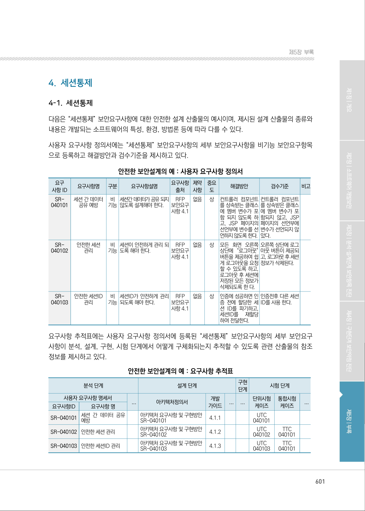
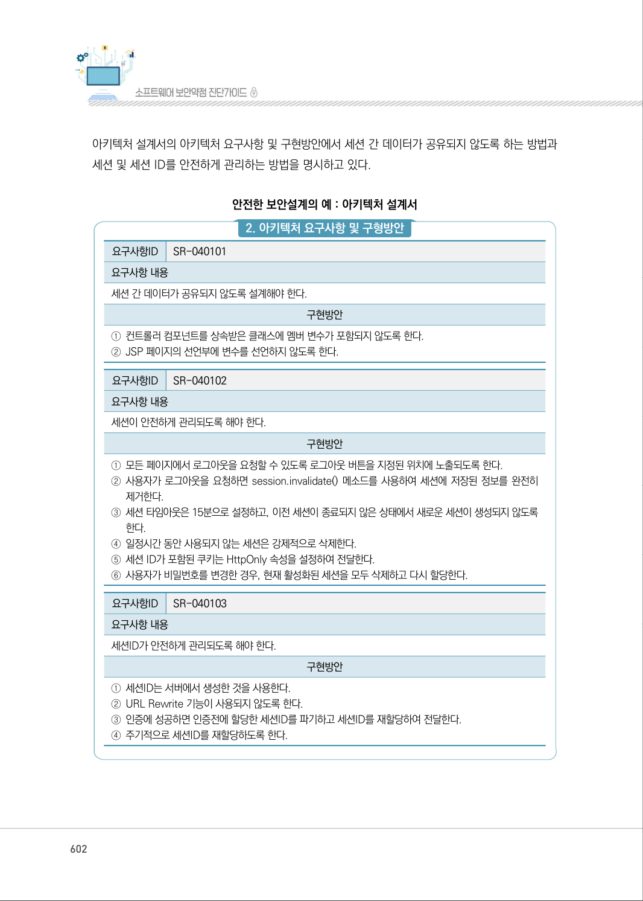
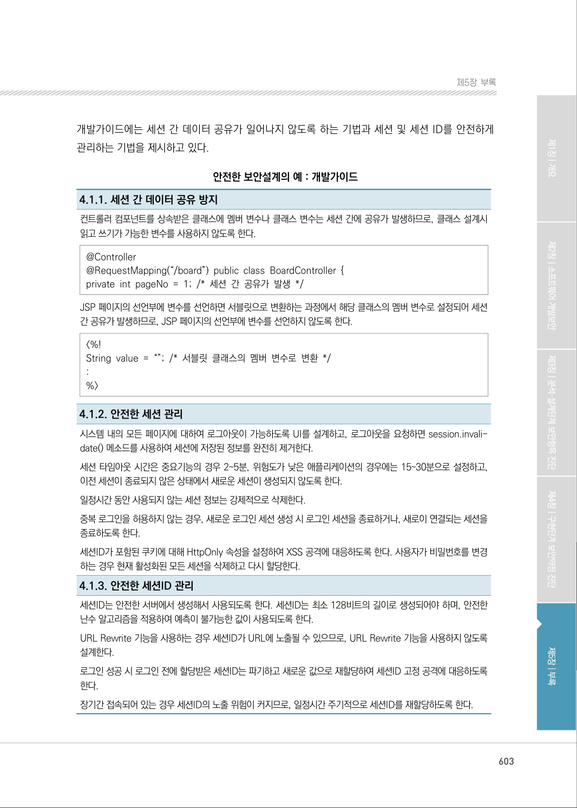
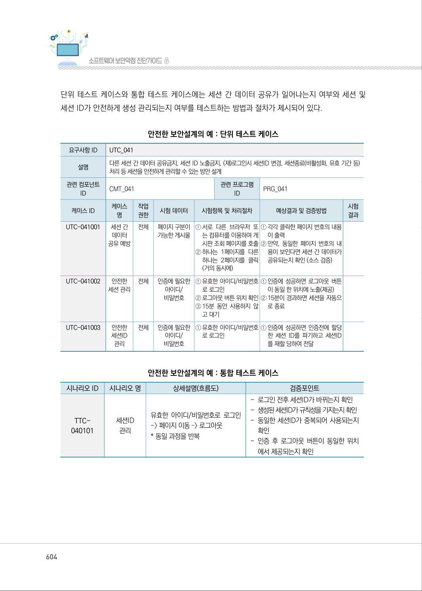
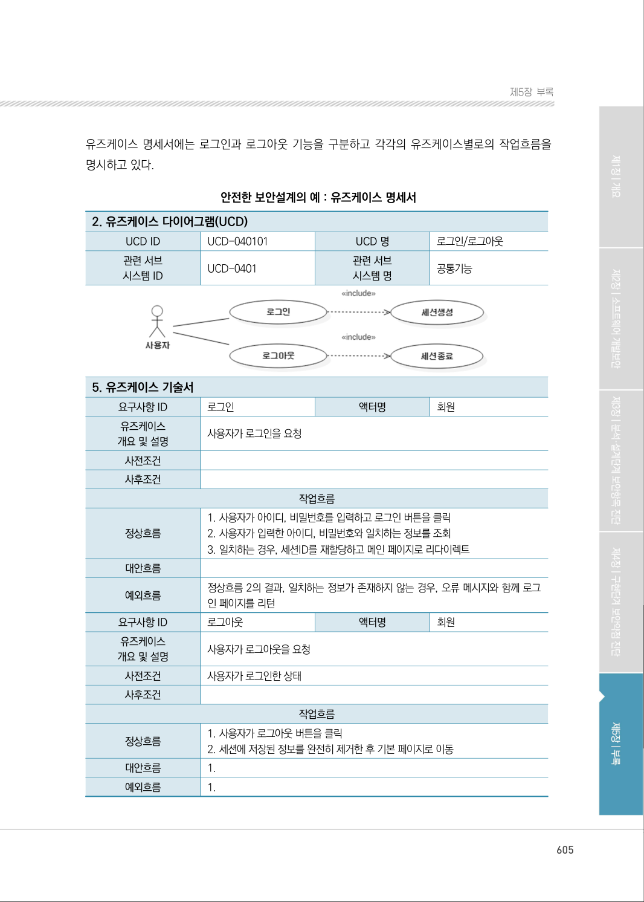
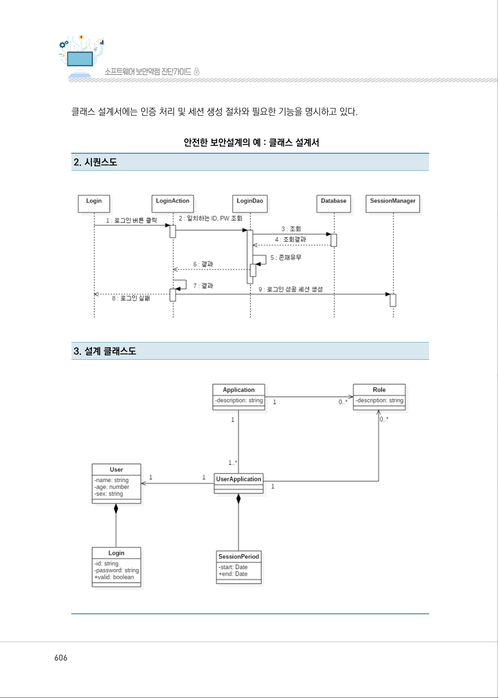
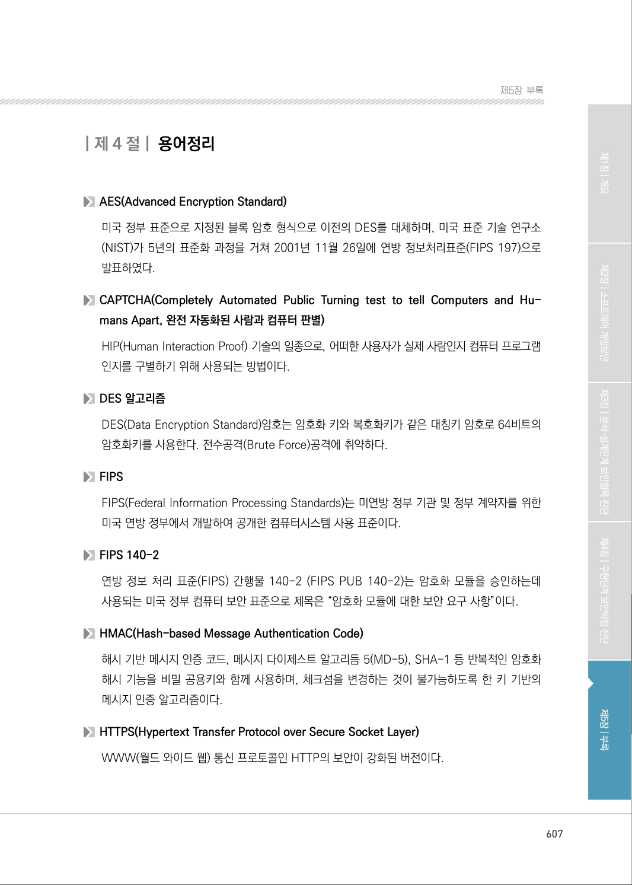

# 4-1. 세션통제

> 변환 안내(원문 외): 아래 본문은 PDF 텍스트를 추출한 전사입니다. 코드 줄번호·특수 공백·원문 오류를 유지했습니다. 실행용 코드가 아닙니다. 표·그림·들여쓰기는 연결된 페이지 이미지와 대조하세요. 페이지 경계의 줄바꿈을 보존하며, 동일 페이지가 여러 항목에 나뉘면 각 항목의 본문은 해당 구간만 포함합니다.

### PDF 601페이지 / 인쇄 601페이지

<!-- source-page:SW-Diagnosis-2021:601; source-lines:0,3,4,5,6,7,8,9,10,11,12,13,14,15,16,17,18,19,20,21,22,23,24,25,26,27,28,29,30,31,32,33,34,35,36,37,38,39,40,41,42,43,44,45,46,47,48,49,50,51,52,53,54,55,56,57,58,59,60,61,62,63,64,65,66,67,68,69,70,71,72,73,74,75,76,77,78,79,80,81,82,83,84,85,86,87,88,89,90,91,92,93,94,95,96,97,98,99,100,101,102,103,104,105,106,107,108,109,110,111,112,113,114,115,116,117,118,119,120,121,122,123,124,125,126,127,128,129,130,131,132,133,134,135,136,137,138,139,140,141 -->

601

4-1. 세션통제
다음은 “세션통제” 보안요구사항에 대한 안전한 설계 산출물의 예시이며, 제시된 설계 산출물의 종류와 
내용은 개발되는 소프트웨어의 특성, 환경, 방법론 등에 따라 다를 수 있다.
사용자 요구사항 정의서에는 “세션통제” 보안요구사항의 세부 보안요구사항을 비기능 보안요구항목
으로 등록하고 해결방안과 검수기준을 제시하고 있다.

안전한 보안설계의 예 : 사용자 요구사항 정의서

```text
요구
사항 ID
요구사항명 
구분 
요구사항설명 
요구사항 
출처
제약 
사항
중요 
도
해결방안
검수기준
비고
SR-
040101
세션 간 데이터 
공유 예방
비 
기능
세션간 데이터가 공유 되지 
않도록 설계해야 한다.
RFP 
보안요구 
사항 4.1
없음 
상
컨트롤러 컴포넌트 
를 상속받는 클래스
에 멤버 변수가 포
함 되지 않도록 하
고, JSP 페이지의 
선언부에 변수를 선
언하지 않도록 한다.
컨트롤러 컴포넌트
를 상속받은 클래스
에 멤버 변수가 포
함되지 않고, JSP 
페이지의 선언부에 
변수가 선언되지 않
았다.
SR-
040102
안전한 세션 
관리
비 
기능
세션이 안전하게 관리 되
도록 해야 한다.
RFP 
보안요구 
사항 4.1
없음 
상
모든 화면 오른쪽 
상단에 “로그아웃” 
버튼을 제공하여 쉽
게 로그아웃을 요청
할 수 있도록 하고, 
로그아웃 후 세션에 
저장된 모든 정보가 
삭제되도록 한 다.
오른쪽 상단에 로그
아웃 버튼이 제공되
고, 로그아웃 후 세션 
정보가 삭제된다.
SR-
040103
안전한 세션ID 
관리
비 
기능
세션ID가 안전하게 관리 
되도록 해야 한다.
RFP 
보안요구 
사항 4.1
없음 
상
인증에 성공하면 인
증 전에 할당한 세
션 ID를 파기하고, 
세션ID를 
재할당 
하여 전달한다.
인증전후 다른 세션
ID를 사용 한다.
```

요구사항 추적표에는 사용자 요구사항 정의서에 등록된 “세션통제” 보안요구사항의 세부 보안요구 
사항이 분석, 설계, 구현, 시험 단계에서 어떻게 구체화되는지 추적할 수 있도록 관련 산출물의 참조 
정보를 제시하고 있다.

안전한 보안설계의 예 : 요구사항 추적표

```text
분석 단계
설계 단계
구현 
단계
시험 단계
사용자 요구사항 명세서
...
아키텍처정의서
개발 
가이드
...
...
단위시험
케이즈
통합시험
케이즈
...
요구사항ID
요구사항 명
SR-040101 세션 간 데이터 공유 
예방
아키텍처 요구사항 및 구현방안 
SR-040101
4.1.1
UTC 
040101
SR-040102 안전한 세션 관리
아키텍처 요구사항 및 구현방안 
SR-040102 
4.1.2
UTC 
040102
TTC 
040101
SR-040103 안전한 세션ID 관리
아키텍처 요구사항 및 구현방안 
SR-040103 
4.1.3
UTC 
040103
TTC 
040101
```

<details><summary>원본 페이지 이미지 (변환 외 보존 자료)</summary>



</details>

### PDF 602페이지 / 인쇄 602페이지

<!-- source-page:SW-Diagnosis-2021:602; source-lines:0,1,2,3,4,5,6,7,8,9,10,11,12,13,14,15,16,17,18,19,20,21,22,23,24,25,26,27,28,29,30,31,32,33 -->

602

아키텍처 설계서의 아키텍처 요구사항 및 구현방안에서 세션 간 데이터가 공유되지 않도록 하는 방법과 
세션 및 세션 ID를 안전하게 관리하는 방법을 명시하고 있다.

안전한 보안설계의 예 : 아키텍처 설계서

#### 2. 아키텍처 요구사항 및 구형방안

요구사항ID

SR-040101

요구사항 내용
세션 간 데이터가 공유되지 않도록 설계해야 한다.

구현방안

①컨트롤러 컴포넌트를 상속받은 클래스에 멤버 변수가 포함되지 않도록 한다.
②JSP 페이지의 선언부에 변수를 선언하지 않도록 한다.

요구사항ID

SR-040102

요구사항 내용
세션이 안전하게 관리되도록 해야 한다.

구현방안

①모든 페이지에서 로그아웃을 요청할 수 있도록 로그아웃 버튼을 지정된 위치에 노출되도록 한다.
②사용자가 로그아웃을 요청하면 session.invalidate() 메소드를 사용하여 세션에 저장된 정보를 완전히 

제거한다.
③세션 타임아웃은 15분으로 설정하고, 이전 세션이 종료되지 않은 상태에서 새로운 세션이 생성되지 않도록 

한다.
④일정시간 동안 사용되지 않는 세션은 강제적으로 삭제한다.
⑤세션 ID가 포함된 쿠키는 HttpOnly 속성을 설정하여 전달한다.
⑥사용자가 비밀번호를 변경한 경우, 현재 활성화된 세션을 모두 삭제하고 다시 할당한다.

요구사항ID

SR-040103

요구사항 내용
세션ID가 안전하게 관리되도록 해야 한다.

구현방안

①세션ID는 서버에서 생성한 것을 사용한다.
②URL Rewrite 기능이 사용되지 않도록 한다.
③인증에 성공하면 인증전에 할당한 세션ID를 파기하고 세션ID를 재할당하여 전달한다.
④주기적으로 세션ID를 재할당하도록 한다.

<details><summary>원본 페이지 이미지 (변환 외 보존 자료)</summary>



</details>

### PDF 603페이지 / 인쇄 603페이지

<!-- source-page:SW-Diagnosis-2021:603; source-lines:0,1,2,3,4,5,6,7,8,9,10,11,12,13,14,15,16,17,18,19,20,21,22,23,24,25,26,27,28,29,30,31,32,33,34 -->

603

제5장부록

개발가이드에는 세션 간 데이터 공유가 일어나지 않도록 하는 기법과 세션 및 세션 ID를 안전하게 
관리하는 기법을 제시하고 있다.

안전한 보안설계의 예 : 개발가이드

4.1.1. 세션 간 데이터 공유 방지
컨트롤러 컴포넌트를 상속받은 클래스에 멤버 변수나 클래스 변수는 세션 간에 공유가 발생하므로, 클래스 설계시 
읽고 쓰기가 가능한 변수를 사용하지 않도록 한다.
@Controller
@RequestMapping(“/board”) public class BoardController { 
private int pageNo = 1; /* 세션 간 공유가 발생 */
JSP 페이지의 선언부에 변수를 선언하면 서블릿으로 변환하는 과정에서 해당 클래스의 멤버 변수로 설정되어 세션 
간 공유가 발생하므로, JSP 페이지의 선언부에 변수를 선언하지 않도록 한다.
&lt;%! 
String value = “”; /* 서블릿 클래스의 멤버 변수로 변환 */ 
: 
%&gt;

4.1.2. 안전한 세션 관리
시스템 내의 모든 페이지에 대하여 로그아웃이 가능하도록 UI를 설계하고, 로그아웃을 요청하면 session.invali- 
date() 메소드를 사용하여 세션에 저장된 정보를 완전히 제거한다.
세션 타임아웃 시간은 중요기능의 경우 2~5분, 위험도가 낮은 애플리케이션의 경우에는 15~30분으로 설정하고, 
이전 세션이 종료되지 않은 상태에서 새로운 세션이 생성되지 않도록 한다.
일정시간 동안 사용되지 않는 세션 정보는 강제적으로 삭제한다.
중복 로그인을 허용하지 않는 경우, 새로운 로그인 세션 생성 시 로그인 세션을 종료하거나, 새로이 연결되는 세션을 
종료하도록 한다.
세션ID가 포함된 쿠키에 대해 HttpOnly 속성을 설정하여 XSS 공격에 대응하도록 한다. 사용자가 비밀번호를 변경
하는 경우 현재 활성화된 모든 세션을 삭제하고 다시 할당한다.
4.1.3. 안전한 세션ID 관리
세션ID는 안전한 서버에서 생성해서 사용되도록 한다. 세션ID는 최소 128비트의 길이로 생성되어야 하며, 안전한 
난수 알고리즘을 적용하여 예측이 불가능한 값이 사용되도록 한다.
URL Rewrite 기능을 사용하는 경우 세션ID가 URL에 노출될 수 있으므로, URL Rewrite 기능을 사용하지 않도록 
설계한다.
로그인 성공 시 로그인 전에 할당받은 세션ID는 파기하고 새로운 값으로 재할당하여 세션ID 고정 공격에 대응하도록 
한다.
장기간 접속되어 있는 경우 세션ID의 노출 위험이 커지므로, 일정시간 주기적으로 세션ID를 재할당하도록 한다.

<details><summary>원본 페이지 이미지 (변환 외 보존 자료)</summary>



</details>

### PDF 604페이지 / 인쇄 604페이지

<!-- source-page:SW-Diagnosis-2021:604; source-lines:0,1,2,3,4,5,6,7,8,9,10,11,12,13,14,15,16,17,18,19,20,21,22,23,24,25,26,27,28,29,30,31,32,33,34,35,36,37,38,39,40,41,42,43,44,45,46,47,48,49,50,51,52,53,54,55,56,57,58,59,60,61,62,63,64,65,66,67,68,69,70,71,72,73,74,75,76,77,78,79,80,81,82,83,84,85,86,87,88,89 -->

604

단위 테스트 케이스와 통합 테스트 케이스에는 세션 간 데이터 공유가 일어나는지 여부와 세션 및 
세션 ID가 안전하게 생성 관리되는지 여부를 테스트하는 방법과 절차가 제시되어 있다.

안전한 보안설계의 예 : 단위 테스트 케이스

```text
요구사항 ID
UTC_041
설명
다른 세션 간 데이터 공유금지, 세션 ID 노출금지, (재)로그인시 세션ID 변경, 세션종료(비활성화, 유효 기간 등) 
처리 등 세션을 안전하게 관리할 수 있는 방안 설계
관련 컴포넌트 
ID
CMT_041 
관련 프로그램 
ID
PRG_041
케이스 ID
케이스 
명
작업 
권한 
시험 데이터
시험항목 및 처리절차 
예상결과 및 검증방법 
시험
결과
UTC-041001
세션 간 
데이터 
공유 예방
전체 
페이지 구분이 
가능한 게시물
①서로 다른 브라우저 또 
는 컴퓨터를 이용하여 게
시판 조회 페이지를 호출 
②하나는 1페이지를 다른 
하나는 2페이지를 클릭 
(거의 동시에)
①각각 클릭한 페이지 번호의 내용
이 출력
②만약, 동일한 페이지 번호의 내
용이 보인다면 세션 간 데이터가 
공유되는지 확인 (소스 검증)
UTC-041002
안전한 
세션 관리 
전체 
인증에 필요한 
아이디/
비밀번호
①유효한 아이디/비밀번호
로 로그인
②로그아웃 버튼 위치 확인 
③15분 동안 사용하지 않
고 대기
①인증에 성공하면 로그아웃 버튼
이 동일 한 위치에 노출(제공) 
②15분이 경과하면 세션을 자동으
로 종료
UTC-041003
안전한 
세션ID 
관리
전체 
인증에 필요한 
아이디/
비밀번호
①유효한 아이디/비밀번호
로 로그인
①인증에 성공하면 인증전에 할당
한 세션 ID를 파기하고 세션ID
를 재할 당하여 전달
```

안전한 보안설계의 예 : 통합 테스트 케이스

|  |  |  |  |
| --- | --- | --- | --- |
| 시나리오 ID | 시나리오 명 | 상세설명(흐름도) | 검증포인트 |
| TTC-<br>040101 | 세션ID<br>관리 | 유효한 아이디/비밀번호로 로그인<br>-> 페이지 이동 –> 로그아웃<br>* 동일 과정을 반복 | - 로그인 전후 세션ID가 바뀌는지 확인<br>- 생성된 세션ID가 규칙성을 가지는지 확인<br>- 동일한 세션ID가 중복되어 사용되는지<br>확인<br>- 인증 후 로그아웃 버튼이 동일한 위치<br>에서 제공되는지 확인 |

<details><summary>원본 페이지 이미지 (변환 외 보존 자료)</summary>



</details>

### PDF 605페이지 / 인쇄 605페이지

<!-- source-page:SW-Diagnosis-2021:605; source-lines:0,1,2,3,4,5,6,7,8,9,10,11,12,13,14,15,16,17,18,19,20,21,22,23,24,25,26,27,28,29,30,31,32,33,34,35,36,37,38,39,40,41,42,43,44,45,46,47,48,49,50,51,52 -->

605

제5장부록

유즈케이스 명세서에는 로그인과 로그아웃 기능을 구분하고 각각의 유즈케이스별로의 작업흐름을 
명시하고 있다.

안전한 보안설계의 예 : 유즈케이스 명세서

#### 2. 유즈케이스 다이어그램(UCD)

|  |  |  |  |
| --- | --- | --- | --- |
| UCD ID | UCD-040101 | UCD 명 | 로그인/로그아웃 |
| 관련 서브<br>시스템 ID | UCD-0401 | 관련 서브<br>시스템 명 | 공통기능 |

#### 5. 유즈케이스 기술서

```text
요구사항 ID
로그인 
액터명
회원
유즈케이스
개요 및 설명
사용자가 로그인을 요청
사전조건
사후조건
```

작업흐름

```text
정상흐름
1. 사용자가 아이디, 비밀번호를 입력하고 로그인 버튼을 클릭
2. 사용자가 입력한 아이디, 비밀번호와 일치하는 정보를 조회
3. 일치하는 경우, 세션ID를 재할당하고 메인 페이지로 리다이렉트
대안흐름
예외흐름
정상흐름 2의 결과, 일치하는 정보가 존재하지 않는 경우, 오류 메시지와 함께 로그
인 페이지를 리턴
요구사항 ID
로그아웃
액터명
회원
유즈케이스
개요 및 설명
사용자가 로그아웃을 요청
사전조건
사용자가 로그인한 상태
사후조건
```

작업흐름

|  |  |
| --- | --- |
| 정상흐름 | 1. 사용자가 로그아웃 버튼을 클릭<br>2. 세션에 저장된 정보를 완전히 제거한 후 기본 페이지로 이동 |
| 대안흐름 | 1. |
| 예외흐름 | 1. |

<details><summary>원본 페이지 이미지 (변환 외 보존 자료)</summary>



</details>

### PDF 606페이지 / 인쇄 606페이지

<!-- source-page:SW-Diagnosis-2021:606; source-lines:0,1,2,3,4 -->

606

클래스 설계서에는 인증 처리 및 세션 생성 절차와 필요한 기능을 명시하고 있다.

안전한 보안설계의 예 : 클래스 설계서

#### 2. 시퀀스도

#### 3. 설계 클래스도

<details><summary>원본 페이지 이미지 (변환 외 보존 자료)</summary>



</details>

### PDF 607페이지 / 인쇄 607페이지

<!-- source-page:SW-Diagnosis-2021:607; source-lines:1 -->

제5장부록

<details><summary>원본 페이지 이미지 (변환 외 보존 자료)</summary>



</details>

---

## 탐색 링크 (원문 외)

[통합 인덱스](../../../INDEX.md)

