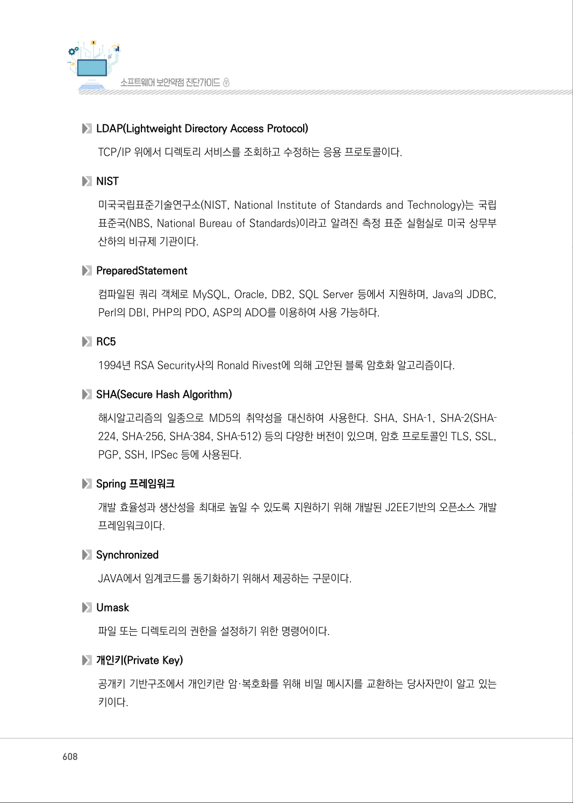
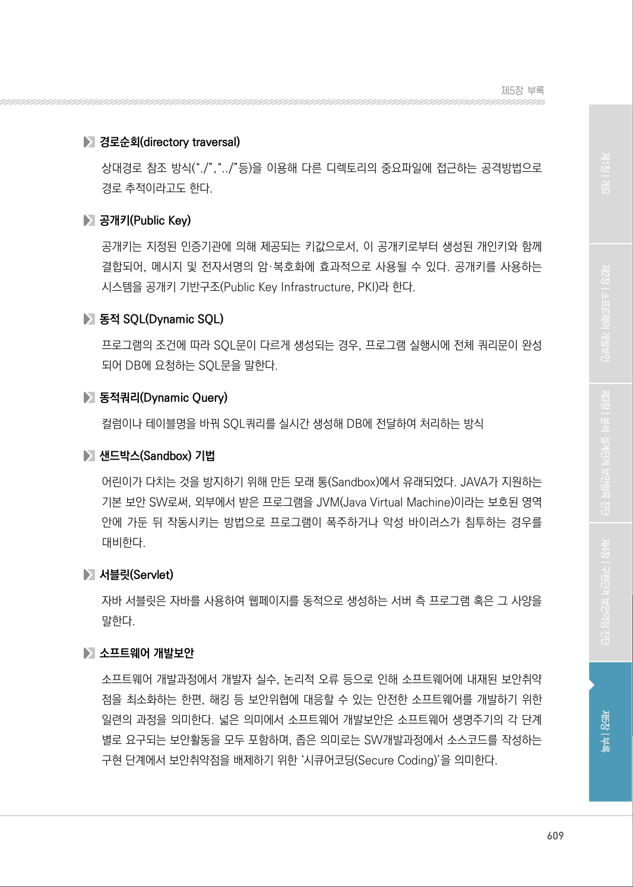
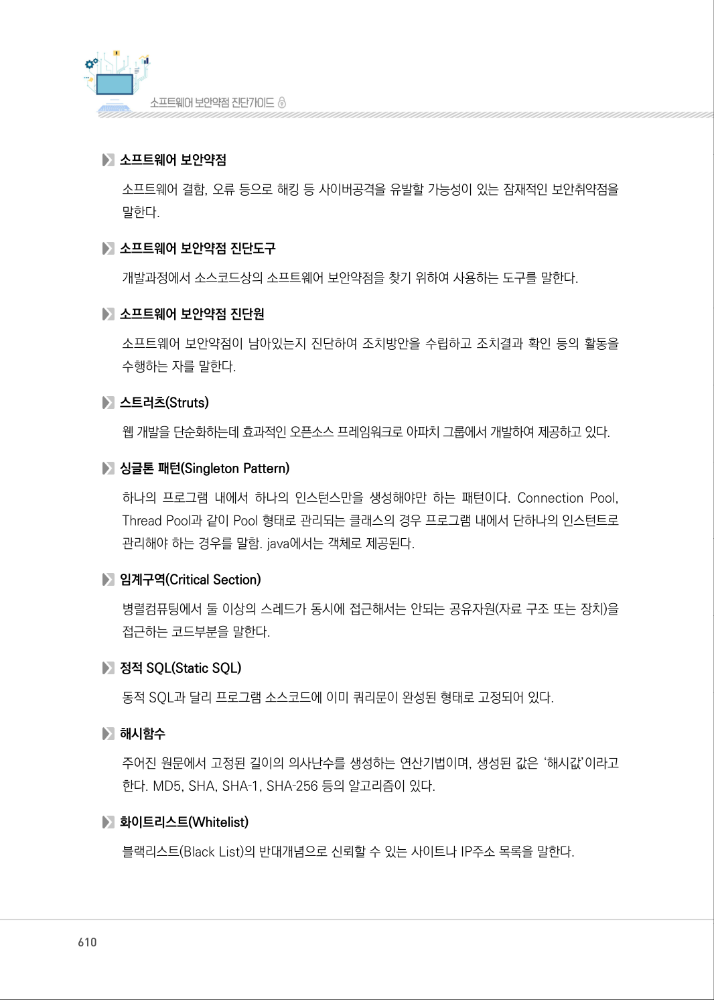

# 제4절 용어정리

> 변환 안내(원문 외): 아래 본문은 PDF 텍스트를 추출한 전사입니다. 코드 줄번호·특수 공백·원문 오류를 유지했습니다. 실행용 코드가 아닙니다. 표·그림·들여쓰기는 연결된 페이지 이미지와 대조하세요. 페이지 경계의 줄바꿈을 보존하며, 동일 페이지가 여러 항목에 나뉘면 각 항목의 본문은 해당 구간만 포함합니다.

### PDF 607페이지 / 인쇄 607페이지

<!-- source-page:SW-Diagnosis-2021:607; source-lines:0,2,3,4,5,6,7,8,9,10,11,12,13,14,15,16,17,18,19,20,21,22,23,24,25 -->

607

| 제4 절| 용어정리

AES(Advanced Encryption Standard)
미국 정부 표준으로 지정된 블록 암호 형식으로 이전의 DES를 대체하며, 미국 표준 기술 연구소 
(NIST)가 5년의 표준화 과정을 거쳐 2001년 11월 26일에 연방 정보처리표준(FIPS 197)으로 
발표하였다.

CAPTCHA(Completely Automated Public Turning test to tell Computers and Hu- 
mans Apart, 완전 자동화된 사람과 컴퓨터 판별)
HIP(Human Interaction Proof) 기술의 일종으로, 어떠한 사용자가 실제 사람인지 컴퓨터 프로그램
인지를 구별하기 위해 사용되는 방법이다.

DES 알고리즘
DES(Data Encryption Standard)암호는 암호화 키와 복호화키가 같은 대칭키 암호로 64비트의 
암호화키를 사용한다. 전수공격(Brute Force)공격에 취약하다.

FIPS
FIPS(Federal Information Processing Standards)는 미연방 정부 기관 및 정부 계약자를 위한 
미국 연방 정부에서 개발하여 공개한 컴퓨터시스템 사용 표준이다.

FIPS 140-2
연방 정보 처리 표준(FIPS) 간행물 140-2 (FIPS PUB 140-2)는 암호화 모듈을 승인하는데 
사용되는 미국 정부 컴퓨터 보안 표준으로 제목은 “암호화 모듈에 대한 보안 요구 사항”이다.

HMAC(Hash-based Message Authentication Code)
해시 기반 메시지 인증 코드, 메시지 다이제스트 알고리듬 5(MD-5), SHA-1 등 반복적인 암호화 
해시 기능을 비밀 공용키와 함께 사용하며, 체크섬을 변경하는 것이 불가능하도록 한 키 기반의 
메시지 인증 알고리즘이다.

HTTPS(Hypertext Transfer Protocol over Secure Socket Layer)
WWW(월드 와이드 웹) 통신 프로토콜인 HTTP의 보안이 강화된 버전이다.

원본 페이지 이미지 (변환 외 보존 자료)

### PDF 608페이지 / 인쇄 608페이지

<!-- source-page:SW-Diagnosis-2021:608; source-lines:0,1,2,3,4,5,6,7,8,9,10,11,12,13,14,15,16,17,18,19,20,21,22,23,24,25 -->

608

LDAP(Lightweight Directory Access Protocol)
TCP/IP 위에서 디렉토리 서비스를 조회하고 수정하는 응용 프로토콜이다.

NIST
미국국립표준기술연구소(NIST, National Institute of Standards and Technology)는 국립
표준국(NBS, National Bureau of Standards)이라고 알려진 측정 표준 실험실로 미국 상무부 
산하의 비규제 기관이다.

PreparedStatement
컴파일된 쿼리 객체로 MySQL, Oracle, DB2, SQL Server 등에서 지원하며, Java의 JDBC, 
Perl의 DBI, PHP의 PDO, ASP의 ADO를 이용하여 사용 가능하다.

RC5
1994년 RSA Security사의 Ronald Rivest에 의해 고안된 블록 암호화 알고리즘이다.

SHA(Secure Hash Algorithm)
해시알고리즘의 일종으로 MD5의 취약성을 대신하여 사용한다. SHA, SHA‐1, SHA‐2(SHA‐
224, SHA‐256, SHA‐384, SHA‐512) 등의 다양한 버전이 있으며, 암호 프로토콜인 TLS, SSL, 
PGP, SSH, IPSec 등에 사용된다.

Spring 프레임워크
개발 효율성과 생산성을 최대로 높일 수 있도록 지원하기 위해 개발된 J2EE기반의 오픈소스 개발 
프레임워크이다.

Synchronized
JAVA에서 임계코드를 동기화하기 위해서 제공하는 구문이다.

Umask
파일 또는 디렉토리의 권한을 설정하기 위한 명령어이다.

개인키(Private Key)
공개키 기반구조에서 개인키란 암·복호화를 위해 비밀 메시지를 교환하는 당사자만이 알고 있는 
키이다.

원본 페이지 이미지 (변환 외 보존 자료)

### PDF 609페이지 / 인쇄 609페이지

<!-- source-page:SW-Diagnosis-2021:609; source-lines:0,1,2,3,4,5,6,7,8,9,10,11,12,13,14,15,16,17,18,19,20,21,22,23,24,25,26,27 -->

609

제5장부록

경로순회(directory traversal)
상대경로 참조 방식(“./”,“../”등)을 이용해 다른 디렉토리의 중요파일에 접근하는 공격방법으로 
경로 추적이라고도 한다.

공개키(Public Key)
공개키는 지정된 인증기관에 의해 제공되는 키값으로서, 이 공개키로부터 생성된 개인키와 함께 
결합되어, 메시지 및 전자서명의 암·복호화에 효과적으로 사용될 수 있다. 공개키를 사용하는 
시스템을 공개키 기반구조(Public Key Infrastructure, PKI)라 한다.

동적 SQL(Dynamic SQL)
프로그램의 조건에 따라 SQL문이 다르게 생성되는 경우, 프로그램 실행시에 전체 쿼리문이 완성
되어 DB에 요청하는 SQL문을 말한다.

동적쿼리(Dynamic Query)
컬럼이나 테이블명을 바꿔 SQL쿼리를 실시간 생성해 DB에 전달하여 처리하는 방식

샌드박스(Sandbox) 기법
어린이가 다치는 것을 방지하기 위해 만든 모래 통(Sandbox)에서 유래되었다. JAVA가 지원하는 
기본 보안 SW로써, 외부에서 받은 프로그램을 JVM(Java Virtual Machine)이라는 보호된 영역 
안에 가둔 뒤 작동시키는 방법으로 프로그램이 폭주하거나 악성 바이러스가 침투하는 경우를 
대비한다.

서블릿(Servlet)
자바 서블릿은 자바를 사용하여 웹페이지를 동적으로 생성하는 서버 측 프로그램 혹은 그 사양을 
말한다.

소프트웨어 개발보안
소프트웨어 개발과정에서 개발자 실수, 논리적 오류 등으로 인해 소프트웨어에 내재된 보안취약
점을 최소화하는 한편, 해킹 등 보안위협에 대응할 수 있는 안전한 소프트웨어를 개발하기 위한 
일련의 과정을 의미한다. 넓은 의미에서 소프트웨어 개발보안은 소프트웨어 생명주기의 각 단계
별로 요구되는 보안활동을 모두 포함하며, 좁은 의미로는 SW개발과정에서 소스코드를 작성하는 
구현 단계에서 보안취약점을 배제하기 위한 ‘시큐어코딩(Secure Coding)’을 의미한다.

원본 페이지 이미지 (변환 외 보존 자료)

### PDF 610페이지 / 인쇄 610페이지

<!-- source-page:SW-Diagnosis-2021:610; source-lines:0,1,2,3,4,5,6,7,8,9,10,11,12,13,14,15,16,17,18,19,20,21,22,23,24 -->

610

소프트웨어 보안약점
소프트웨어 결함, 오류 등으로 해킹 등 사이버공격을 유발할 가능성이 있는 잠재적인 보안취약점을 
말한다.

소프트웨어 보안약점 진단도구
개발과정에서 소스코드상의 소프트웨어 보안약점을 찾기 위하여 사용하는 도구를 말한다.

소프트웨어 보안약점 진단원
소프트웨어 보안약점이 남아있는지 진단하여 조치방안을 수립하고 조치결과 확인 등의 활동을 
수행하는 자를 말한다.

스트러츠(Struts)
웹 개발을 단순화하는데 효과적인 오픈소스 프레임워크로 아파치 그룹에서 개발하여 제공하고 있다.

싱글톤 패턴(Singleton Pattern)
하나의 프로그램 내에서 하나의 인스턴스만을 생성해야만 하는 패턴이다. Connection Pool, 
Thread Pool과 같이 Pool 형태로 관리되는 클래스의 경우 프로그램 내에서 단하나의 인스턴트로 
관리해야 하는 경우를 말함. java에서는 객체로 제공된다.

임계구역(Critical Section)
병렬컴퓨팅에서 둘 이상의 스레드가 동시에 접근해서는 안되는 공유자원(자료 구조 또는 장치)을 
접근하는 코드부분을 말한다.

정적 SQL(Static SQL)
동적 SQL과 달리 프로그램 소스코드에 이미 쿼리문이 완성된 형태로 고정되어 있다.

해시함수
주어진 원문에서 고정된 길이의 의사난수를 생성하는 연산기법이며, 생성된 값은 ‘해시값’이라고 
한다. MD5, SHA, SHA‐1, SHA‐256 등의 알고리즘이 있다.

화이트리스트(Whitelist)
블랙리스트(Black List)의 반대개념으로 신뢰할 수 있는 사이트나 IP주소 목록을 말한다.

원본 페이지 이미지 (변환 외 보존 자료)

---

## 탐색 링크 (원문 외)

[통합 인덱스](../../../INDEX.md)

