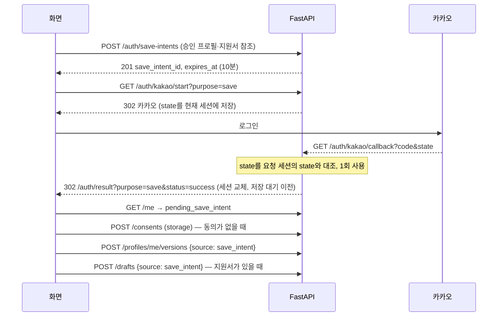

# API 계약 (W01-02)

> 기준일: 2026-10-15 · 담당: C(백엔드·보안), 협력 A(기획·프론트엔드) · 관련 이슈: #5 → 후속 #11(W02-04), #15(W02-08)

[`openapi.yaml`](openapi.yaml)이 프론트엔드·백엔드·모델 연동이 함께 쓰는 API 계약의 원본이다. 화면은 이 파일에 있는 경로만 호출한다.

| 단계 | 범위 |
|---|---|
| 1차 (#116) | 공통 규칙(오류·헤더·CSRF·멱등 키), [계획 §5](../../Plan/Implementation_Plan.md#5-개발-전에-보완할-계약) 보완 계약, 그 계약이 걸린 경로 |
| 2차 | [03 §3](../../Plan/03_Architecture_and_Dependencies.md#3-api-계약)의 나머지 경로 입출력과 정상·누락·409·429 예제, 지역 목록·운영자 공고 상세 |

03 §3의 경로 46개가 모두 들어 있다. 여기에 지역 목록(`GET /regions`), 운영자 공고 상세(`GET /admin/opportunities/{id}`), 내부 health 2개가 더 있다.

#87 회원 화면 연결에서는 `GET /consents/notices`(명시적으로 게시한 현재 안내문)와 `DELETE /auth/save-intents/{save_intent_id}`(현재 세션의 정확한 저장 대기 폐기)를 보완했다. 안내문 조회는 동의가 아니며, 취소는 이미 저장한 자료·동의·로그인을 되돌리지 않는다. 회원 취소는 저장과 같은 소유자 잠금으로 직렬화한다.

로컬 검사:

```bash
npx -y @redocly/cli@2.56.1 lint --config docs/api/redocly.yaml
```

검사 규칙은 Redocly `recommended`이고, 예제가 스키마와 맞는지도 확인한다. 의도한 예외는 [`.redocly.lint-ignore.yaml`](.redocly.lint-ignore.yaml)에 위치별로 적었다.

- 성공 응답이 302뿐인 카카오 시작·콜백, 4xx가 없는 내부 health 경로(4건)
- "(오류 예제)"라고 표시한 요청 예제(9건). 일부러 스키마를 어기는 입력이다. 목록에 없는 예제가 스키마를 어기면 경고가 나므로, 나머지 예제는 모두 스키마와 맞는다는 확인이 된다.

## 1. 결정 기록 (2026-10-15)

| 번호 | 결정 | 이유 |
|---|---|---|
| D1 | 계약을 `docs/api/openapi.yaml`(OpenAPI 3.1)에 직접 작성한다. FastAPI가 생기면 생성된 스펙과 이 파일의 차이를 CI에서 검사한다(W02-08) | 백엔드 코드가 아직 없고, 화면 개발이 계약을 먼저 써야 한다 |
| D2 | 02·03 명세를 v1.2로 올려 바뀐 경로·필드를 반영하고, 세부 형식은 이 파일에 둔다 | 승인 명세와 실제 계약이 따로 놀지 않게 한다 |
| D3 | 정상·오류 예제는 `openapi.yaml`의 `examples` 안에 둔다 | 원본을 하나로 두고, 모의 응답 도구가 그대로 읽게 한다 |
| D4 | 오류 본문은 `code`·`message`·`request_id`로 통일하고, 422에만 `fields`를 붙인다. 입력값은 오류에 되돌려 주지 않는다. 정의하지 않은 필드가 오면 422로 거절한다. 요청 본문의 선택 항목도 키를 보내고 값을 `null`로 둔다(§2.1) | 화면이 코드로 분기하고, 오류 응답으로 입력이 새지 않게 한다 |
| D5 | 429는 `RATE_LIMITED`(분당)·`DAILY_QUOTA_EXCEEDED`(일일)·`INFERENCE_BUSY`(추론 슬롯) 세 코드로 나누고 `Retry-After`를 붙인다 | 기다리면 되는지, 내일 다시 와야 하는지 안내가 다르다 |
| D6 | 클라이언트 멱등 키는 `Idempotency-Key` 헤더로 받는다. 오류 본문의 `request_id`와 `X-Request-ID` 헤더는 서버가 붙이는 추적 ID다 | 03 명세에서 두 값이 모두 "요청 ID"로 불려 섞일 수 있었다 |
| D7 | CSRF는 세션에 결합한 서명 토큰을 쿠키로 내려주고 `X-CSRF-Token` 헤더로 돌려받는 방식(double-submit)과 `Origin` 검사를 함께 쓴다. 카카오 시작·콜백은 세션에 저장한 1회용 state로 보호한다(§2.3) | 서버 상태를 늘리지 않고, 화면 구현이 단순하다. 로그인 CSRF로 다른 계정에 자료가 저장되는 것을 막는다 |
| D8 | 저장 대기는 승인본을 서버에 복사해 두고, 로그인 왕복 동안 세션에 결합한다. URL에는 아무 참조도 넣지 않는다. 로그인 후에는 기존 `POST /profiles/me/versions`·`POST /drafts`에 `save_intent_id`를 넘겨 소비한다. 대기 상태는 `GET /me`의 `pending_save_intent`로 확인한다 | 로그인 왕복에서 화면이 새로 열려도 자료를 잃지 않고, 저장 경로가 하나로 유지된다 |
| D9 | 반려는 사유 코드 + 선택 메모(최대 500자)다. `rejected`는 그 버전에서 끝나는 상태이고, 다시 고치려면 PATCH로 새 `pending` 버전을 만든다 | 상태 전이를 단순하게 두고 감사 기록에 사유를 남긴다 |
| D10 | `description_text`는 공개 상세에도 보여 주고 검수 대상에 넣는다. 정규화 후 5,000자를 넘으면 앞부분만 저장하고 `description_truncated=true`로 표시한다 | 추천 근거로 쓴 키워드를 사용자가 확인할 수 있어야 하고, 원문에 섞인 담당자 연락처를 운영자가 지울 기회가 필요하다 |
| D11 | 읽어주기는 `{kind, 자원 ID, 버전, field}` 참조를 서버가 해석한다. 버전이 바뀌었으면 409로 거절한다 | 화면마다 토큰을 Redis에 쌓지 않고, 보이는 내용과 읽는 내용이 어긋나지 않는다 |
| D12 | 역할이 여러 개인 공고는 제외한 역할이 **하나라도** 있으면 추천에서 뺀다. 모든 공고 변경은 새 `pending` 버전이 되고, 중요 변경일 때만 이전 공개본의 추천·지원서 생성을 보류한다 | 원하지 않는 역할 노출을 막고, 검수 전 내용이 공개되지 않게 한다 |
| D13 | `/health/live`·`/health/ready`는 컨테이너 내부 전용이다. Nginx로 공개하지 않는다 | Nginx는 `/api/*`만 넘기고, 상태 상세는 운영자 API에서 본다 |
| D14 | 비회원 세션도 `GET /me`가 200을 돌려준다(`authenticated=false`). 화면은 시작할 때 `GET /me`를 불러 CSRF 쿠키와 동의 상태를 받는다 | 비회원 여정에도 CSRF·동의 확인이 필요하다 |
| D15 | `GET /regions`를 더한다. 프로필 지역 입력과 공고 검색이 같은 목록을 쓴다 | 시·군·구 식별값을 서버가 검증하므로 화면도 같은 목록이 있어야 한다(W02-04) |
| D16 | `GET /admin/opportunities/{id}`를 더한다. 최신 버전과 공개본 내용, 바뀐 필드, 중요 변경 여부를 함께 준다 | 검수 화면에서 원문·정규화·공개본을 비교해야 한다(W07-02) |
| D17 | 프로필 초안·지원서 초안 수정은 본문 전체 교체다. 운영자 공고 수정만 바꿀 필드를 보낸다 | 사용자 편집 화면은 전체를 들고 있고, 부분 병합 규칙을 따로 만들 필요가 없다 |
| D18 | 지원서 자기소개·지원동기는 각각 최대 2,000자다 | 대화 입력·읽어주기 한 조각과 같은 한도로 맞춘다 |
| D19 | 추천은 최대 20건을 순서대로 주고 내부 점수는 내보내지 않는다. 역할 제외는 `kind=journey`일 때만 적용한다 | 점수가 신청 성공 확률처럼 보이지 않게 하고, 역할 제외는 체험 단위 필터다 |
| D20 | 자격 대조는 `opportunity_version`을 받아 화면의 공고가 최신 공개본이 아니면 409로 거절한다 | 오래된 조건으로 판정한 결과를 보여 주지 않는다 |
| D21 | 탈퇴 재인증은 `GET /auth/kakao/start?purpose=reauth`로 하고, 5분 안에 `DELETE /me`를 해야 한다. reauth는 세션을 교체하지 않고, 다른 카카오 계정으로 돌아오거나 비회원이면 `failed`다. 유효 시각은 `GET /me`의 `user.reauth_until`로 알려 준다 | 카카오 로그인만 있어 비밀번호 재확인을 쓸 수 없다. 공용 PC에서 다른 계정이 탈퇴되는 일을 막는다 |
| D22 | 저장 프로필이 없으면 `GET /profiles/me`는 `saved=null`로 200이다. 체험·저장 프로필 삭제는 없어도 204(멱등), 저장 지원서 삭제는 없으면 404다 | 저장본 없음은 정상 상태이고, 문서 ID는 사적 자원 참조라 404 규칙을 따른다 |
| D23 | OTP 불일치는 403 `MFA_INVALID`다. 실패는 운영자 계정 단위로 세고, 연속 5회 실패하면 15분 잠가 429 `MFA_LOCKED`로 응답한다 | MFA 미완료(`MFA_REQUIRED`)와 화면 안내가 다르다. 세션을 바꿔 가며 OTP를 계속 시도하는 것을 막는다 |
| D24 | 신고는 비회원도 하고 유형 6종으로 받는다. 운영자 처리는 신고 `version`으로 충돌을 막는다 | 개인정보 대신 공고 오류 유형 중심으로 받는다(F10) |
| D25 | 회원이 저장 프로필로 체험을 시작하면 그 내용이 체험의 확정본 1번이 된다 | 이미 확정·저장한 사실이라 다시 확정할 필요가 없다 |
| D26 | 공개 공고 목록은 모집 중·확인 필요 공고만, 마감이 가까운 순으로 보여 준다 | 추천 정렬 기준(F06)과 같게 하고 종료 공고를 섞지 않는다 |
| D27 | 로그인·로그아웃으로 세션이 바뀌면 이전 세션의 진행 중 체험을 지운다(로그인은 저장 대기를 옮긴 뒤) | 세션이 바뀌면 체험에 다시 접근할 수 없으므로 남겨 둘 이유가 없다 |
| D28 | 수동 등록 공고가 기존 공고와 겹쳐 보여도 거절하지 않고 검수 화면에 중복 후보로 보여 준다 | 출처 간 유사 공고는 자동 병합하지 않는다(02 §6) |
| D29 | `/admin/*`는 MFA 확인 후에만 처리하고, 상태를 바꾸는 운영자 연산은 모두 감사 기록을 남긴다(§2.11) | 연산마다 다르게 읽혀 감사 기록이 빠지는 일을 막는다 |
| D30 | 녹음 형식은 Content-Type이 아니라 파일 시그니처와 디코더 프로브로 확인한다. WAV는 16kHz·16비트 모노로만 받는다 | 임의 바이너리가 디코더에 닿지 않게 하고, 고음질 WAV가 90초 전에 6MiB를 넘지 않게 한다 |
| D31 | 경험·프로필 스키마를 요청용(`ExperienceInput`·`ProfileContentInput`, 새 경험 id는 null)과 응답용(`Experience`·`ProfileContent`, id 필수)으로 나눈다 | 계약에서 만든 화면 타입에서 응답의 경험 id가 null이 되지 않게 한다 |
| D32 | 신고 등록에도 `Idempotency-Key`를 받는다 | 재전송·중복 클릭으로 같은 신고가 쌓이지 않게 한다 |

## 2. 공통 규칙

### 2.1 요청·응답 기본

- 기본 경로 `/api/v1`. 본문은 JSON(UTF-8), 전사만 `multipart/form-data`, 읽어주기 결과만 `audio/wav`이다.
- 시각은 시간대가 있는 UTC(`2026-10-15T03:00:00Z`), 날짜는 `YYYY-MM-DD`(한국 날짜)이다.
- 요청 본문은 스키마의 `required`를 따른다. 선택 항목도 키를 보내고 값을 `null`로 둔다. 키를 빠뜨리면 422 `required`다. 예외는 추천 `filters`와 운영자 공고 수정 `changes`로, 여기서는 생략한 항목이 "조건 없음"·"변경 없음"을 뜻한다. 응답은 항상 모든 키를 담는다.
- 텍스트 값이 없으면 빈 문자열이 아니라 `null`을 보낸다. 빈 문자열·공백뿐인 값과 보이지 않는 문자(제어 문자·폭 없는 문자·글자 방향 제어)는 422 `invalid_value`(빈 문자열은 `too_short`)다.
- `null`은 미확인, 빈 배열은 "없다고 확인함"이다. 예외로 추천에 필요한 프로필 항목 `experiences`·`preferred_regions`·`activity_types`는 `null`을 허용하지 않으므로, 빈 배열이 "아직 입력하지 않음"이고 `missing_for_recommendation`으로 다시 묻는다.
- 목록은 `page`(1부터)·`page_size`(기본 20, 최대 20)를 받고 `items`·`page`·`page_size`·`total`을 돌려준다.
- 개인 자료 응답에는 `Cache-Control: no-store`를 붙인다.

### 2.2 헤더

| 헤더 | 방향 | 의미 |
|---|---|---|
| `X-Request-ID` | 응답 | 서버가 붙인 추적 ID. 오류 본문의 `request_id`와 같다 |
| `Idempotency-Key` | 요청 | 클라이언트가 만든 UUID. AI 실행·영구 저장·저장 대기 발급 요청에 필수 |
| `X-CSRF-Token` | 요청 | `GET`이 아닌 모든 요청에 필수. 값은 CSRF 쿠키 값 |
| `Retry-After` | 응답 | 429·503에서 다시 시도할 수 있을 때까지의 초 |

### 2.3 CSRF

1. 서버는 CSRF 쿠키가 없거나 세션과 맞지 않는 요청의 응답에 새 쿠키를 내려준다. 운영 이름은 `__Host-rc_csrf`(속성 `Path=/; Secure; SameSite=Strict`), 로컬 HTTP 개발은 `rc_csrf`(`Secure` 없음)이다. `HttpOnly`가 아니라서 화면이 읽을 수 있다. 세션 쿠키 `__Host-rc_session`은 `HttpOnly; Secure; SameSite=Lax; Path=/`이다(카카오에서 돌아오는 최상위 GET에도 실려야 해서 Lax).
2. 화면은 `GET`이 아닌 요청마다 쿠키 값을 `X-CSRF-Token`에 넣는다. 로그인으로 세션이 바뀌면 쿠키도 바뀌므로 매 요청마다 다시 읽는다.
3. 서버는 헤더와 쿠키가 같은지, 토큰 서명이 현재 세션에 결합돼 있는지, `Origin`이 서비스 도메인인지 확인한다. 하나라도 틀리면 403 `CSRF_FAILED`이다.
4. GET 경로는 상태를 바꾸지 않는다. 예외는 카카오 로그인 두 경로이고, CSRF 헤더 대신 세션 결합 state로 보호한다.
   - `GET /auth/kakao/start`: 새 state를 만들어 현재 세션에 저장한다. 1회용, 10분 만료, 세션당 최대 3개이며 기존 state를 덮어쓰지 않는다. 다른 사이트가 이 경로로 보내도 진행 중인 흐름은 끊기지 않는다.
   - `GET /auth/kakao/callback`: 쿼리 state가 요청 세션에 저장된 state와 같을 때만 처리하고 바로 지운다. 세션이 없거나 다른 세션이 발급한 state, 만료·재사용 state는 토큰 교환 없이 `status=failed`로 보낸다(로그인 CSRF 방지).

### 2.4 멱등 키

- 키는 주체(세션 또는 계정)·체험·API별로 구분한다. 같은 키에 같은 입력이면 첫 결과를 다시 돌려주고 새로 실행하지 않는다.
- 같은 키에 다른 입력이면 409 `IDEMPOTENCY_KEY_REUSED`, 첫 요청이 아직 처리 중이면 409 `REQUEST_IN_PROGRESS`(`Retry-After` 포함)이다.
- 읽어주기는 음성을 보관하지 않으므로 완료된 키를 다시 쓰면 409 `REQUEST_ALREADY_COMPLETED`이다. 다시 들으려면 새 키를 만든다.
- 키 보관은 24시간이다. 체험 키는 체험이 끝나면 함께 지운다.

### 2.5 오류 코드

본문 형식:

```json
{
  "code": "VERSION_CONFLICT",
  "message": "정보가 변경되었습니다. 최신 내용을 확인해 주세요.",
  "request_id": "req_01JABCDXYZ"
}
```

| 상태 | 코드 | 언제 |
|---|---|---|
| 401 | `UNAUTHENTICATED` | 로그인이 필요한 요청에 회원 세션이 없음 |
| 401 | `SESSION_EXPIRED` | 세션이 만료됨 |
| 403 | `FORBIDDEN` | 역할 권한 없음 |
| 403 | `CSRF_FAILED` | CSRF 토큰·Origin 검사 실패 |
| 403 | `MFA_REQUIRED` | 운영자 MFA 미완료·만료 |
| 403 | `MFA_INVALID` | OTP 불일치 |
| 403 | `CONSENT_REQUIRED` | AI 처리 또는 저장 동의가 없거나 폐기된 버전 |
| 403 | `REAUTH_REQUIRED` | 탈퇴 전 5분 안에 재인증하지 않음 |
| 404 | `NOT_FOUND` | 없는 자원 또는 접근할 수 없는 사적 자원(구분하지 않음). 만료된 체험도 여기에 해당 |
| 404 | `SAVE_INTENT_NOT_FOUND` | 저장 대기가 만료됐거나 이미 처리됨 |
| 409 | `VERSION_CONFLICT` | `base_revision`·`base_version`이 최신이 아님 |
| 409 | `IDEMPOTENCY_KEY_REUSED` | 같은 멱등 키에 다른 입력 |
| 409 | `REQUEST_IN_PROGRESS` | 같은 멱등 키의 요청이 아직 처리 중(`Retry-After` 포함) |
| 409 | `REQUEST_ALREADY_COMPLETED` | 다시 돌려줄 수 없는 완료 요청(읽어주기)의 키 재사용 |
| 409 | `PROFILE_NOT_CONFIRMED` | 확정 프로필이 필요한데 확정본이 없음 |
| 409 | `PROFILE_NOT_SAVED` | 지원서의 근거 프로필이 저장돼 있지 않음 |
| 409 | `DRAFT_NOT_APPROVED` | 승인하지 않은 지원서를 저장·전달하려 함 |
| 409 | `OPPORTUNITY_NOT_AVAILABLE` | 종료·비공개·재검수 중인 공고로 추천·지원서 생성 |
| 409 | `INVALID_STATE_TRANSITION` | 허용하지 않는 상태 전이(예: `pending`이 아닌 공고 반려) |
| 409 | `ALREADY_SIGNED_IN` | 회원 세션에서 비회원 전용 요청(저장 대기 발급) |
| 413 | `PAYLOAD_TOO_LARGE` | 요청 크기 초과(JSON 64KiB, 녹음 6MiB) |
| 422 | `VALIDATION_FAILED` | 형식·범위 오류. `fields`에 위치와 이유 |
| 429 | `RATE_LIMITED` | 분당 호출 한도 |
| 429 | `DAILY_QUOTA_EXCEEDED` | 하루 한도(주체별·전체 추론 500회) |
| 429 | `INFERENCE_BUSY` | 추론 슬롯이 모두 사용 중 |
| 429 | `MFA_LOCKED` | OTP 연속 5회 실패로 운영자 계정 15분 잠금 |
| 500 | `INTERNAL_ERROR` | 예상하지 못한 서버 오류 |
| 503 | `MODEL_UNAVAILABLE` | 모델 준비 실패·메모리 부족·모델 출력의 근거 검증 실패 |
| 503 | `AI_TIMEOUT` | AI 처리 60초 초과 |
| 503 | `SERVICE_UNAVAILABLE` | Redis·DB 등 내부 서비스 장애 |

422의 `fields[].reason`은 `required`, `invalid_type`, `invalid_value`, `too_long`, `too_short`, `out_of_range`, `unknown_field`, `required_with` 중 하나다. `path`는 `profile.preferred_regions[0].district` 같은 점 경로다.

### 2.6 로그인 저장 흐름



- 저장 대기는 비회원 세션에서만 발급한다. 회원은 체험 참조로 바로 저장한다.
- 저장 대기는 state가 아니라 시작 세션에 결합한다. 콜백이 성공하면 시작 세션의 저장 대기를 새 세션으로 옮긴다.
- 서버는 발급 시점의 승인본을 Redis에 복사한다. 대화 원문·음성·미승인 초안은 넣지 않는다.
- 비회원의 지원서는 근거 프로필이 저장돼 있지 않으므로 프로필과 함께 담아야 한다. 화면은 "프로필과 지원서를 함께 저장한다"고 보여 주고 동의를 받는다.
- 로그인 후 진행 중이던 체험은 새 세션으로 옮기지 않고 지운다(재진입 규칙과 같음, D27). 저장 대기만 옮긴다.
- 대상이 모두 저장되거나 10분이 지나면 저장 대기를 지운다. 같은 회원의 저장본과 내용이 같으면 새 버전을 만들지 않고 그 버전을 연결한다.
- 인증 성공만으로 저장하지 않는다. 화면이 확인 후 저장 요청을 보낸다.
- 카카오 앱 설정(동의 항목·Redirect URI·Client Secret·PKCE·재인증 확인)은 [카카오 로그인 앱 설정](kakao-app.md)에 있다.

### 2.7 공고 변경과 재검수

- 수집·운영자 수정으로 생긴 변경은 모두 새 `pending` 버전이다. 승인 전까지 이전 공개본을 계속 보여 준다.
- 아래 **중요 변경 필드**가 바뀌면, 승인 전까지 이전 공개본을 추천·지원서 생성에서 보류하고 상세에 `change_pending=true`("변경 확인 중")를 표시한다.

  `activity_type`, `requirements`, `activity_region`, `remote_allowed`, `schedule_text`, `hours_per_week`, `deadline_date`, `deadline_at`, `application_method`, `application_url`, `application_instructions`, `required_documents`, `paid`, `source_url`, `recruitment_status`(`closed` → `open`, `open` → `unknown`)

- 그 밖의 필드(`title`, `organization_name`, `role_tags`, `skill_tags`, `location_text`, `compensation_text`, `description_text`, `is_public_job`)는 검수 전까지 이전 공개본이 그대로 추천에 남는다.
- 안전 방향 변경은 검수 없이 바로 반영한다. 출처가 모집 종료를 알리거나 마감일이 지나면 `recruitment_status=closed`로 바꾸고 추천에서 뺀다.
- `source_checked_at` 갱신만으로는 새 버전을 만들지 않는다.

### 2.8 역할 제외

- `PUT /journeys/{id}/role-exclusions`는 현재 체험의 추천 필터만 바꾼다. 프로필 사실은 바뀌지 않고 저장되지도 않는다.
- 공고의 `role_tags`에 제외한 역할이 하나라도 있으면 맞춤 추천에서 뺀다. `role_tags`가 빈 공고는 영향을 받지 않는다.
- 공개 공고 목록·검색에는 적용하지 않는다.
- 역할 ID는 역할 사전(RoleDefinition)의 키이고, 공고 `role_tags`도 같은 키를 쓴다.

### 2.9 읽어주기 참조

- `POST /speech`는 화면에 보이는 자료의 참조만 받는다. 임의 텍스트는 받지 않는다.
- 읽을 수 있는 대상은 `journey_message`(현재 질문), `journey_draft`(임시 지원서), `saved_draft`(저장 지원서), `opportunity`(공개 공고)이고, 대상마다 읽을 수 있는 필드가 정해져 있다.
- 공개 공고를 읽을 때도 AI 처리 동의를 확인한다(403 `CONSENT_REQUIRED`).
- 한 번에 최대 2,000자다. 더 긴 필드는 서버가 문장 단위로 나누고, `segment`(0부터)로 이어서 요청한다. 응답 헤더 `X-Speech-Segment-Count`가 전체 조각 수다.
- 음성은 `Cache-Control: no-store`로 내려주고 서버에 보관하지 않는다.

### 2.10 상태 확인 (내부 전용)

- `/health/live`: 프로세스가 살아 있으면 200.
- `/health/ready`: DB·Redis가 정상이면 200, 아니면 503. 모델·음성 서비스 장애는 `status=degraded`로 200을 유지해 공개 공고 조회를 계속한다.
- 응답은 구성 요소별 `ok`·`fail`만 담는다. 버전·주소·오류 메시지는 넣지 않는다. 상세는 `GET /admin/operations`에서 본다.

### 2.11 운영자 연산

- `/admin/*`는 운영자 역할과 이 세션의 MFA 확인이 있어야 처리한다(`/admin/mfa/verify` 제외). 없으면 403 `FORBIDDEN`·`MFA_REQUIRED`다.
- 상태를 바꾸는 운영자 연산(등록·수정·승인·반려·비공개·종료·신고 처리)은 모두 감사 기록을 남긴다. 감사 기록에는 행위자·행위·대상·결과·추적 ID만 넣고, 개인 본문·OTP·토큰은 넣지 않는다. 공고 검수의 사유 코드·메모는 같은 `request_id`의 검수 근거(`opportunity_reviews`)에 둔다.
- 감사 기록은 30일 보관한다. `GET /admin/audit`는 `[from, to)` 기간(최대 30일)을 최신순으로 돌려주고, 보관기간이 지난 기록은 정리 전이라도 보여주지 않는다. 계약에 없는 쿼리는 422다.
- OTP 실패는 운영자 계정 단위로 센다. 연속 5회 실패하면 15분 잠그고 429 `MFA_LOCKED`(`Retry-After`)로 응답한다. 실패·잠금도 감사 기록에 남긴다.

### 2.12 운영 상태 조회

`GET /admin/operations`(W07-04)는 운영자가 수집 실패와 추론 혼잡을 확인하는 화면(UX10)용이다. 상태를 바꾸지 않으므로 감사 기록은 남기지 않는다.

- 응답에는 고정 코드·시각·건수만 담는다. 오류 메시지·주소·비밀값·프로필·지원서 본문은 넣지 않는다.
- DB나 Redis를 읽지 못해도 200으로 응답한다. 읽지 못한 부분(`sources`·`limits`)은 null이고, 해당 `stores` 값이 `fail`이다. 장애 중에 이 화면이 가장 필요하기 때문이다.
- 출처는 사용 중(`enabled`)인 것만 보여 준다.
  - `last_status`·`last_failure_code`·`last_run_at`은 마지막으로 끝난 실행 기준이다. 실행 중인 수집은 `running`으로 따로 표시한다.
  - `partial`은 일부만 받고 멈춘 실패(`budget_exhausted`·`incomplete`)다. `consecutive_failures`에 들어간다.
  - `stale`은 출처의 마지막 성공이 48시간을 넘었거나 성공한 적이 없다는 뜻이다. 추천 보류는 공고마다 마지막 확인 시각으로 판정하므로([공고 수명](../data/opportunity-lifecycle.md)) 출처 전체의 보류와 같지 않다.
- 모델(`llm`·`stt`·`tts`)은 공유 추론 제어(Redis)와 런타임이 모두 준비돼야 `ok`다. STT와 TTS는 음성 서비스의 모델별 준비 값을 따로 보여 준다. `loading`은 런타임이 적재 중을 알려 줄 때만 쓰며, 지금은 나오지 않는다.
- `limits`는 KST 하루 전체 추론 실행 수와 한도(500), 공유 슬롯 점유(전체 1개)다. 제어 상태를 믿을 수 없으면(세대·식별키 불일치) null이다.
- 프로세스가 비정상 종료해 `running`으로 남은 실행은 아직 따로 찾아내지 않는다([#96](https://github.com/YongSamGo/RE_CONNECT/issues/96)).
- 경로는 운영자 권한·MFA([#52](https://github.com/YongSamGo/RE_CONNECT/issues/52))와 함께 연다. 그 전에는 집계 서비스(`app.state.operations_service`)만 있고 경로는 없다.

## 3. 명세 반영

- [02 Data Design](../../Plan/02_Data_Design.md) v1.2: 공고 `description_text`·`description_truncated`·`change_pending`, Requirement 연산 허용표, 중요 변경 필드
- [03 Architecture](../../Plan/03_Architecture_and_Dependencies.md) v1.2: 추가 경로(저장 대기·반려·지역 목록·운영자 공고 상세), 카카오 시작 목적(`login`·`save`·`reauth`), 읽어주기·자격 대조 입력, 헤더·CSRF·오류 코드

#69 후속: 자기 체험 지원서의 현재 재검토 사유와 편집 충돌 재조회를 위해 `GET /journeys/{journey_id}/drafts/{draft_id}`를 추가했다. 목록/이전 세션 복원이 아니며 조회로 체험 수명을 연장하지 않는다. 상세는 [지원서 서버 기록](../data/journey-drafts.md)을 따른다.
