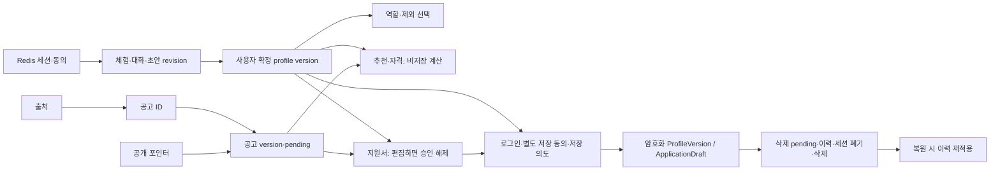

# 구조와 변경 영향

> main 병합 코드만을 분석한 자료가 아니다. `54d2daa` 작업 브랜치 스냅샷 기준이다. [브랜치 비교와 분석 범위](README.md)를 확인한다.

기준: `54d2daa3f25e6e39d2abf5585786676d09be7941` · 2026-10-25. 자세한 노드·함수·호출 단계·발췌는 [Cockpit](index.html)의 구조/실행 화면에서 탐색한다.

## 초기 Mental Model

다시잇다는 경험을 **제안 → 사용자 확정 → 역할/기회 비교 → 서류 승인 → 공식 신청처 이동**으로 연결한다. 한 FastAPI 안의 도메인 모듈이 조립 시점에 Redis/SQL/모델 구현을 받는다. React 미리보기와 `/journeys/:id/*` 실제 서버 화면이 공존한다. 기능 코어는 상당 부분 구현됐지만 운영자 API, 실인증/모델/운영 검증을 포함한 완결 서비스와는 구분한다.

## As-Is와 To-Be

- As-Is: React 19 / TypeScript / Vite → FastAPI / Pydantic / SQLAlchemy → Redis와 PostgreSQL. 생성은 Ollama 어댑터와 내부 음성 서비스. 수집은 별도 명령이지만 backend 모듈을 재사용한다.
- 최신 설계 To-Be: EC2 Docker Compose(Nginx·FastAPI·Redis·Ollama·음성), 비공개 TLS RDS, 카카오와 승인 공고 API, 선택적 S3 삭제 이력. 실제 GPU·키·MFA·운영 복구 증거가 필요하다.
- README의 OpenAI/pgvector는 구현 증거가 아니다. 최신 Plan/03은 로컬 추론과 조건·태그·키워드 초기 검색을 명시하고 pgvector·상시 AI 큐를 초기 구성에서 제외한다.
- 운영자 React 화면/계약과 DB 검수 메타데이터는 존재한다. `create_app`에 운영자 라우터가 없고 operator 요청은 MFA 연결 전 거절한다. 따라서 검수·공개까지 연결됐다고 표시할 수 없다.

근거: [backend/app/main.py:110](index.html#source=app), [backend/app/main.py:97](index.html#source=llmwire), [Plan/03_Architecture_and_Dependencies.md:18](index.html#source=plan), [backend/app/modules/recommendations/ranking.py:47](index.html#source=rank), [frontend/src/features/admin/AdminPage.tsx:40](index.html#source=adminui), [backend/app/modules/auth/members.py:48](index.html#source=mfa).

## 데이터 관계와 생명주기

위 그래프는 논리적 참조다. Redis-PostgreSQL 간 외래키나 단일 트랜잭션이 있다는 뜻이 아니다. 추천·자격은 반환 직전 참조를 재확인한다. 공고는 `sources → opportunity_documents → opportunity_versions`, 공개는 `(opportunity_id, version)` 포인터로 분리된다. 회원 저장은 `profile_documents → profile_versions`, `application_documents → application_drafts`에 암호화 본문을 둔다. 키는 별도 설정이며 소유자·종류·문서·버전·스키마를 AAD로 결합한다.

근거: [backend/app/modules/journeys/repository.py:184](index.html#source=jstore), [backend/app/persistence/operations.py:137](index.html#source=version), [backend/app/persistence/operations.py:190](index.html#source=publish), [backend/app/persistence/members.py:82](index.html#source=profiledb), [backend/app/persistence/members.py:114](index.html#source=draftdb), [backend/app/core/encryption.py:143](index.html#source=cipher), [backend/app/modules/recommendations/service.py:41](index.html#source=recommend), [backend/app/modules/eligibility/service.py:31](index.html#source=eligible), [backend/app/modules/deletions/service.py:69](index.html#source=recover).

## 변경 영향

| 바꾸는 것 | 함께 확인할 경로 | 검증 |
|---|---|---|
| 프로필 필드·확정 규칙 | 계약 → 화면 파서 → 추출 → 역할/추천/자격 → 초안 → 회원 암호화 스키마 | 계약·확정·추천·자격·저장 회귀 |
| 공고 구조·신선도 | 정규화 → 버전/공개 포인터 → 검색/추천 → 자격/준비 → 초안 재검토 | 정상/보류/변경/마감 표본 |
| Redis 세션·수명 | 동의·체험·요청 키·슬롯 → 회원 전환·철회·종료 | 실제 Redis 동시성·재시작·취소 |
| API 계약 | OpenAPI → 생성 타입 → 런타임 파서 → Router/Service | api:check·계약 잡·화면 시험 |
| 모델/장치 | 어댑터 → admission → 근거검증 → UI 오류 | 실제 모델 품질·시간초과·OOM·프로세스 종료 |

병렬 개발은 OpenAPI 계약을 고정한 뒤 프론트/공고 운영/회원/추론·인프라 경계로 나눈다. 프로필·공고 버전과 세션 수명은 공유 경계이므로 담당자 간 변경 합의가 필요하다. 코드를 서비스로 쪼개기 전에 현재 한 여정의 통합 증거를 확보하는 것이 권장이다(분석 의견).

## 강점과 한계

확정·승인·공개 포인터·암호화 저장을 분리한 점은 유지할 가치가 있다. 추론 실패가 공개 공고 탐색까지 반드시 중단시키지는 않도록 readiness는 모델 장애를 degraded로 구분한다. 반면 Redis 장애는 임시 상태를 잃게 하고, 여러 저장소의 재검사만으로 완전한 원자성을 제공하지는 않는다. 배포 상태·품질·실 사용자 접근성은 코드만으로 확인할 수 없다.

## 원기획과 현재 활동 유형의 차이

[개발기획서 PDF](../../다시잇다_개발기획서_수정.pdf) 12~13쪽은 취업·공공일자리·봉사뿐 아니라 교육·멘토링·지역활동의 수동 검수 공고를 포함한다. 현재 공통 계약은 `employment`, `volunteering`만 허용한다. 이는 단순 설명 차이보다 API·DB·정규화·필터·UI 전체의 제품 범위 결정이다. 축소 승인 여부는 확인하지 못했다. 근거: [backend/app/contracts/fields.py:20](index.html#source=types), [frontend/src/features/recommendations/JourneyRecommendations.tsx:64](index.html#source=recommendui).
