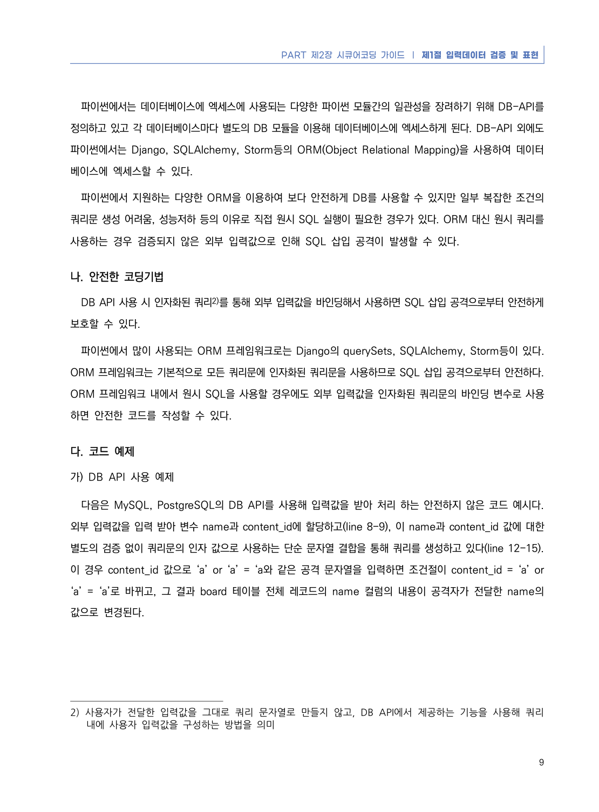
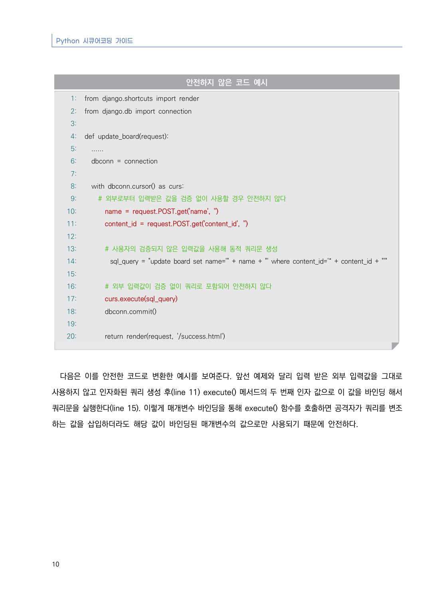
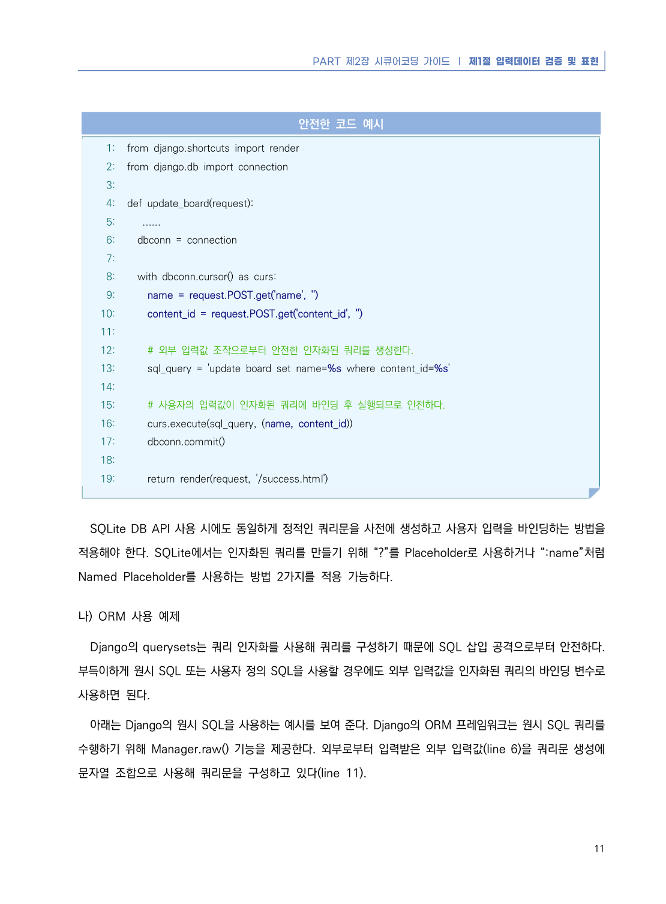
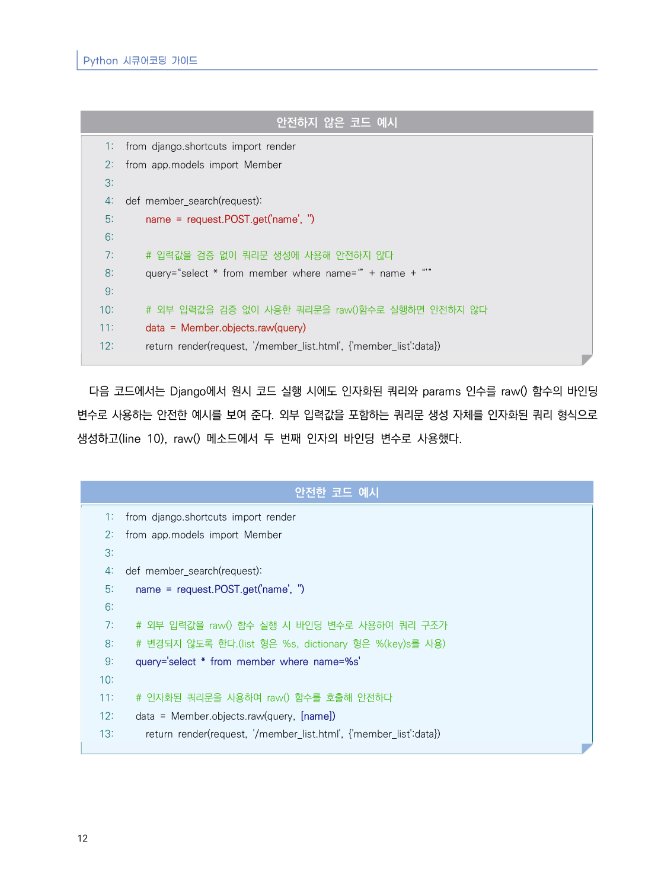
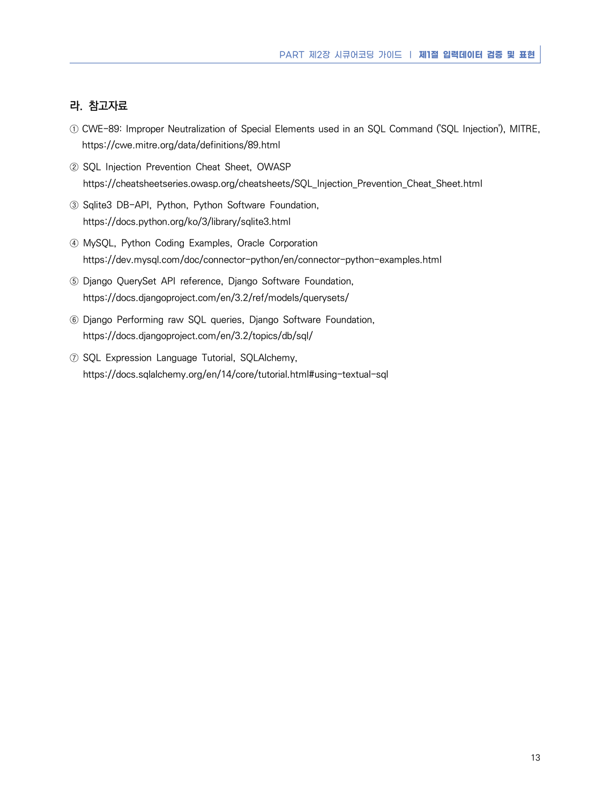

# 1. SQL 삽입

> 변환 안내(원문 외): 아래 본문은 PDF 텍스트를 추출한 전사입니다. 코드 줄번호·특수 공백·원문 오류를 유지했습니다. 실행용 코드가 아닙니다. 표·그림·들여쓰기는 연결된 페이지 이미지와 대조하세요. 페이지 경계의 줄바꿈을 보존하며, 동일 페이지가 여러 항목에 나뉘면 각 항목의 본문은 해당 구간만 포함합니다.

### PDF 14페이지 / 인쇄 8페이지

<!-- source-page:Python-2023:14; source-lines:1,8,9,10,11,12,13 -->

8

#### 1. SQL 삽입

#### 가. 개요

데이터베이스(DB)와 연동된 웹 응용프로그램에서 입력된 데이터에 대한 유효성 검증을 하지 않을 경우 공격자가 
입력 폼 및 URL 입력란에 SQL 문을 삽입하여 DB로부터 정보를 열람하거나 조작할 수 있는 보안약점을 말한다. 
취약한 웹 응용프로그램에서는 사용자로부터 입력된 값을 검증 없이 넘겨받아 동적쿼리(Dynamic Query)를 
생성하기 때문에 개발자가 의도하지 않은 쿼리가 실행되어 정보유출에 악용될 수 있다.

<details><summary>원본 페이지 이미지 (변환 외 보존 자료)</summary>


</details>

### PDF 15페이지 / 인쇄 9페이지

<!-- source-page:Python-2023:15; source-lines:0,1,2,3,4,5,6,7,8,9,10,11,12,13,14,15,16,17,18,19,20,21,22,23,24,25 -->

PART 제2장 시큐어코딩 가이드 ❘ 제1절 입력데이터 검증 및 표현

9

파이썬에서는 데이터베이스에 엑세스에 사용되는 다양한 파이썬 모듈간의 일관성을 장려하기 위해 DB-API를 
정의하고 있고 각 데이터베이스마다 별도의 DB 모듈을 이용해 데이터베이스에 엑세스하게 된다. DB-API 외에도 
파이썬에서는 Django, SQLAlchemy, Storm등의 ORM(Object Relational Mapping)을 사용하여 데이터
베이스에 엑세스할 수 있다. 

파이썬에서 지원하는 다양한 ORM을 이용하여 보다 안전하게 DB를 사용할 수 있지만 일부 복잡한 조건의 
쿼리문 생성 어려움, 성능저하 등의 이유로 직접 원시 SQL 실행이 필요한 경우가 있다. ORM 대신 원시 쿼리를 
사용하는 경우 검증되지 않은 외부 입력값으로 인해 SQL 삽입 공격이 발생할 수 있다. 

#### 나. 안전한 코딩기법

DB API 사용 시 인자화된 쿼리2)를 통해 외부 입력값을 바인딩해서 사용하면 SQL 삽입 공격으로부터 안전하게 
보호할 수 있다. 

파이썬에서 많이 사용되는 ORM 프레임워크로는 Django의 querySets, SQLAlchemy, Storm등이 있다. 
ORM 프레임워크는 기본적으로 모든 쿼리문에 인자화된 쿼리문을 사용하므로 SQL 삽입 공격으로부터 안전하다. 
ORM 프레임워크 내에서 원시 SQL을 사용할 경우에도 외부 입력값을 인자화된 쿼리문의 바인딩 변수로 사용
하면 안전한 코드를 작성할 수 있다.

#### 다. 코드 예제

#### 가) DB API 사용 예제

다음은 MySQL, PostgreSQL의 DB API를 사용해 입력값을 받아 처리 하는 안전하지 않은 코드 예시다. 
외부 입력값을 입력 받아 변수 name과 content_id에 할당하고(line 8-9), 이 name과 content_id 값에 대한 
별도의 검증 없이 쿼리문의 인자 값으로 사용하는 단순 문자열 결합을 통해 쿼리를 생성하고 있다(line 12-15). 
이 경우 content_id 값으로 ‘a’ or ‘a’ = ‘a와 같은 공격 문자열을 입력하면 조건절이 content_id = ‘a’ or 
‘a’ = ‘a’로 바뀌고, 그 결과 board 테이블 전체 레코드의 name 컬럼의 내용이 공격자가 전달한 name의 
값으로 변경된다.

2) 사용자가 전달한 입력값을 그대로 쿼리 문자열로 만들지 않고, DB API에서 제공하는 기능을 사용해 쿼리

내에 사용자 입력값을 구성하는 방법을 의미

<details><summary>원본 페이지 이미지 (변환 외 보존 자료)</summary>



</details>

### PDF 16페이지 / 인쇄 10페이지

<!-- source-page:Python-2023:16; source-lines:0,1,2,3,4,5,6,7,8,9,10,11,12,13,14,15,16,17,18,19,20,21,22,23,24,25,26,27,28,29,30,31,32,33,34,35,36,37,38,39,40,41,42,43 -->

Python 시큐어코딩 가이드

10

#### 안전하지 않은 코드 예시

```python
1: from django.shortcuts import render
2: from django.db import connection
3:
4: def update_board(request):
5:   ......
6:   dbconn = connection
7:    
8:   with dbconn.cursor() as curs:
9:     # 외부로부터 입력받은 값을 검증 없이 사용할 경우 안전하지 않다
10:       name = request.POST.get('name', '')
11:       content_id = request.POST.get('content_id', '')
12:      
13:       # 사용자의 검증되지 않은 입력값을 사용해 동적 쿼리문 생성
14:         sql_query = "update board set name='" + name + "' where content_id='“ + content_id + "'"
15:
16:       # 외부 입력값이 검증 없이 쿼리로 포함되어 안전하지 않다
17:       curs.execute(sql_query)
18:       dbconn.commit()
19:
20:       return render(request, '/success.html')
```

다음은 이를 안전한 코드로 변환한 예시를 보여준다. 앞선 예제와 달리 입력 받은 외부 입력값을 그대로 
사용하지 않고 인자화된 쿼리 생성 후(line 11) execute() 메서드의 두 번째 인자 값으로 이 값을 바인딩 해서 
쿼리문을 실행한다(line 15). 이렇게 매개변수 바인딩을 통해 execute() 함수를 호출하면 공격자가 쿼리를 변조
하는 값을 삽입하더라도 해당 값이 바인딩된 매개변수의 값으로만 사용되기 때문에 안전하다.

<details><summary>원본 페이지 이미지 (변환 외 보존 자료)</summary>



</details>

### PDF 17페이지 / 인쇄 11페이지

<!-- source-page:Python-2023:17; source-lines:0,1,2,3,4,5,6,7,8,9,10,11,12,13,14,15,16,17,18,19,20,21,22,23,24,25,26,27,28,29,30,31,32,33,34,35,36,37,38,39,40,41,42,43,44,45 -->

PART 제2장 시큐어코딩 가이드 ❘ 제1절 입력데이터 검증 및 표현

11

#### 안전한 코드 예시

```python
1: from django.shortcuts import render
2: from django.db import connection
3:
4: def update_board(request):
5:    ......
6:   dbconn = connection
7:
8:   with dbconn.cursor() as curs:
9:     name = request.POST.get('name', '')
10:     content_id = request.POST.get('content_id', '')
11:
12:     # 외부 입력값 조작으로부터 안전한 인자화된 쿼리를 생성한다.
13:     sql_query = 'update board set name=%s where content_id=%s'
14:
15:     # 사용자의 입력값이 인자화된 쿼리에 바인딩 후 실행되므로 안전하다.
16:     curs.execute(sql_query, (name, content_id))
17:     dbconn.commit()
18:
19:     return render(request, '/success.html')
```

SQLite DB API 사용 시에도 동일하게 정적인 쿼리문을 사전에 생성하고 사용자 입력을 바인딩하는 방법을 
적용해야 한다. SQLite에서는 인자화된 쿼리를 만들기 위해 “?”를 Placeholder로 사용하거나 “:name”처럼 
Named Placeholder를 사용하는 방법 2가지를 적용 가능하다.

#### 나) ORM 사용 예제

Django의 querysets는 쿼리 인자화를 사용해 쿼리를 구성하기 때문에 SQL 삽입 공격으로부터 안전하다. 
부득이하게 원시 SQL 또는 사용자 정의 SQL을 사용할 경우에도 외부 입력값을 인자화된 쿼리의 바인딩 변수로 
사용하면 된다.

아래는 Django의 원시 SQL을 사용하는 예시를 보여 준다. Django의 ORM 프레임워크는 원시 SQL 쿼리를 
수행하기 위해 Manager.raw() 기능을 제공한다. 외부로부터 입력받은 외부 입력값(line 6)을 쿼리문 생성에 
문자열 조합으로 사용해 쿼리문을 구성하고 있다(line 11).

<details><summary>원본 페이지 이미지 (변환 외 보존 자료)</summary>



</details>

### PDF 18페이지 / 인쇄 12페이지

<!-- source-page:Python-2023:18; source-lines:0,1,2,3,4,5,6,7,8,9,10,11,12,13,14,15,16,17,18,19,20,21,22,23,24,25,26,27,28,29,30,31,32,33,34,35,36,37,38,39,40,41,42,43,44,45,46,47,48,49,50,51 -->

Python 시큐어코딩 가이드

12

#### 안전하지 않은 코드 예시

```python
1: from django.shortcuts import render
2: from app.models import Member
3:
4: def member_search(request):
5:     name = request.POST.get('name', '')
6:     
7:     # 입력값을 검증 없이 쿼리문 생성에 사용해 안전하지 않다
8:     query=“select * from member where name=‘” + name + “’”
9:
10:     # 외부 입력값을 검증 없이 사용한 쿼리문을 raw()함수로 실행하면 안전하지 않다
11:     data = Member.objects.raw(query)
12:     return render(request, '/member_list.html', {'member_list':data})
```

다음 코드에서는 Django에서 원시 코드 실행 시에도 인자화된 쿼리와 params 인수를 raw() 함수의 바인딩 
변수로 사용하는 안전한 예시를 보여 준다. 외부 입력값을 포함하는 쿼리문 생성 자체를 인자화된 쿼리 형식으로 
생성하고(line 10), raw() 메소드에서 두 번째 인자의 바인딩 변수로 사용했다.

#### 안전한 코드 예시

```python
1: from django.shortcuts import render
2: from app.models import Member
3:
4: def member_search(request):
5:   name = request.POST.get('name', '')
6:
7:   # 외부 입력값을 raw() 함수 실행 시 바인딩 변수로 사용하여 쿼리 구조가 
8:   # 변경되지 않도록 한다.(list 형은 %s, dictionary 형은 %(key)s를 사용)
9:   query='select * from member where name=%s'
10:
11:   # 인자화된 쿼리문을 사용하여 raw() 함수를 호출해 안전하다
12:   data = Member.objects.raw(query, [name])
13:     return render(request, '/member_list.html', {'member_list':data})
```

<details><summary>원본 페이지 이미지 (변환 외 보존 자료)</summary>



</details>

### PDF 19페이지 / 인쇄 13페이지

<!-- source-page:Python-2023:19; source-lines:0,1,2,3,4,5,6,7,8,9,10,11,12,13,14,15,16 -->

PART 제2장 시큐어코딩 가이드 ❘ 제1절 입력데이터 검증 및 표현

13

#### 라. 참고자료

① CWE-89: Improper Neutralization of Special Elements used in an SQL Command ('SQL Injection'), MITRE, 

https://cwe.mitre.org/data/definitions/89.html
② SQL Injection Prevention Cheat Sheet, OWASP

https://cheatsheetseries.owasp.org/cheatsheets/SQL_Injection_Prevention_Cheat_Sheet.html
③ Sqlite3 DB-API, Python, Python Software Foundation,

https://docs.python.org/ko/3/library/sqlite3.html
④ MySQL, Python Coding Examples, Oracle Corporation

https://dev.mysql.com/doc/connector-python/en/connector-python-examples.html
⑤ Django QuerySet API reference, Django Software Foundation,

https://docs.djangoproject.com/en/3.2/ref/models/querysets/
⑥ Django Performing raw SQL queries, Django Software Foundation,

https://docs.djangoproject.com/en/3.2/topics/db/sql/
⑦ SQL Expression Language Tutorial, SQLAlchemy,

https://docs.sqlalchemy.org/en/14/core/tutorial.html#using-textual-sql

<details><summary>원본 페이지 이미지 (변환 외 보존 자료)</summary>



</details>

---

## 탐색 링크 (원문 외)

[통합 인덱스](../../../INDEX.md)

