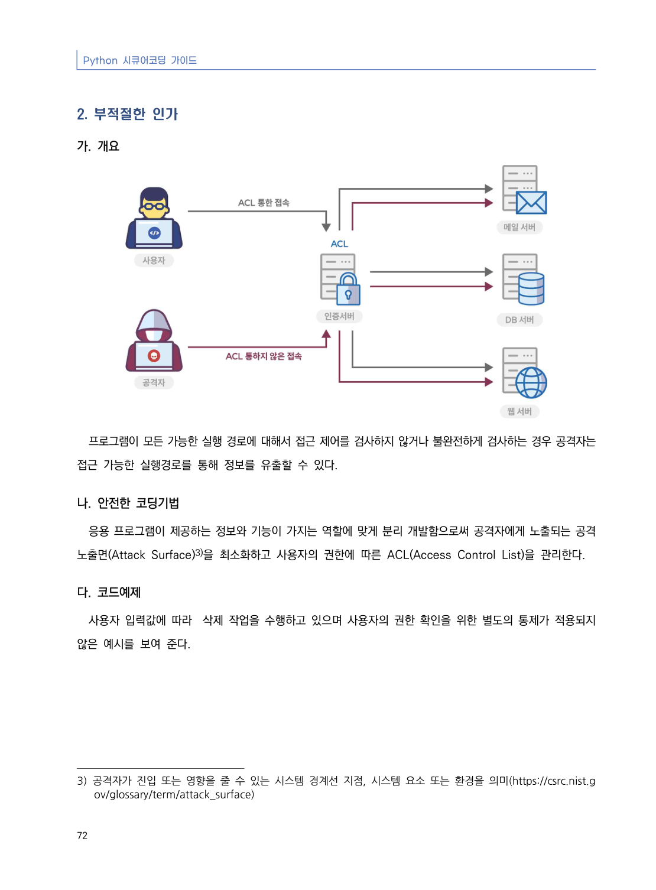
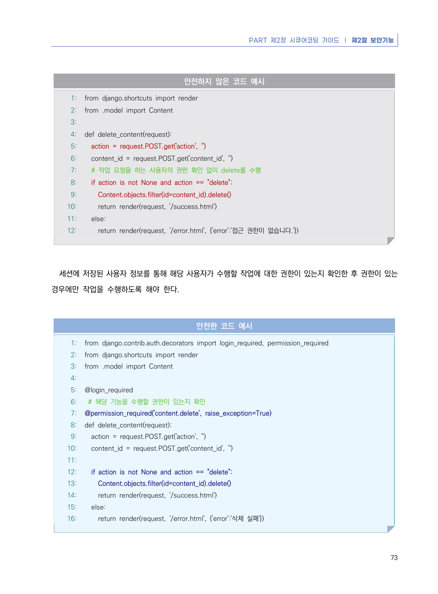
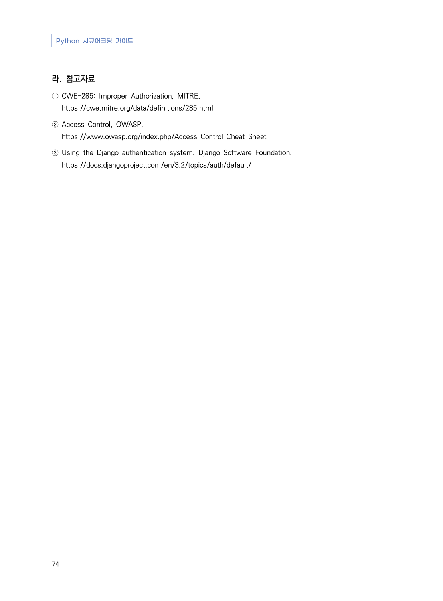

# 2. 부적절한 인가

> 변환 안내(원문 외): 아래 본문은 PDF 텍스트를 추출한 전사입니다. 코드 줄번호·특수 공백·원문 오류를 유지했습니다. 실행용 코드가 아닙니다. 표·그림·들여쓰기는 연결된 페이지 이미지와 대조하세요. 페이지 경계의 줄바꿈을 보존하며, 동일 페이지가 여러 항목에 나뉘면 각 항목의 본문은 해당 구간만 포함합니다.

### PDF 78페이지 / 인쇄 72페이지

<!-- source-page:Python-2023:78; source-lines:0,1,2,3,4,5,6,7,8,9,10,11,12,13 -->

Python 시큐어코딩 가이드

72

#### 2. 부적절한 인가

#### 가. 개요

프로그램이 모든 가능한 실행 경로에 대해서 접근 제어를 검사하지 않거나 불완전하게 검사하는 경우 공격자는 
접근 가능한 실행경로를 통해 정보를 유출할 수 있다.

#### 나. 안전한 코딩기법

응용 프로그램이 제공하는 정보와 기능이 가지는 역할에 맞게 분리 개발함으로써 공격자에게 노출되는 공격 
노출면(Attack Surface)3)을 최소화하고 사용자의 권한에 따른 ACL(Access Control List)을 관리한다. 

#### 다. 코드예제

사용자 입력값에 따라  삭제 작업을 수행하고 있으며 사용자의 권한 확인을 위한 별도의 통제가 적용되지 
않은 예시를 보여 준다.

3) 공격자가 진입 또는 영향을 줄 수 있는 시스템 경계선 지점, 시스템 요소 또는 환경을 의미(https://csrc.nist.g

ov/glossary/term/attack_surface)

<details><summary>원본 페이지 이미지 (변환 외 보존 자료)</summary>



</details>

### PDF 79페이지 / 인쇄 73페이지

<!-- source-page:Python-2023:79; source-lines:0,1,2,3,4,5,6,7,8,9,10,11,12,13,14,15,16,17,18,19,20,21,22,23,24,25,26,27,28,29,30,31,32,33,34,35,36,37,38,39,40,41,42,43,44,45,46,47,48,49,50,51,52,53,54,55,56,57,58 -->

PART 제2장 시큐어코딩 가이드 ❘ 제2절 보안기능

73

#### 안전하지 않은 코드 예시

```python
1: from django.shortcuts import render
2: from .model import Content
3:
4: def delete_content(request):
5:   action = request.POST.get('action', '')
6:   content_id = request.POST.get('content_id', '')
7:   # 작업 요청을 하는 사용자의 권한 확인 없이 delete를 수행
8:   if action is not None and action == "delete":
9:     Content.objects.filter(id=content_id).delete()
10:     return render(request, '/success.html')
11:   else:
12:     return render(request, '/error.html', {'error':'접근 권한이 없습니다.'})
```

세션에 저장된 사용자 정보를 통해 해당 사용자가 수행할 작업에 대한 권한이 있는지 확인한 후 권한이 있는 
경우에만 작업을 수행하도록 해야 한다.

#### 안전한 코드 예시

```python
1: from django.contrib.auth.decorators import login_required, permission_required
2: from django.shortcuts import render
3: from .model import Content
4:
5: @login_required
6:  # 해당 기능을 수행할 권한이 있는지 확인
7: @permission_required('content.delete', raise_exception=True)
8: def delete_content(request):
9:   action = request.POST.get('action', '')
10:   content_id = request.POST.get('content_id', '')
11:
12:   if action is not None and action == "delete":
13:     Content.objects.filter(id=content_id).delete()
14:     return render(request, '/success.html')
15:   else:
16:     return render(request, '/error.html', {'error':'삭제 실패'})
```

<details><summary>원본 페이지 이미지 (변환 외 보존 자료)</summary>



</details>

### PDF 80페이지 / 인쇄 74페이지

<!-- source-page:Python-2023:80; source-lines:0,1,2,3,4,5,6,7,8 -->

Python 시큐어코딩 가이드

74

#### 라. 참고자료

① CWE-285: Improper Authorization, MITRE,

https://cwe.mitre.org/data/definitions/285.html
② Access Control, OWASP, 

https://www.owasp.org/index.php/Access_Control_Cheat_Sheet
③ Using the Django authentication system, Django Software Foundation,

https://docs.djangoproject.com/en/3.2/topics/auth/default/

<details><summary>원본 페이지 이미지 (변환 외 보존 자료)</summary>



</details>

---

## 탐색 링크 (원문 외)

[통합 인덱스](../../../INDEX.md)

