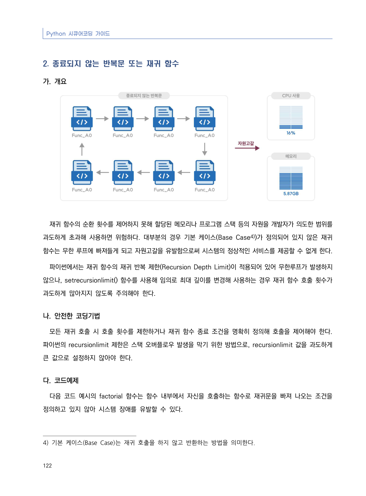
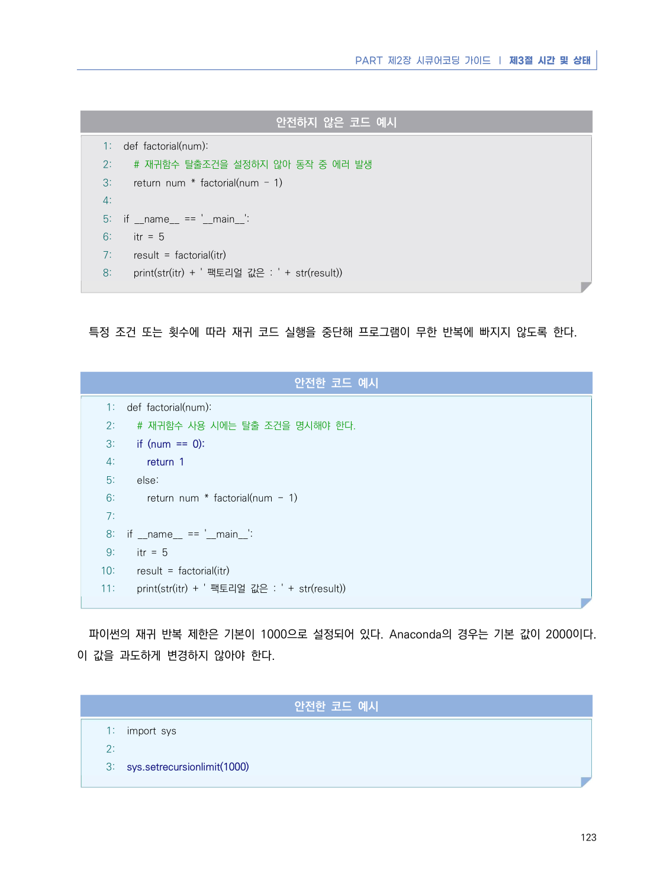
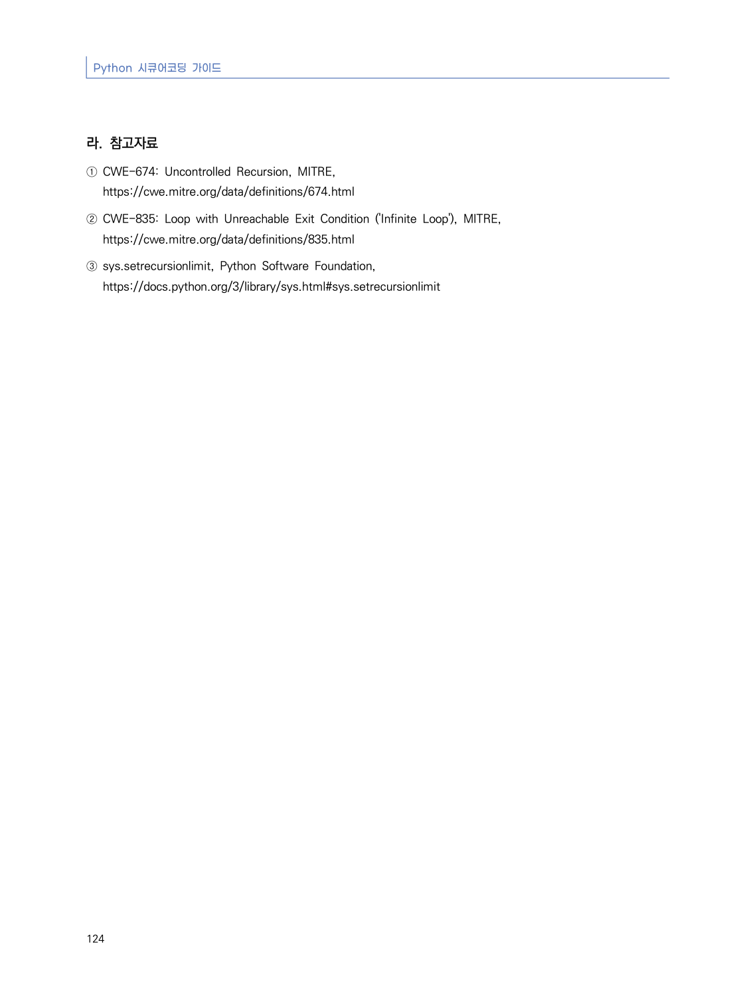

# 2. 종료되지 않는 반복문 또는 재귀 함수

> 변환 안내(원문 외): 아래 본문은 PDF 텍스트를 추출한 전사입니다. 코드 줄번호·특수 공백·원문 오류를 유지했습니다. 실행용 코드가 아닙니다. 표·그림·들여쓰기는 연결된 페이지 이미지와 대조하세요. 페이지 경계의 줄바꿈을 보존하며, 동일 페이지가 여러 항목에 나뉘면 각 항목의 본문은 해당 구간만 포함합니다.

### PDF 128페이지 / 인쇄 122페이지

<!-- source-page:Python-2023:128; source-lines:0,1,2,3,4,5,6,7,8,9,10,11,12,13,14,15,16,17 -->

Python 시큐어코딩 가이드

122

#### 2. 종료되지 않는 반복문 또는 재귀 함수

#### 가. 개요

재귀 함수의 순환 횟수를 제어하지 못해 할당된 메모리나 프로그램 스택 등의 자원을 개발자가 의도한 범위를 
과도하게 초과해 사용하면 위험하다. 대부분의 경우 기본 케이스(Base Case4))가 정의되어 있지 않은 재귀 
함수는 무한 루프에 빠져들게 되고 자원고갈을 유발함으로써 시스템의 정상적인 서비스를 제공할 수 없게 한다.

파이썬에서는 재귀 함수의 재귀 반복 제한(Recursion Depth Limit)이 적용되어 있어 무한루프가 발생하지 
않으나, setrecursionlimit() 함수를 사용해 임의로 최대 깊이를 변경해 사용하는 경우 재귀 함수 호출 횟수가 
과도하게 많아지지 않도록 주의해야 한다.

#### 나. 안전한 코딩기법

모든 재귀 호출 시 호출 횟수를 제한하거나 재귀 함수 종료 조건을 명확히 정의해 호출을 제어해야 한다. 
파이썬의 recursionlimit 제한은 스택 오버플로우 발생을 막기 위한 방법으로, recursionlimit 값을 과도하게 
큰 값으로 설정하지 않아야 한다.

#### 다. 코드예제

다음 코드 예시의 factorial 함수는 함수 내부에서 자신을 호출하는 함수로 재귀문을 빠져 나오는 조건을 
정의하고 있지 않아 시스템 장애를 유발할 수 있다.

4) 기본 케이스(Base Case)는 재귀 호출을 하지 않고 반환하는 방법을 의미한다.

<details><summary>원본 페이지 이미지 (변환 외 보존 자료)</summary>



</details>

### PDF 129페이지 / 인쇄 123페이지

<!-- source-page:Python-2023:129; source-lines:0,1,2,3,4,5,6,7,8,9,10,11,12,13,14,15,16,17,18,19,20,21,22,23,24,25,26,27,28,29,30,31,32,33,34,35,36,37,38,39,40,41,42,43,44,45,46,47,48 -->

PART 제2장 시큐어코딩 가이드 ❘ 제3절 시간 및 상태

123

#### 안전하지 않은 코드 예시

```python
1: def factorial(num):
2:   # 재귀함수 탈출조건을 설정하지 않아 동작 중 에러 발생
3:   return num * factorial(num – 1)
4:
5: if __name__ == '__main__':
6:   itr = 5
7:   result = factorial(itr)
8:   print(str(itr) + ' 팩토리얼 값은 : ' + str(result))
```

특정 조건 또는 횟수에 따라 재귀 코드 실행을 중단해 프로그램이 무한 반복에 빠지지 않도록 한다.

#### 안전한 코드 예시

```python
1: def factorial(num):
2:   # 재귀함수 사용 시에는 탈출 조건을 명시해야 한다.
3:   if (num == 0):
4:     return 1
5:   else:
6:     return num * factorial(num - 1)
7:
8: if __name__ == '__main__':
9:   itr = 5
10:   result = factorial(itr)
11:   print(str(itr) + ' 팩토리얼 값은 : ' + str(result))
```

파이썬의 재귀 반복 제한은 기본이 1000으로 설정되어 있다. Anaconda의 경우는 기본 값이 2000이다. 
이 값을 과도하게 변경하지 않아야 한다.

#### 안전한 코드 예시

```python
1: import sys
2:
3: sys.setrecursionlimit(1000)
```

<details><summary>원본 페이지 이미지 (변환 외 보존 자료)</summary>



</details>

### PDF 130페이지 / 인쇄 124페이지

<!-- source-page:Python-2023:130; source-lines:0,1,2,3,4,5,6,7,8 -->

Python 시큐어코딩 가이드

124

#### 라. 참고자료

① CWE-674: Uncontrolled Recursion, MITRE,

https://cwe.mitre.org/data/definitions/674.html
② CWE-835: Loop with Unreachable Exit Condition ('Infinite Loop'), MITRE,

https://cwe.mitre.org/data/definitions/835.html
③ sys.setrecursionlimit, Python Software Foundation,

https://docs.python.org/3/library/sys.html#sys.setrecursionlimit

<details><summary>원본 페이지 이미지 (변환 외 보존 자료)</summary>



</details>

---

## 탐색 링크 (원문 외)

[통합 인덱스](../../../INDEX.md)

