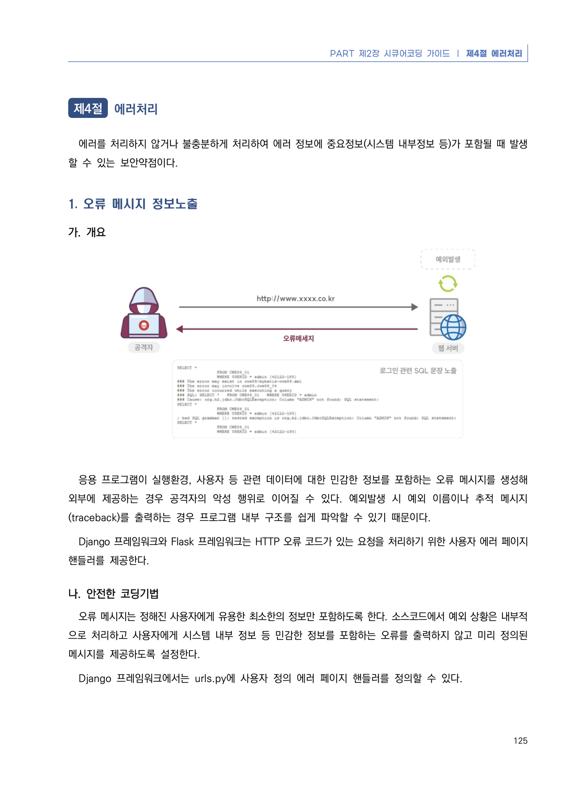
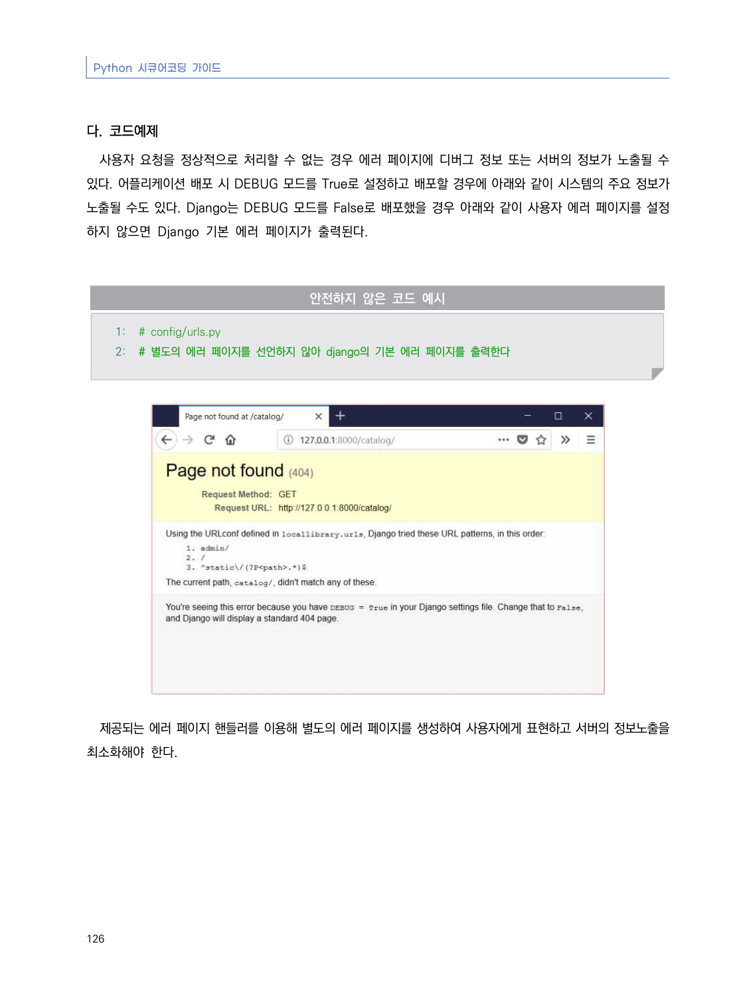
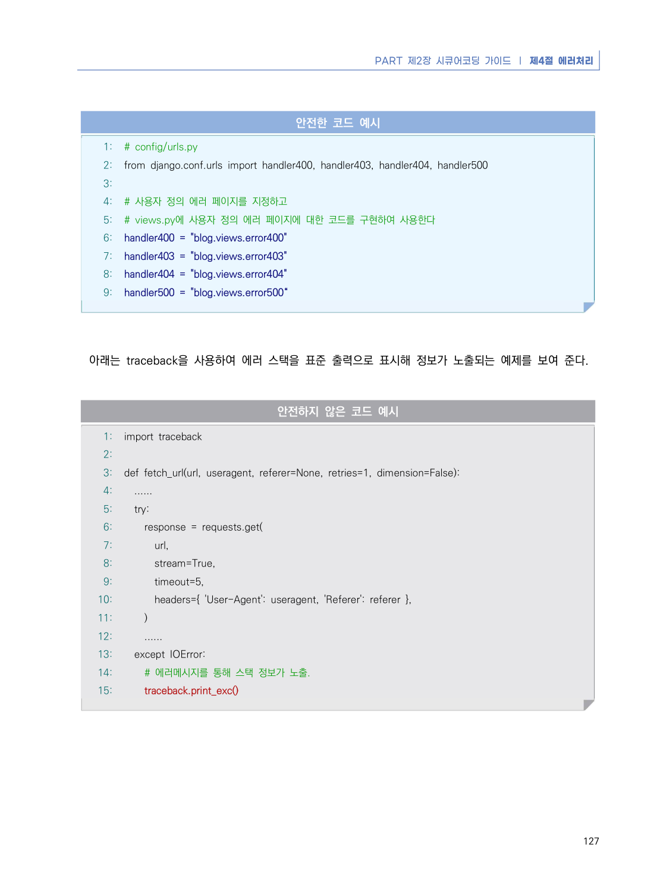
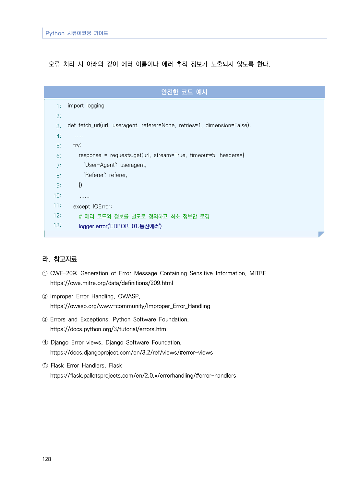

# 1. 오류 메시지 정보노출

> 변환 안내(원문 외): 아래 본문은 PDF 텍스트를 추출한 전사입니다. 코드 줄번호·특수 공백·원문 오류를 유지했습니다. 실행용 코드가 아닙니다. 표·그림·들여쓰기는 연결된 페이지 이미지와 대조하세요. 페이지 경계의 줄바꿈을 보존하며, 동일 페이지가 여러 항목에 나뉘면 각 항목의 본문은 해당 구간만 포함합니다.

### PDF 131페이지 / 인쇄 125페이지

<!-- source-page:Python-2023:131; source-lines:1,5,6,7,8,9,10,11,12,13,14,15,16 -->

125

#### 1. 오류 메시지 정보노출

#### 가. 개요

응용 프로그램이 실행환경, 사용자 등 관련 데이터에 대한 민감한 정보를 포함하는 오류 메시지를 생성해 
외부에 제공하는 경우 공격자의 악성 행위로 이어질 수 있다. 예외발생 시 예외 이름이나 추적 메시지
(traceback)를 출력하는 경우 프로그램 내부 구조를 쉽게 파악할 수 있기 때문이다.

Django 프레임워크와 Flask 프레임워크는 HTTP 오류 코드가 있는 요청을 처리하기 위한 사용자 에러 페이지 
핸들러를 제공한다.

#### 나. 안전한 코딩기법

오류 메시지는 정해진 사용자에게 유용한 최소한의 정보만 포함하도록 한다. 소스코드에서 예외 상황은 내부적
으로 처리하고 사용자에게 시스템 내부 정보 등 민감한 정보를 포함하는 오류를 출력하지 않고 미리 정의된 
메시지를 제공하도록 설정한다.

Django 프레임워크에서는 urls.py에 사용자 정의 에러 페이지 핸들러를 정의할 수 있다. 

<details><summary>원본 페이지 이미지 (변환 외 보존 자료)</summary>



</details>

### PDF 132페이지 / 인쇄 126페이지

<!-- source-page:Python-2023:132; source-lines:0,1,2,3,4,5,6,7,8,9,10,11,12,13 -->

Python 시큐어코딩 가이드

126

#### 다. 코드예제

사용자 요청을 정상적으로 처리할 수 없는 경우 에러 페이지에 디버그 정보 또는 서버의 정보가 노출될 수 
있다. 어플리케이션 배포 시 DEBUG 모드를 True로 설정하고 배포할 경우에 아래와 같이 시스템의 주요 정보가 
노출될 수도 있다. Django는 DEBUG 모드를 False로 배포했을 경우 아래와 같이 사용자 에러 페이지를 설정
하지 않으면 Django 기본 에러 페이지가 출력된다.

#### 안전하지 않은 코드 예시

```python
1: # config/urls.py
2: # 별도의 에러 페이지를 선언하지 않아 django의 기본 에러 페이지를 출력한다
```

제공되는 에러 페이지 핸들러를 이용해 별도의 에러 페이지를 생성하여 사용자에게 표현하고 서버의 정보노출을 
최소화해야 한다.

<details><summary>원본 페이지 이미지 (변환 외 보존 자료)</summary>



</details>

### PDF 133페이지 / 인쇄 127페이지

<!-- source-page:Python-2023:133; source-lines:0,1,2,3,4,5,6,7,8,9,10,11,12,13,14,15,16,17,18,19,20,21,22,23,24,25,26,27,28,29,30,31,32,33,34,35,36,37,38,39,40,41,42,43,44,45,46,47,48,49,50 -->

PART 제2장 시큐어코딩 가이드 ❘ 제4절 에러처리

127

#### 안전한 코드 예시

```python
1: # config/urls.py
2: from django.conf.urls import handler400, handler403, handler404, handler500    
3:
4: # 사용자 정의 에러 페이지를 지정하고
5: # views.py에 사용자 정의 에러 페이지에 대한 코드를 구현하여 사용한다
6: handler400 = "blog.views.error400"
7: handler403 = "blog.views.error403"  
8: handler404 = "blog.views.error404"
9: handler500 = "blog.views.error500“
```

아래는 traceback을 사용하여 에러 스택을 표준 출력으로 표시해 정보가 노출되는 예제를 보여 준다.

#### 안전하지 않은 코드 예시

```python
1: import traceback
2:
3: def fetch_url(url, useragent, referer=None, retries=1, dimension=False):
4:   ......
5:   try:
6:     response = requests.get(
7:       url,
8:       stream=True,
9:       timeout=5,
10:       headers={ 'User-Agent': useragent, 'Referer': referer },
11:     )
12:     ......
13:   except IOError:
14:     # 에러메시지를 통해 스택 정보가 노출.
15:     traceback.print_exc()
```

<details><summary>원본 페이지 이미지 (변환 외 보존 자료)</summary>



</details>

### PDF 134페이지 / 인쇄 128페이지

<!-- source-page:Python-2023:134; source-lines:0,1,2,3,4,5,6,7,8,9,10,11,12,13,14,15,16,17,18,19,20,21,22,23,24,25,26,27,28,29,30,31,32,33,34,35,36,37,38,39 -->

Python 시큐어코딩 가이드

128

오류 처리 시 아래와 같이 에러 이름이나 에러 추적 정보가 노출되지 않도록 한다.

#### 안전한 코드 예시

```python
1: import logging
2:
3: def fetch_url(url, useragent, referer=None, retries=1, dimension=False):
4:   ......
5:   try:
6:     response = requests.get(url, stream=True, timeout=5, headers={
7:       'User-Agent': useragent,
8:       'Referer': referer,
9:     })
10:     ......
11:   except IOError:
12:     # 에러 코드와 정보를 별도로 정의하고 최소 정보만 로깅
13:     logger.error('ERROR-01:통신에러')
```

#### 라. 참고자료

① CWE-209: Generation of Error Message Containing Sensitive Information, MITRE

https://cwe.mitre.org/data/definitions/209.html
② Improper Error Handling, OWASP,

https://owasp.org/www-community/Improper_Error_Handling
③ Errors and Exceptions, Python Software Foundation,

https://docs.python.org/3/tutorial/errors.html
➃ Django Error views, Django Software Foundation,

https://docs.djangoproject.com/en/3.2/ref/views/#error-views
➄ Flask Error Handlers, Flask

https://flask.palletsprojects.com/en/2.0.x/errorhandling/#error-handlers

<details><summary>원본 페이지 이미지 (변환 외 보존 자료)</summary>



</details>

---

## 탐색 링크 (원문 외)

[통합 인덱스](../../../INDEX.md)

